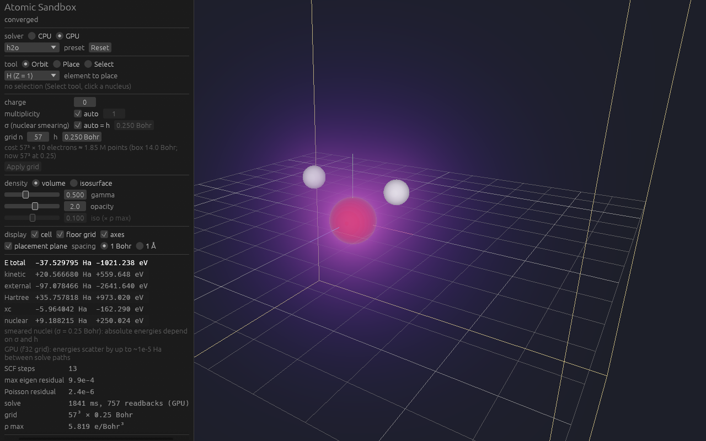
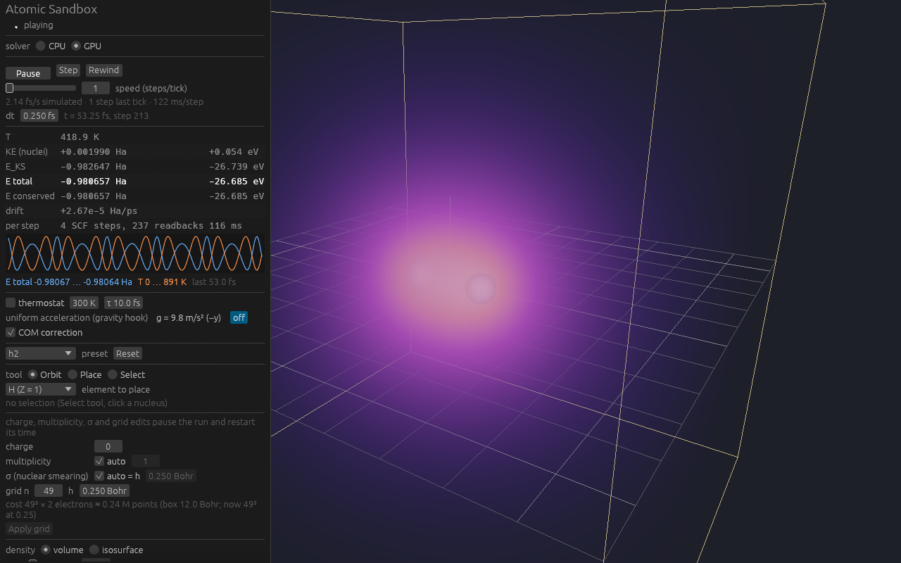

# Atomic Sandbox

An interactive 3D sandbox that simulates matter from the atomic level up with real physics, written from scratch in Rust + wgpu. Nuclei are classical point particles; electrons are solved with real-space Kohn-Sham density-functional theory on a GPU grid. Nothing chemical is hardcoded — every element is described by its atomic number and isotope mass only, and bonds, shapes and energies have to *emerge* from the equations.



## What it does today

| Milestone | Status | What you get |
|---|---|---|
| M1 — CPU reference solver (`qm`) | done | f64 spin-polarised LSDA Kohn-Sham solver on a uniform real-space grid, validated against NIST/literature atoms and the H₂ bond length |
| First pictures | done | H₂ density slice and energy curve (`docs/images/h2_*.png`) |
| M2 — 3D viewer (`app`, `render`) | done | place / select / drag nuclei, orbit camera, volume or isosurface density, energy readouts, scene save/load |
| M3 — GPU solver (`qm-gpu`) | done | the same solver in f32 WGSL compute, 30–100× faster, agrees with the CPU reference at fixed smearing to ≤ 3.5e-7 Ha for H … LiH and 4.1e-6 Ha for H₂O, forces to ≤ 3.7e-6 Ha/Bohr for H₂ and 4.8e-6 for H₂O; the viewer re-solves ~0.1–0.2 s after you move an atom |
| M4 — Dynamics (`sim`) | done | Born-Oppenheimer molecular dynamics in the viewer (velocity Verlet on the GPU Kohn-Sham forces, warm-started and density-extrapolated SCF with a cold retry on a stall): play / pause / step / rewind, drag a nucleus on a capped spring while it moves, pins, CSVR thermostat, temperature and energy readouts with a sparkline and an energy-drift health number; a GPU dynamics suite checks drift, vibration frequency, thermostat statistics and rewind |
| M5 — Surrogate ("estimated") force provider | planned (spec + plan written) | a linear ACE-style model trained on this solver's own DFT, with a Bayesian uncertainty and DFT fallback, behind the same `ForceProvider` boundary |
| M6 — Tools | planned | bond graph read off the density, molecule formulas and names, isotopes, input-replay harness, more presets |

The sandbox now **moves**: the nuclei are classical particles pushed by the Kohn-Sham forces (velocity Verlet, 0.25 fs steps), and the electron cloud is re-solved at every step. It opens on H₂ at 1.6 Bohr, slightly compressed from the bond length of its smeared nuclei; press **Play** and it vibrates with a period of 10.3 fs (one DFT solve per step, while the window stays at full frame rate: on the RX 7900 XTX the viewer showed about 2.5 fs of simulated time per wall second at 49³ — the panel shows the live figure; the headless MD step of the validation suite is 63–82 ms, 3–4 fs/s). The dynamics suite measures what that run does against references: NVE energy drift −4.0e-6 Ha/ps (bound 2e-4), the vibration frequency against the curvature of the same energy surface to 5.6e-4, the thermostat's mean temperature, and rewind retracing to 5.8e-6 Bohr (`crates/validate/references.md`, "Dynamics (M4)").



Measured on an AMD RX 7900 XTX (one solve after a drag release): H₂ on a 49³ grid 0.2 s cold / 0.1 s warm; H₂O on 97³ 3.6 s. Energies vs the f64 CPU reference at fixed smearing (σ = h = 0.25, 49³): H 2.2e-8, He 5.5e-8, H₂ 3.3e-8, LiH 3.5e-7, H₂O 4.1e-6 Ha (bound 2e-5; the GPU's own H₂O path scatter is 5.4e-6); forces ≤ 3.7e-6 Ha/Bohr for H₂ (bound 5e-6) and 4.8e-6 for H₂O (bound 6e-5).

## Running it

Requirements: Rust (stable, 1.99 or newer), a Vulkan/DX12/Metal-capable GPU for the GPU backend (the CPU backend works anywhere, slowly).

```bash
cargo run -p app --release
```

Options: `-- --preset h2o` (presets: `h`, `h2`, `he`, `lih`, `h2o`), `-- --backend cpu` (the f64 reference: one MD step takes seconds). Always build `--release`; debug builds are far too slow for the solver.

### Controls

| Action | Input |
|---|---|
| Orbit | middle-drag, or left-drag on empty space |
| Pan | right-drag |
| Zoom | scroll wheel |
| Place an atom | tool **Place**, pick an element (H–Ne), left-click; it lands on the camera's focus plane (shown as the blue placement grid) |
| Move an atom | tool **Select**, click a nucleus, drag. Paused: it moves where you drop it. Playing: it is pulled toward the cursor by a critically damped spring whose force is capped at 0.1 Ha/Bohr (an orange ring marks the target; drag slowly and the molecule follows, drag fast and it mostly heats up). Targets and placements are kept inside the cell, at least 3 grid steps from its faces. Faint lines show its distance to nearby atoms in Bohr and Å | While it falls, the drift readout turns amber (≈ −1e-3 Ha/ps): that is the molecule releasing 4.4 eV into motion on the grid's surface, not an integrator fault.
| Remove an atom | select it, press **Delete** (also while playing) |
| Play / pause | **Play** button or **Space**; **Step** advances one time step; **Rewind** reverses every velocity (an undisturbed trajectory retraces itself) |
| Speed and time step | **speed (steps/tick)** slider, 1–1000 steps per ≈16 ms tick (the panel shows the measured fs/s; one DFT step usually fills a tick); **dt** in fs, default 0.25, with a warning above 0.5 |
| Hold an atom | select it, tick **pinned** (a blue square marks it) |
| Temperature | **thermostat** (Bussi CSVR) with target T and coupling time τ; switching it on with the atoms at rest gives them Maxwell–Boltzmann velocities first |
| Gravity hook | **uniform acceleration (gravity hook)**: **g = 9.8 m/s² (−y)** or **off**; an acceleration on every nucleus, invisible at atomic scale, by design |
| COM correction | on by default: removes the grid's small spurious net force so a molecule does not wander off |
| Readouts | T, **KE (nuclei)**, **E_KS**, **E total**, **E conserved** and the **work done by tools** (Ha and eV), drift in Ha/ps (amber above 1e-4, red above 1e-3), sim time, SCF steps per MD step (**per step**), a sparkline of E total and T; a warning when a nucleus nears the box face; a nucleus closer than 3 grid steps to a face pauses the run with an error, since the electrons cannot follow it there |
| Solver | CPU / GPU radio (switching restarts the run, paused); charge, spin multiplicity, nuclear smearing σ, grid size and spacing (these pause the run and restart its time) |
| View | volume or isosurface density, gamma / opacity / iso sliders; cell box, floor grid, axes, placement plane, 1 Bohr or 1 Å spacing |

Things to try: press Play on H₂ and watch E total stay flat while T swings between 0 and ~900 K; tug one H with the Select tool while it vibrates; switch the thermostat on at 300 K; stretch the H₂ bond and watch the energy curve and the density neck split; compare the symmetric H₂ cloud with lopsided LiH (charge transfer with nothing told about electronegativity); build water from an O and two H (at the default 0.25 Bohr grid the smeared oxygen makes the relaxed molecule nearly linear — a resolution artefact worth seeing for yourself; the real 104.5° bend needs a finer grid or pseudopotentials); push two He atoms together and watch them refuse to bond; make HeH⁺ (charge +1) and watch them bond.

## Physics, honestly

- **Model:** Born-Oppenheimer separation; electrons in spin-polarised Kohn-Sham DFT with the LSDA exchange-correlation functional (Dirac exchange + Perdew–Wang 92 correlation); 8th-order finite-difference Laplacian; nuclei represented as narrow Gaussians (σ = grid spacing by default) with an analytic potential; Hartree potential from a multipole-bounded Poisson solve; Hellmann-Feynman forces.
- **Units:** atomic units everywhere inside the solver (Hartree, Bohr, mₑ, ħ = e = 1); the UI converts.
- **Precision:** f32 on the GPU grid with two-level compensated reductions; f64 on the CPU for nuclei, small dense algebra and the reference solver.
- **Known gaps, documented rather than hidden:** LSDA underbinds the hydrogen atom (−0.4777 Ha here vs −0.5 exact; the LSDA reference value is −0.4787); absolute energies of anything containing oxygen or heavier are not physical at the default 0.25 Bohr spacing because the nucleus is heavily smeared — the density *shapes* are right, the numbers are not; the f32 GPU path carries ~1e-6 Ha of scatter between solve paths; the lithium atom oracle misses its reference by 0.33 Ha at the tested grid and is kept as an ignored test. See `crates/validate/references.md` for every reference number and tolerance.
- **Dynamics on the smeared surface:** the vibrating H₂ runs at 3237 cm⁻¹ (period 10.30 fs) against 4401 cm⁻¹ measured, because at σ = h = 0.25 the smeared nuclei lengthen the bond (1.79 Bohr, vs 1.45 at σ → 0) and soften its well — the dynamics match the curvature of that same surface to 6e-4, and this solver's σ → 0 curvature gives ≈ 4405 ± 60 cm⁻¹, a figure too coarse to tell experiment (4401) from LSDA (4201).
- **Water heats up on Play:** the same smearing makes water's minimum on this surface near-linear (O–H 2.34 Bohr, 177°) and 0.160 Ha (4.4 eV) below the physical geometry the `h2o` preset loads, so pressing Play on `h2o` heats the molecule — past 10 000 K within ~2.5 fs while it opens toward linear; a 300 K thermostat (τ = 10 fs) brings it back to ~300 K after ~100 fs. Along that fast motion the warm-started solver sometimes stalls; it then retries the step cold (twice in 600 steps, the slower step 24 s instead of ~1 s at 57³), and only a failed cold retry pauses the run.
- **No per-element parameters.** Allowed inputs are Z and the isotope mass (plus display colours and radii, which are not physics). No force fields, no fitted pair potentials, no chemistry libraries.

## Repository layout

```
crates/units      unit conversions and isotope masses (the only per-element data)
crates/qm         CPU f64 reference Kohn-Sham solver: grid, Laplacian, Poisson, LOBPCG, LSDA, SCF, forces
crates/qm-gpu     the same solver in WGSL compute (wgpu), bit-deterministic, cancellable
crates/gpu        wgpu plumbing: context, surface, 3D volume textures
crates/render     camera, impostor spheres, volume raymarch, line overlays
crates/app        the viewer: winit + egui, solver worker thread, tools, scene files
crates/validate   physics oracles and GPU-vs-CPU suites with cited references
docs/superpowers  design spec, per-milestone implementation plans, handoff notes
```

Tests: `cargo test -p units -p qm --release` (~75 s), `cargo test -p qm-gpu -p sim -p render -p app --release`, `cargo test -p validate --release --test gpu_vs_cpu` (~3.5 min, needs a GPU), `cargo test -p validate --release --test dynamics` (the dynamics suite, ~6 min, needs a GPU), `cargo test -p validate --release` (everything in `validate`: the oracles, ~30 min, plus the two GPU suites). Validation gates are never loosened to make a test pass.

## Design and process

The design is in [`docs/superpowers/specs/2026-10-12-atomic-sandbox-design.md`](docs/superpowers/specs/2026-10-12-atomic-sandbox-design.md); each milestone has a plan in `docs/superpowers/plans/` and a handoff note in `docs/superpowers/notes/`. The code is developed with Claude Code (Fable 5.1 for physics and numerics, Opus 5.5 for engineering), task by task with independent review; every decision made along the way is recorded in the plans and notes.

## Roadmap after M5

Scaling up the "ladder": more elements (pseudopotentials for Z > 10), larger systems through ML potentials trained on this solver's own data and loaded as data behind the same `ForceProvider` boundary, then coarse-grained and continuum stages. Gravity exists as an external-field hook but is invisible at atomic scale, as it should be.


Nuclear physics (decay, transmutation) is planned as a **nuclear-events layer**, not as explicit protons and neutrons: the nucleus is 10⁻⁵ of the atom and no first-principles route from QCD exists, so nuclei stay points for the electrons while a stochastic α/β/γ event process — Q-values from the isotope mass table, rates from measured half-lives — changes Z live and lets the chemistry respond. Decay time gets its own labelled clock, separate from the MD speed.