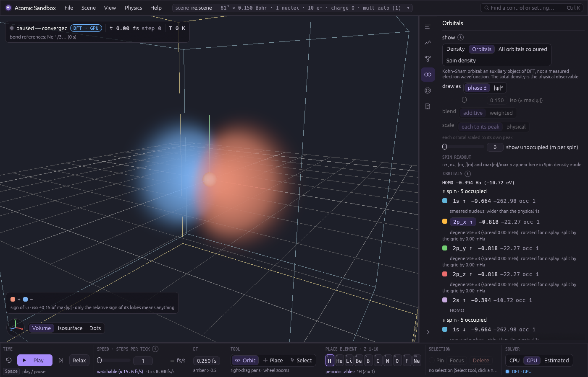

# Atomic Sandbox

An interactive 3D sandbox that simulates matter from the atomic level up with real physics, written from scratch in Rust + wgpu. Nuclei are classical point particles; electrons are solved with real-space Kohn-Sham density-functional theory on a GPU grid. Nothing chemical is hardcoded — every element is described by its atomic number and isotope mass only, and bonds, shapes and energies have to *emerge* from the equations.


## What it does today

| Milestone | Status | What you get |
|---|---|---|
| M1 — CPU reference solver (`qm`) | done | f64 spin-polarised LSDA Kohn-Sham solver on a uniform real-space grid, validated against NIST/literature atoms and the H₂ bond length |
| First pictures | done | H₂ density slice and energy curve (`docs/images/h2_*.png`) |
| M2 — 3D viewer (`app`, `render`) | done | place / select / drag nuclei, orbit camera, volume or isosurface density, energy readouts, scene save/load |
| M3 — GPU solver (`qm-gpu`) | done | the same solver in f32 WGSL compute, 30–100× faster, agrees with the CPU reference at fixed smearing to ≤ 3.5e-7 Ha for H … LiH and 4.1e-6 Ha for H₂O, forces to ≤ 3.7e-6 Ha/Bohr for H₂ and 4.8e-6 for H₂O; the viewer re-solves ~0.1–0.2 s after you move an atom |
| M4 — Dynamics (`sim`) | done | Born-Oppenheimer molecular dynamics in the viewer (velocity Verlet on the GPU Kohn-Sham forces, warm-started and density-extrapolated SCF with a cold retry on a stall): play / pause / step / rewind, drag a nucleus on a capped spring while it moves, pins, CSVR thermostat, temperature and energy readouts with a sparkline and an energy-drift health number; a GPU dynamics suite checks drift, vibration frequency, thermostat statistics and rewind |
| M5 — Surrogate ("estimated") force provider | done | a linear ACE-style model trained on this solver's own DFT, with a Bayesian uncertainty and DFT fallback, behind the same `ForceProvider` boundary: the **estimated** solver in the viewer samples the scene, then answers MD steps in ~5 µs and hands the step back to DFT wherever it is unsure; the surrogate validation suite checks it against its teacher (H₂ frequency within 7e-6 of DFT-MD, energies 2.5e-6 Ha / forces 2e-5 Ha/Bohr rms on fresh geometries, 38 DFT calls to learn H₂ from nothing) |
| Orbital viewer (`qm::orbitals`, `render`, `app`) | done (branch `orbital-viewer`; the core-shell reconstruction waits for pseudopotentials) | **View ▸ Density ▸ show**: *Orbitals* (one Kohn–Sham orbital as a ± phase surface or volume, or its square), *All orbitals coloured* (the inner shells and the outer lobes at once, each in its own colour), *Spin density* (ρ↑ − ρ↓), with a list of the occupied and the lowest unoccupied orbitals — ε in Ha and eV, occupation, HOMO / LUMO, labels like 2p_x for a lone atom — and the honesty text of what an orbital is and is not; all of it display-only (a bitwise test pins that it never changes the dynamics) |
| M6 — Tools | done | bonds read off the solved density and drawn in the view, molecules labelled with their formula and name, a composition badge, isotopes (¹H ²H ³H … ²²Ne) per atom, a FIRE **Relax** tool, a periodic-table picker; a tools suite checks the bonds of H₂, He₂, H₃⁺ and water, the H₂/D₂ frequency ratio and the relax against an independent quench; the viewer's manual checklist became recorded input scripts that replay headlessly (`--record` / `--replay`) |

The sandbox now **moves**: the nuclei are classical particles pushed by the Kohn-Sham forces (velocity Verlet, 0.25 fs steps), and the electron cloud is re-solved at every step. It opens on H₂ at 1.45 Bohr — this solver's σ → 0 LSDA bond length, the physical starting point — and because the nuclei are smeared over σ = h the minimum of the surface it moves on lies further out (1.60 Bohr at the default Accurate grid, 1.79 at Balanced), so pressing **Play** makes it vibrate, with a period of about 10 fs (10.3 fs measured at σ = 0.25; one DFT solve per step, while the window stays at full frame rate: on the RX 7900 XTX the viewer showed about 2.5 fs of simulated time per wall second at the old 49³ default, and a warm 81³ solve costs ≈ 0.3 s, so expect roughly 1 fs/s at Accurate — the toolbar shows the live figure; the headless MD step of the validation suite is 63–82 ms, 3–4 fs/s). The dynamics suite measures what that run does against references: NVE energy drift −4.0e-6 Ha/ps (bound 2e-4), the vibration frequency against the curvature of the same energy surface to 5.6e-4, the thermostat's mean temperature, and rewind retracing to 5.8e-6 Bohr (`crates/validate/references.md`, "Dynamics (M4)").


**Estimated mode (M5).** Pick **estimated** as the solver and the viewer first *teaches* a surrogate on the scene: a sampling pass (about 40 s for H₂ at Balanced 49³, a few minutes at the default Accurate 81³ — 273 DFT solves at SCF tolerance 1e-6: isolated-atom references, random perturbations, a bond scan and a hot MD burst) fits a linear model of the energy with a Bayesian uncertainty. From then on each MD step asks the model; when its uncertainty is above the threshold, or the geometry is outside what it was taught, the step goes to DFT instead (a **fallback**, shown amber), and that answer becomes a new training sample — the model learns as you play. The validation suite (`crates/validate/tests/surrogate.rs`) measures it against its teacher: the H₂ vibration frequency within 7e-6 of the DFT-MD value, energies within 2.5e-6 Ha and forces within 2e-5 Ha/Bohr (rms) on fresh geometries, and an active-learning run from nothing that needs only 38 DFT calls in 300 steps. The model alone runs at **2.4 × 10⁵ steps/s** for H₂ (headless, the validate suite) against ~10 DFT steps/s. In the viewer a DFT **audit** every 2000 answered steps (a safety check: the teacher answers at that geometry and the gap is compared) runs on a second GPU teacher in the background while the model keeps stepping, so it no longer sets the pace: H₂ plays at ≈ 40 000 fs/s at speed 1000 (headless at 49³; 38 800 fs/s in the worker test at 41³, 44 000 with audits off — before the background auditor it was ≈ 3300 fs/s in the window). At that speed the model outruns the background teacher: the audits run back to back, one per DFT solve — every ≈ 20 000–40 000 answered steps rather than 2000 — and a failed one arrives that many steps after the geometry it checked (the Model tab's **audit lag**); the 2000-step cadence holds at paced speeds. The in-window rate has not been re-measured since; the window kept full frame rate before (p95 frame interval 5 ms). With the CPU teacher the audit still runs in the step. A surrogate step has no electrons, so the cloud between DFT densities is an **atomic superposition** — the teacher's own isolated atoms (solved once per species and grid in the background), placed at the current nuclei and blended with the last real density as the atoms move away from it — labelled "atomic superposition — not solved": it shows where the atoms are, not their bonds. The real densities come from DFT steps, from the background audits ("DFT density from the audit at t = … fs") and, if you switch it on, from a display-only **refresh** every 1–10 s while playing. With the superposition off, the last real density is drawn faded and labelled with its time. Both need the GPU teacher (the CPU teacher has no background solver).


**Bonds, molecules and isotopes (M6).** After every converged DFT step the viewer reads the bonds off the density itself: a pair is bonded where the solved density piles up between the two nuclei beyond what their free atoms would put there — compared against the solver's own isolated atoms, solved once per element in the background (O ≈ 1 min at 57³; the status chip says "bond references: O 2/3…") — and nothing about chemistry is told to it. Water gets its two O–H bonds and no H–H bond, He₂ gets none (closed shells push density out of the contact), H₃⁺ gets a three-centre ring (dashed violet). Each molecule is labelled in the view ("H₂O — water") and listed in the Selection tab, and hovering an atom with the Select tool shows its badge: "¹⁶O · 8 p · 8 n · |F| 0.342 Ha/Bohr". **Relax** (toolbar, or Physics ▸ Relax geometry) moves the atoms downhill with FIRE until every force is below 1e-3 Ha/Bohr; under the estimated solver it relaxes on the model and checks the result with one DFT solve. Any atom can be swapped to another isotope (deuterium, tritium, ¹³C, ¹⁸O, …): only its mass changes, so D₂ vibrates slower than H₂ by √(m_D/m_H) — the tools suite measures 1.4136050 against 1.4136703 (−4.6e-5).


**Accuracy vs speed (the Quality levels).** The default grid is now **Accurate**, h = σ = 0.15 Bohr (81³ for a 12 Bohr box), not the old 0.25: the nuclei are smeared over σ = h, which lengthens bonds, and a finer grid shrinks that error. H₂ on this solver (`crates/validate/references.md`, "Quality presets"; RX 7900 XTX):

| level | h = σ (Bohr) | grid (12 Bohr box) | H₂ R_e(σ = h) | vs 0.7414 Å (experiment) | cold solve at R_e | warm re-solve (+0.01 Bohr) |
|---|---|---|---|---|---|---|
| Fast | 0.30 | 41³ | 1.8931 Bohr = 1.0018 Å | +0.260 Å | 0.12 s (9 SCF steps) | 0.07 s (6) |
| Balanced (old default) | 0.25 | 49³ | 1.7889 Bohr = 0.9467 Å | +0.205 Å | 0.15 s (9) | 0.07 s (6) |
| **Accurate (default)** | 0.15 | 81³ | 1.6008 Bohr = 0.8471 Å | +0.106 Å | 0.53 s (13) | 0.28 s (9) |
| Precise | 0.10 | 121³ | 1.5241 Bohr = 0.8065 Å | +0.065 Å | 0.76 s (13) | 0.46 s (8) |
| σ → 0 (the oracle's extrapolation, not a level) | — | 81³ ladder | 1.4511 Bohr = 0.7679 Å | +0.027 Å (the LSDA functional's own error: LSDA 1.446) | — | — |

Measured on an AMD RX 7900 XTX (one solve after a drag release): H₂ on a 49³ grid 0.2 s cold / 0.1 s warm, on 81³ (the new default) 0.53 s cold / 0.28 s warm; H₂O on 97³ 3.6 s. Energies vs the f64 CPU reference at fixed smearing (σ = h = 0.25, 49³): H 2.2e-8, He 5.5e-8, H₂ 3.3e-8, LiH 3.5e-7, H₂O 4.1e-6 Ha (bound 2e-5; the GPU's own H₂O path scatter is 5.4e-6); forces ≤ 3.7e-6 Ha/Bohr for H₂ (bound 5e-6) and 4.8e-6 for H₂O (bound 6e-5).


## Orbitals and spin



The density is what the solver converges; **View ▸ Density ▸ show** opens it up into the Kohn–Sham orbitals it is built from. There is no Ne preset: save a scene file (`grid 81 0.15`, `charge 0`, `nucleus 10 0 0 0`) and start with `--scene ne.scene --ui "show=orbitals;orbital=2p_x↑"`.

- **Orbitals** draws one orbital by track, as a signed volume or a ± isosurface (red where ψ is positive, blue where it is negative: the textbook convention) or as ψ², with a list of the occupied and the lowest *m* unoccupied ones per spin channel. A lone atom's orbitals get atomic names — 1s, 2s, 2p_x, 2p_y, 2p_z — from their angular character and radial nodes (no table, no per-element rule), and its p set is rotated to line up with the cell axes; in a molecule they are `#1`, `#2`, … and are never given atomic names. Colours, signs and orientations stay steady from step to step (a sign rule with continuity; 100 steps of a vibrating H₂ absorb 42–60 raw sign flips per orbital without a visible one).
- **All orbitals coloured** gives every orbital its own colour and shows them all at once, so the inner shells are visible through the outer ones: *additive* blending (emission only, the default) or *weighted* (the front shell hides what is behind it), each orbital scaled to its own peak or all to the physical density maximum. With **dots** (View ▸ Density ▸ render as dots) it is a cloud of samples coloured by orbital.
- **Spin density** is ρ↑ − ρ↓: amber where ↑ dominates, teal where ↓ does, with n↑, n↓, ∫m, ∫|m| and max|m|/max ρ read out in the tab ("no net spin" for a closed shell, whose m is numerical noise; lithium shows its 2s↑ electron and a ∫|m| of 1.0004 against ∫m = 1: LSDA core polarisation, a real feature of the functional).

| | |
|---|---|
|  |  |
|  |  |

**What is on screen, honestly** (every mode's tooltip and the tab's header say it): a Kohn–Sham orbital is an auxiliary object of DFT — the eigenfunction of a fictitious non-interacting system with the same density — not a measured electron wavefunction; **the total density is the physical observable**. The eigenvalues ε are not excitation energies; only the HOMO's has a meaning (−ε_HOMO is the ionisation energy in *exact* DFT), and in LSDA it is far too shallow (this solver's H atom: ε_1s↑ = −0.2373 Ha against NIST's LSD −0.2690 and the exact −0.5; 93 % of the gap to NIST is the smeared nucleus, measured by an independent radial solve, `crates/validate/references.md` "Orbital viewer"). **Unoccupied orbitals** are eigenstates of the converged ground-state potential, computed for display by a separate eigensolve that never touches the dynamics; LSDA's potential decays too fast, so they are mostly not bound — in the 12 Bohr box they are *states of the box* (the tab says "a state of the simulation box, not of the molecule", and words the tag by the sign of ε), and **the Kohn–Sham gap is not the fundamental gap**. **Spin is intrinsic** (↑/↓), not a rotation, and orbitals do not rotate: they are stationary, moving only with the nuclei. The sign of an orbital is arbitrary — only the relative sign of its lobes means anything — and a degenerate set is shown rotated to a steady orientation ("rotated within a degenerate set for display", with the set's eigenvalue spread). **The smeared nucleus is visible here**: at Ne's Accurate grid the 1s sits at −9.66 Ha (the point-nucleus LSD value is −30.31) and 2s lies *above* 2p, the reverse of the physical order, which the tab flags as "shell order inverted by the smeared nucleus — not physical (needs a finer grid or pseudopotentials)"; a lone atom's p shell is also split by the grid (a fraction of a mHa, depending on where the atom sits in it: "split by the grid by … mHa"), never by physics. In estimated mode the model has no electrons, so the orbitals shown are the last DFT solve's, faded and labelled with their time. The reconstruction of core shells for pseudised atoms ("core: reconstructed for display") is built with the pseudopotentials.

**Cost** (RX 7900 XTX, 10 orbitals): one display update is one readback of scalars plus a few GPU copies — 1.0–1.3 ms at 49³, 1.0–1.8 ms at 57³, 1.3–2.3 ms at 97³ — and in play at most one per 100 ms; playing H₂ at the default grid runs at the same rate with an orbital view on (about 2.2 fs of simulated time per wall second either way) and the same trajectory, bit for bit. The unoccupied eigensolve is the expensive part: H₂ 81³ takes 1.7–1.8 s (about 9 warm SCF solves), H₂O 95³ 9–10 s, so it runs when paused (the view first appears with the occupied orbitals and the unoccupied ones follow, "computing unoccupied orbitals…") and in play only if its last solve took ≤ 0.25 s (small grids). Rendering every mode at 97³ in a 1400 × 900 frame takes under 1 ms (volume 0.8, signed volume 0.6, ± isosurface 0.5, colour volume 0.5–0.7, 200 000 dots 0.8 ms). VRAM for the view (10 orbitals): 0.011 / 0.016 / 0.041 / 0.067 GB at 49³ / 57³ / 81³ / 97³ with no unoccupied orbitals, 0.09 / 0.14 / 0.36 / 0.59 GB with four per channel (a solve itself is 0.15 / 0.22 / 0.55 / 0.91 GB); a view that would not fit the GPU budget is refused with a message, never the scene. Estimated mode shows the orbitals of its background solver (a refresh per changed view, or "refresh cloud every N s"), and the CPU backend computes the same products in f64 (an H₂ solve at 49³ takes ≈ 6 s there).

## Running it

Requirements: Rust (stable, 1.99 or newer), a Vulkan/DX12/Metal-capable GPU for the GPU backend (the CPU backend works anywhere, slowly).

On Windows, double-click **`start.bat`** in the repository root: it builds the release app (incrementally — only what changed) and launches it. `build.bat` only builds. Options pass straight through, e.g. `start.bat --preset h2o --quality balanced`. If a window is already open, close it first — a running app locks its own executable. Elsewhere, or by hand:

```bash
cargo run -p app --release
```

Options (after `--` with cargo, or directly after `start.bat`; the hidden `--screenshot <png>` mode takes `--ui "show=orbitals|colour|spin;orbital=2p_x↑;unocc=<m>;phase=pm|squared;blend=additive|weighted;scale=peak|physical;render=volume|iso|dots;dotcolour=density|orbital"` for the orbital views): `-- --preset h2o` (presets: `empty`, `h`, `h2`, `he`, `lih`, `h2o`; `empty` is the default cell with no atoms — nothing is solved until you place some), `-- --quality fast|balanced|accurate|precise` (the grid spacing, default accurate; a `--scene` file keeps its own grid), `-- --backend cpu` (the f64 reference: an H₂ MD step takes ≈ 6 s at 49³ and ≈ 40 s at 81³ (estimated), and a CPU solve cannot be interrupted — so started on the CPU without `--quality` or `--scene` the preset loads at **Balanced**; switching the solver later keeps the grid), `-- --estimated` (start on the estimated solver: its sampling pass begins at once), `-- --speed 1000` (the steps-per-tick slider's start value), `-- --audit 200` (the estimated solver's DFT audit interval; default 2000, 0 = never). Always build `--release`; debug builds are far too slow for the solver.

### Controls

The window has four parts (screenshots below): a **menu bar** at the top (File, Scene, View, Physics, Help — what you set once — plus the scene chip and the control search), a **toolbar** at the bottom (what your hands do: time, speed, dt, tool, element, the selection's actions, the solver), a **dock** on the right (what you read: Readouts, Graph, Model, Orbitals, Selection and Log tabs; click the open tab's icon, or the chevron, to fold it to its icon strip — the strip's dots keep the drift, the model's trust and the error count visible, and hovering an icon peeks its key numbers), and the 3D view with a status chip (top left), the atom card (top right), toasts (bottom right) and a Volume / Isosurface / Dots switch with an axes gizmo (bottom left). Below 1240 points of width the toolbar and the menu bar switch to a compact layout (the toolbar already below about 1325, where its fixed-width groups stop fitting; the five menus fold into one, the element chips into one chip with a periodic-table flyout).

| Action | Input |
|---|---|
| Find any control | **Ctrl K** (or the search box at the top right): type part of a control's name, **Enter** reveals it — its menu or dock tab opens and the control is outlined |
| Orbit | middle-drag, or left-drag on empty space |
| Pan | right-drag |
| Zoom | scroll wheel (while dragging an atom the wheel sets its pull instead — next row) |
| Place an atom | toolbar **Tool ▸ Place**, or click an element chip (H–Ne: picking one switches to Place), then left-click; it lands on the camera's focus plane (shown as the blue placement grid) |
| Periodic table and isotopes | **periodic table ›** under the element chips (the compact layout's element chip opens it too): all 118 elements in the standard layout, searchable by symbol, name or Z (Enter picks the first match); H–Ne can be placed, heavier elements are greyed — they **need pseudopotentials (planned)**. The row under the table lists the chosen element's isotopes with their AME2020 masses (the most abundant is the default): pick ²H to place deuterium. A placed atom's isotope: **Dock ▸ Selection ▸ isotope** (only the mass changes; the kinetic-energy change is booked as work done by tools) |
| Bonds and molecules | drawn after each converged DFT step (**View ▸ Bonds and molecules**: bonds, molecule names, composition badge — all on by default). A bond is a line between the two atoms; dashed violet is a multi-centre (ring) bond. Under the estimated solver the bonds are the last DFT step's, drawn faded between the current positions and labelled "bonds from the last DFT step (t = … fs) — the surrogate has no electrons". **Dock ▸ Selection** lists the selected atom's bonds with each pair's numbers (the density at the bond point, how much the atoms piled up there, or why a pair is not bonded) and every molecule with its formula and name; with several molecules and a net charge the charge is stated once for the scene ("not assignable to one molecule without a density partition") |
| Molecule name style | **View ▸ Bonds and molecules ▸ name style**: **common** (water, ammonia, hydrogen peroxide — the default), **systematic (stoichiometric)** (the IUPAC Red Book IR-5 name from the composition: dihydrogen monoxide, nitrogen trihydride, carbon tetrahydride, trihydrogen(1+); a heteronuclear ion such as HeH⁺ or a compound of three elements has none and shows its formula), **IUPAC hydride** (oxidane, azane, methane, borane where a parent hydride exists, else the stoichiometric name) or **formula only**. The formula always shows; the setting lasts for the session |
| Composition badge | with the Select tool, hover an atom (or select one): "¹⁶O · 8 p · 8 n · \|F\| 0.012 Ha/Bohr" — isotope, protons, neutrons and the force on it |
| Relax | toolbar **Time ▸ Relax** (or **Physics ▸ Relax geometry**): FIRE moves the atoms downhill until every force is below 1e-3 Ha/Bohr, then leaves them at rest; a card over the view shows the step, max\|F\|, the energy drop and FIRE's own time step, and **Stop** ends it. Play and Step wait for it; it is refused during a sampling pass; its energy drop shows as work done by tools; the clock does not advance. Under the estimated solver it relaxes on the model and one DFT solve checks the result ("verified by one teacher solve: DFT max\|F\| …") |
| Move an atom | toolbar **Tool ▸ Select**, click a nucleus, drag. Paused: it moves where you drop it. Playing: it is pulled toward the cursor by a critically damped spring whose force is capped at the **pull** (an orange ring marks the target; drag slowly and the molecule follows, drag fast and it mostly heats up). **Scroll the wheel while dragging** to set the pull: ×1.25 per notch up, ÷1.25 down, from 0.01 Ha/Bohr (a gentle tug that stretches a bond) to 1 Ha/Bohr (51 eV/Å: pulling the lighter atom of a bond tears it in a few fs), 0.1 by default; the current pull shows next to the cursor in Ha/Bohr and eV/Å (and in the toolbar's Tool group with Select on), it stays for the next drag, and **Physics ▸ Drag pull** has a slider and **Reset to 0.1**. A pull only changes how hard the spring pulls — its stiffness, damping and dt never change — and its work is booked like the drag's. At the strongest pulls one drag can turn the drift readout red for the next ~0.5 ps of simulated time (≈ −1e-2 Ha/ps; amber, −1e-4, at the default): it is the damped spring's booking residual — about −4e-3 Ha each time a dragged hydrogen starts or stops at full pull, ∝ pull² and dt² — not the solver (`crates/validate/references.md`, "Drag force (wheel)"). Targets and placements are kept inside the cell, at least 3 grid steps from its faces. Faint lines show its distance to nearby atoms in Bohr and Å (the dock's **Selection** tab lists them too). While it falls, the drift readout turns amber (≈ −1e-3 Ha/ps): that is the molecule releasing 4.4 eV into motion on the grid's surface, not an integrator fault |
| Remove / deselect | **Delete** removes the selected atom (also while playing; or **Delete** in the toolbar's Selection group); **Esc** deselects |
| Atom card | selecting an atom shows a labelled Bohr-style schematic (protons, neutrons, electron shells) at the top right of the view — a diagram, not the simulation; the Selection tab repeats its lines and can hide it |
| Play / pause | toolbar **Time**: **Play** or **Space**; **Step** advances one time step; **Rewind** reverses every velocity (an undisturbed trajectory retraces itself) |
| Speed and time step | toolbar **Speed**: slider or typed value, 1–1000 steps per ≈16 ms tick: a tick that finishes early waits out its 16 ms, so a low speed is a slow run; 1000 means as fast as possible. The large number is the measured fs/s over the last 2 s, to three significant figures (15.6, 126, 79.4k), with this tick's rate below it (one DFT step usually fills a tick); the toolbar's groups keep their widths whatever the numbers. Above ~30 fs/s a 10 fs bond vibration is faster than the frame rate — you see a shimmer, not a swing: **watchable** sets the speed so one vibration takes ≈ 0.5 s. Speed never changes dt. **dt** in fs (toolbar, also Physics menu), default 0.25, amber with a warning above 0.5 |
| Hold an atom | select it, **Pin** in the toolbar's Selection group (or **pinned** in the Selection tab; a blue square marks it) |
| Temperature | **Physics ▸ Thermostat** (Bussi CSVR) with target T and coupling time τ; switching it on with the atoms at rest gives them Maxwell–Boltzmann velocities first; the status chip shows "CSVR T" while it is on. A **K / °C / °F** toggle beside it (also Ctrl K "celsius" / "fahrenheit") picks the scale every temperature is shown and typed in — the T readout, the status chip, the sparkline's range, the thermostat target and the sampling plan's hot-burst T; display only (the simulation works in kelvin), and typed values stop at absolute zero (0 K = −273.15 °C = −459.67 °F) |
| Gravity hook | **Physics ▸ External field**: **g = 9.8 m/s² (−y)** or **off**; an acceleration on every nucleus, invisible at atomic scale, by design |
| COM correction | **Physics** menu, on by default: removes the grid's small spurious net force so a molecule does not wander off |
| Quality | **Scene ▸ Quality** (also Ctrl K "quality"): **Fast** h = 0.30, **Balanced** 0.25, **Accurate** 0.15 (**the default**), **Precise** 0.10, or a **Custom** h slider (0.08–0.35 Bohr, snapped to 3 decimals). σ follows h unless you set σ yourself; the box keeps its size (12 Bohr for the small presets: 41³ / 49³ / 81³ / 121³), so a finer level means more points. Each level shows its grid, its cost (≈, a rough estimate from this scene's last solve × (n′/n)³ — the GPU is latency-bound on small grids, so from a coarse solve it overestimates the finer levels, e.g. 0.68 s predicted vs 0.53 s measured for 81³, and it can be well off either way) and H₂'s measured bond length at that level (table below). A change is a scene edit: it pauses and re-solves (in estimated mode the model's grid no longer matches: the usual refusal / fresh-model path). Presets and a fresh launch use the selected quality; a loaded scene file keeps its own grid |
| Container walls | **Scene ▸ Container**, **on by default** (every launch, preset and solver, the estimated one included) at 1.5 Bohr inside the cell's face — ±4.5 Bohr in the presets' 12 Bohr cell; untick **container walls** for unconfined physics, or start with `--no-walls` (`--walls <Bohr>` sets the half-width): **container walls** + a half-width slider (Bohr, Å shown; at most the cell less its solver margin) put smooth repulsive walls on the six faces of the box drawn faint blue in the view: a nucleus with up to 1 Ha of kinetic energy per axis turns before the face, so a hot or drifting molecule stays in the cell instead of pausing the run. The walls are a booked potential (E conserved and the drift stay meaningful, rewind stays exact); shrinking the box while playing is a **piston** that squeezes the atoms, and its work shows on the Readouts row **of which walls (piston)**. A cluster squeezed this way is not a crystal (no periodic cell) |
| Readouts | dock **Readouts**: T, drift (Ha/ps; amber above 1e-4, red above 1e-3) and the measured rate as tiles; **KE (nuclei)**, **E_KS**, **E total**, **E conserved** and the **work done by tools** in Ha, eV or both (with the estimated solver the model's own bookings — **model refit** jumps and the **model force mismatch** — on rows of their own); sim time and step, fs/s, steps and ms per step, SCF steps per MD step (**per step**); a small sparkline; **Health**: a warning when a nucleus nears the box face (a nucleus closer than 3 grid steps to a face pauses the run with an error, since the electrons cannot follow it there), the dt warning, evaluation warnings and the newest dynamics notes; the collapsible **energy breakdown and solver** (kinetic, external, Hartree, xc, nuclear; SCF steps, residuals, solve time, ρ max). Dock **Graph**: E total (coloured by who answered each step) and T, large, over the last 400 points or all ≤ 2000 |
| Log | dock **Log**: every UI error, solver failure, refusal, box / dt / evaluation warning, dynamics and evaluation note, sampling-pass summary and status line of the session, newest first, with filters; errors and refusals also turn the status chip red or show as a toast, and the strip counts the unread ones |
| Solver | toolbar **Solver**: CPU / GPU / **Estimated** (switching restarts the run, paused; leaving estimated and coming back keeps its model for the session), with a trust light and who answered this step. **Scene** menu: charge, spin multiplicity, nuclear smearing σ, grid size and spacing (these pause the run and restart its time) |
| Estimated solver | dock **Model**: who answered this step (**surrogate** green, **fallback** amber, **DFT** blue), the model's force uncertainty against its threshold (a bar with the bound marked), **trusted** yes/no with the reason when not (e.g. too few samples, or a training residual above the accuracy it claims), samples, model epoch, last fit (rmse), **fit vs held** (why the last fit used fewer samples than the model holds: box-excluded, quarantined, superseded, newer than the fit), last refit, fallbacks over the last 100 steps, the teacher gap (DFT − model energy on the most recent fallback, with its step), the **last audit** (passed / failed / not judged because box-affected, its gap, its DFT time, its **audit lag** — the answered steps between its dispatch and its verdict) and the booked force-mismatch work; "yes, but not answering here …" when a trusted model has fallen back for 50 steps at one place — "not learning here: every answer here touches the box wall — enlarge the grid (or turn container walls on)" when all those DFT answers were box-affected, so nothing could be learned from them; **DFT audit every** n answered steps (2000 by default, on a background GPU teacher; 0 = never, flagged unsafe) |
| Sampling pass | starts by itself when estimated has no model, aiming to finish in about 2 minutes: it starts with the panel's plan and, after its first three solves, is scaled down to fit at their median solve time (never below the samples trust needs); a pass whose fewest trust-earning solves would take longer even at the scene's first solve time waits for **Start anyway** on a card in the view and in the Model tab (water at 57³: 210 solves); next to the Model tab's button the solve count and the expected time, a second click for anything over 2 min; **sampling plan** (perturbations, σ_r, hot-burst steps and T, scan points per pair, seed) with presets — **Quick look**, **Gentle**, **Standard** (the default) and **Hot / reactive**, each with its use case under the row (a preset only sets what the pass samples: no preset's trust outcome is measured, trust is checked after every pass and shown in the Model tab, and atoms pulled beyond the model's cutoff or into arrangements it has not seen are answered by DFT whatever was sampled — Hot / reactive widens what the model has seen, it does not make bond breaking a model answer; the hover text's rule of thumb: sample at roughly twice the temperature you will play at; editing a field shows **Custom**), a progress bar with stage, time left, last energy and skipped/failed counts (also on a card above the toolbar), **Cancel** (keeps what it sampled; it is refitted only once there are enough samples to fit — Q′ — else the log says so and **Sample more** adds to them), **Sample more** (another pass over the current scene, new seed). The dynamics stay paused while it runs; editing is allowed |
| Draft mode | estimated solver, off by default, per session: **guess instead of falling back (unsafe)** (**Physics ▸ Estimated solver**, also in the Model tab) makes the model answer every step — also where it is untrusted, uncertain or outside what it has learned — instead of handing it to DFT. A red banner over the view says "extrapolating: N atoms beyond what the model has learned — forces here are an educated guess" while it does, atoms are tinted toward red by their uncertainty (and their distance outside the training envelope), the status chip shows **draft guess**, guessed steps are red in the sparklines, and **last audit** shows how far off the model was and at which step. The background audits keep running and the model keeps learning from them; nothing stops it answering. Scenes it cannot be asked about at all (another grid, σ, charge, multiplicity or a new species) still go to DFT |
| Model files | **File ▸ Estimated model** (and the Model tab): **Save model** writes `<scene>.model` next to the scene file (`my.scene` → `my.model`); **Load model** reads it — refused unless it was trained on this scene's grid, σ, charge, multiplicity, teacher and teacher tolerance (a model saved before the 1e-6 sample tolerance is refused with both tolerances named; the isotopes it was trained with are recorded in the file but never compared — the Born-Oppenheimer surface does not depend on mass, so an H₂ model serves D₂); loading a scene with File ▸ Load in estimated mode also loads its `.model` when there is one; starting with `--scene` does **not** load the scene's `.model` (the session autosave loads instead, or the sampling pass starts) — use **Load model** to load it; **Forget model** (click twice within 4 s) drops the model and its samples |
| Scenes and files | **File**: presets — **empty**, h, h2, he, lih, h2o — (also the scene chip in the menu bar) and **Reset**. **empty** is the default cell with no nuclei: nothing to solve, no cloud, T reads “—”, and the status says “empty scene — place atoms to start”; Play is accepted but time does not advance until an atom is placed (place one while playing and the run starts at once); in estimated mode no model is needed and the Model tab says “place atoms to sample”; the scene file path, **Save** (positions and velocities as they are now), **Load** |
| Orbitals | **View ▸ Density ▸ show** (also the buttons at the top of the dock's **Orbitals** tab, and Ctrl K "orbitals", "spin density", …): **Density** (the default), **Orbitals**, **All orbitals coloured**, **Spin density** — see *Orbitals and spin* below. The tab lists every orbital by channel and energy (click one to show it; the selection follows the orbital as levels reorder), with **show unoccupied** (0–8 per spin channel, default 4), **phase ± / \|ψ\|²**, the iso slider for the ± surface (View ▸ Density ▸ render as isosurface), the colour blend (additive / weighted) and scale (each to its peak / physical) and an include box per orbital for All orbitals coloured; a legend chip over the view names the colour pair or palette in use. In estimated mode the orbitals are the last background DFT solve's, drawn faded and labelled "orbitals from t = … fs (last DFT solve)"; with the CPU teacher there is no background solver, so there are none (the view says so) |
| View | **View ▸ Density**: **show** (above), volume, isosurface or **dots** (also the quick switch at the bottom left of the view; dots are random samples of where an electron is likely to be — drawn denser where the density is higher, coloured by density on a purple → pink → yellow → white ramp, sampled exactly from the trilinear density so no grid pattern shows; the volume uses a soft opacity knee so faint density stays translucent), gamma / opacity / iso sliders (an orbital or the spin density draws its own ± isosurface at ±iso of its scale; **colour dots by** density or orbital); estimated solver: **atomic superposition between DFT clouds** (on by default) and **refresh cloud every N s** (off by default, 1–10 s); **View ▸ Display aids**: cell box, floor grid, axes (and the corner gizmo), placement plane, 1 Bohr or 1 Å spacing; **smooth motion** (on by default) draws the nuclei between the last two snapshots, one publish interval behind, so they glide at the frame rate instead of jumping at the simulation's tick rate, and crossfades the density cloud between the last two solved densities with the same weight (a display blend, not a transported density; it snaps on a grid change; the orbital layer crossfades the same way between payloads of the same orbital and snaps when the mode, the orbital or the grid changes) |
| Help | **Help**: the controls, and the long-form "Physics, honestly" notes (LSDA and smeared nuclei, the estimated solver as a model of this DFT, gravity, the atom card, fast play) |

| | |
|---|---|
|  |  |
|  |  |

More states (every menu, each dock tab, the control search) are in `docs/images/ui_*.png` (the Selection tab: `m6_water_bonds.png`); the design is `docs/superpowers/notes/2026-10-14-ui-mockup.html`.

Things to try: switch the solver to **estimated** on H₂, let it sample (about 40 s at Balanced, a few minutes at the default Accurate — the pass card shows its time left), set the speed to 1000 and press Play — the bond vibrates at tens of thousands of fs per second, the sparkline green (the audits now run in the background: see **last audit**); then drag one H away with the Select tool and watch the fallback light up amber while the model learns the new geometry from each DFT answer (the samples count climbs, the epoch moves, and the amber turns green again once it has seen enough) — up to ≈ 4 Bohr at 49³; farther, the box itself squeezes the molecule, and DFT answers those steps without teaching the model. Press Play on H₂ and watch E total stay flat while T swings between 0 and ~900 K; tug one H with the Select tool while it vibrates; switch the thermostat on at 300 K; stretch the H₂ bond and watch the energy curve and the density neck split; compare the symmetric H₂ cloud with lopsided LiH (charge transfer with nothing told about electronegativity); build water from an O and two H (at the Balanced 0.25 Bohr grid the smeared oxygen makes the relaxed molecule nearly linear — a resolution artefact worth seeing for yourself; the default Accurate grid smears less, but water's relaxed angle there has not been measured; the real 104.5° bend needs a finer grid or pseudopotentials); push two He atoms together and watch them refuse to bond (no line appears); make HeH⁺ (charge +1) and watch them bond; build water from an O and two H and watch its two bonds and the label "H₂O — water" appear once the oxygen's free-atom reference is in; press **Relax** and watch the energy drain into "work done by tools"; swap both hydrogens of H₂ for ²H in the Selection tab and play: the vibration slows by √(m_D/m_H) ≈ 1.414.

### Recording and replaying input

For contributors: the viewer's checklist runs headlessly as **replay scripts** (`crates/app/replays/*.replay`). `cargo run -p app --release -- --record session.replay` writes what you do in the window — the 3D view's mouse and keys, and every toolbar / menu / dock action that reaches the solver or the scene by name (`action relax`, `action isotope 1 2`; the egui layout itself and display-only settings — density look, display aids, units, graph toggles — are not recorded, so a replayed screenshot shows them at their defaults) — with `wait ms` for pauses longer than 50 ms and `wait idle` whenever the solver went idle. `cargo run -p app --release -- --replay session.replay [--preset h2] [--backend gpu] [--screenshot last.png] [--size 1400x900]` plays one without a window and exits with code 1 at the first failed `expect` line, naming the line and what it saw. Add `expect` lines by hand (`nuclei 3`, `dist 0 1 1.75 1.83` in Bohr, `bonds 2`, `molecule 0 H2O`, `isotope 0 2`, `relaxed true`, `paused true`, `selected 1`, `source surrogate`, `no-error`; after a `mark` line also `max-dist 0 1 2.8`, `fallbacks 1`, `new-samples 1`) and let dynamics advance with `wait steps N` / `wait fs X` / `wait source surrogate`, never with wall time, so a script passes on a slower GPU too. A recorded action a script cannot carry (Apply grid, saving or loading files, Sample — their settings live in the panel) is written as a `# not replayable` comment and reported when recording; the replayer skips a save and refuses the others until you edit the line. Cursor positions are stored relative to the 3D view (offsets from its centre in half its height), so a script recorded at one window size picks the same atoms at another (camera orbits are per pixel, so the replayer lays the chrome out at the script's `view` size unless `--size` says otherwise). Each shipped script pins the grid and the walls it was written for (`action quality balanced`, `action walls off 4.5`; `scene h2_r16.scene` for the H₂ at 1.6 Bohr the scripts were written around), and `--record` writes the session's quality and walls at the top, so a change of the app's defaults never moves a replay. `cargo test -p app --release` runs every script (`replays_pass`); the format is documented in `crates/app/src/replay.rs`.

## Physics, honestly

- **Model:** Born-Oppenheimer separation; electrons in spin-polarised Kohn-Sham DFT with the LSDA exchange-correlation functional (Dirac exchange + Perdew–Wang 92 correlation); 8th-order finite-difference Laplacian; nuclei represented as narrow Gaussians (σ = grid spacing by default) with an analytic potential; Hartree potential from a multipole-bounded Poisson solve; Hellmann-Feynman forces.
- **Units:** atomic units everywhere inside the solver (Hartree, Bohr, mₑ, ħ = e = 1); the UI converts.
- **Precision:** f32 on the GPU grid with two-level compensated reductions; f64 on the CPU for nuclei, small dense algebra and the reference solver.
- **Known gaps, documented rather than hidden:** LSDA underbinds the hydrogen atom (−0.4777 Ha here vs −0.5 exact; the LSDA reference value is −0.4787); absolute energies of anything containing oxygen or heavier are not physical at the Balanced 0.25 Bohr spacing (and still smeared at the default Accurate 0.15) because the nucleus is heavily smeared — the density *shapes* are right, the numbers are not; the f32 GPU path carries ~1e-6 Ha of scatter between solve paths; the lithium atom oracle misses its reference by 0.33 Ha at the tested grid and is kept as an ignored test. A stretched H₂ beyond ~3 Bohr keeps a bond line and a too-high energy (≈ +0.05 Ha at dissociation) because the solver stays on the spin-symmetric solution; the broken-symmetry fix (a spin-asymmetric start for even electron counts, keeping the lower energy) is a planned solver item. See `crates/validate/references.md` for every reference number and tolerance.
- **Dynamics on the smeared surface:** the vibrating H₂ runs at 3237 cm⁻¹ (period 10.30 fs) against 4401 cm⁻¹ measured, because at σ = h = 0.25 the smeared nuclei lengthen the bond (1.79 Bohr, vs 1.45 at σ → 0) and soften its well — the dynamics match the curvature of that same surface to 6e-4, and this solver's σ → 0 curvature gives ≈ 4405 ± 60 cm⁻¹, a figure too coarse to tell experiment (4401) from LSDA (4201).
- **Water heats up on Play:** the same smearing makes water's minimum on this surface near-linear (O–H 2.34 Bohr, 177°) and 0.160 Ha (4.4 eV) below the physical geometry the `h2o` preset loads, so pressing Play on `h2o` heats the molecule — past 10 000 K within ~2.5 fs while it opens toward linear; a 300 K thermostat (τ = 10 fs) brings it back to ~300 K after ~100 fs. Along that fast motion the warm-started solver sometimes stalls; it then retries the step cold (twice in 600 steps, the slower step 24 s instead of ~1 s at 57³), and only a failed cold retry pauses the run.
- **Draft mode guesses.** With "guess instead of falling back" on, the model answers where it would otherwise refuse, and what it says there is an extrapolation of a linear fit: beyond its 6 Bohr descriptor cutoff a bond contributes nothing at all (a pulled-apart pair is two free atoms at the sum of their reference energies, whatever the true dissociation curve does), and a geometry, species or charge state it never saw is answered confidently wrong — its uncertainty can even look small there (a linear model's variance shrinks where its features vanish). The energy bookkeeping stays honest (one surface, booked jumps); the forces do not. A region whose samples were quarantined (the model cannot represent them) is answered by the model too and re-learned only from the audits there, so it learns slowly; and on a hot draft run the drift readout can turn red — the guessed surface may be stiffer than the time step resolves. Steps answered by a guess are drawn red in the sparkline. Use it to look, not to measure.
- **The estimated solver is a model of this DFT, not of nature.** It inherits every approximation of its teacher (smearing, LSDA, the box) and adds its own fit error; the uncertainty it shows is a *model* uncertainty — how sure it is of reproducing the DFT — not a physical error bar. It is valid only where it has been taught: it falls back to DFT when unsure, and an untrusted model (too few samples, or a training sample it cannot fit to the accuracy it claims) never answers. A sample the model cannot represent at all is **quarantined** rather than allowed to untrust everything: kept in the store and the model file, excluded from the fit, its neighbourhood answered by DFT, and counted in the Model tab ("N samples quarantined — the model cannot represent them"); a later DFT answer there that agrees with the model releases it, and if three consistent DFT answers there all disagree with the model, one is kept and the next refit decides whether the model can learn that region. A DFT answer whose density on the outermost grid plane (one grid step inside the box wall) exceeds 2e-5 e/Bohr³ at the default 0.25 Bohr spacing — scaled by (h / 0.25 Bohr)², because the confinement energy per unit of that density grows as 1/h² (a quarter of it is tolerated at h = 0.125) — is used for that step but never trained on, and an audit there is recorded but not judged: the box's confinement (≈ π d ρ_face / (4κ²h²) for a nucleus d from the wall, ≈ 50 Ha per e/Bohr³ for H₂ at h = 0.25 — measured 40–55 — so ≥ 1e-3 Ha from there on) depends on *where* the molecule sits and how it is *oriented* against the box axes, which a model of the internal geometry neither can nor should learn — in the 10 Bohr box of 41³ that is H₂ stretched beyond ≈ 2.5 Bohr or parked 2–3 Bohr from a face, at the default 49³ beyond ≈ 4 Bohr; the cure is a bigger box. Such answers taken while a model is still being built — the sampling pass's own included — are never quarantined and leave the fit once enough others are held. The estimated solver's own DFT teacher (sampling pass, fallbacks, audits) solves at SCF tolerance 1e-6, tighter than the plain DFT backends' 1e-5, because its answers are kept as training data; a model taught at another tolerance is refused, never mixed. Without a model (a pass waiting to be started), DFT steps keep at most 4 Q′ samples before keeping one in ten. (Before Task 9 such an answer could fail an audit on pure confinement, get quarantined, and fence the equilibrium bond everywhere in the cell: a "trusted" model falling back on every step.) An untrusted model whose fit still holds box-affected samples because too few clean ones exist to leave them out (the trust floor, Q′ + 30) says so too — "no — 130 of 145 samples touch the box walls …" instead of only the residual that failed — and suggests a cell that keeps every nucleus a hydrogen-like density tail's distance from the faces (e.g. 123³ at 0.15 Bohr for H₂ + H out to 3.7 Bohr, where the same scene in an 18 Bohr cell was measured trusted), with the GPU memory guard's verdict on it. A trusted model that keeps falling back at one place says so in the Model tab — and says when the reason is the box (every DFT answer there box-affected, so it cannot learn). Repeated fallbacks at one geometry keep only one sample in ten. Since M6 Task 11 (a user's report: an H added to a hot H₂, a model answering free atoms "trusted" 15 Ha off, the atoms leaving the cell): the estimated solver applies the same cell check as DFT (a nucleus within 3 grid steps of a face pauses the run instead of flying away); an atom with no neighbour within the model's 6 Bohr cutoff is never answered by the model in a scene of more than one atom (its free-atom guess is not the teacher's dissociated state), and an atom whose neighbourhood is three times sparser than anything the model was taught falls back too (one kept stretched-pair sample used to make an empty neighbourhood look "inside"); a fallback outside what the model knows, the first step after an edit, or one where the model is off by more than its 1e-3 Ha/atom tier is reported with the DFT energy (the switch booked so E conserved stays continuous), so E total is never the model's guess there; the force-uncertainty test leaves out the fit's own label noise σ_f (a fallback on noise teaches nothing), and a model whose σ_f exceeds 2e-3 Ha/Bohr is untrusted ("force noise") instead of falling back on every pass through equilibrium. A model also refuses a geometry that reaches feature directions its training data never spanned ("new environment") — an H₂-only model asked about H₂ + H used to answer with forces 4–22 times their bound and, in one hot run, an energy 1.32e-3 Ha/atom off (beyond its 1e-3 tier), its own uncertainty estimate blind to it; it re-checks its uncertainty whenever an atom gains or loses a neighbour; and its DFT audits judge the forces as well as the energy. A sparsely learned region is not trusted on the strength of a few samples either: each atom's environment is graded against the most informative environments the model was trained on (an extrapolation grade, D-optimality / MaxVol), and an atom more than twice as far out as anything learned falls back — before this, a model that had kept a few dozen three-body samples answered other three-body geometries with forces up to 20 times their bound under a confident uncertainty; now it waits until the region is actually learned. The model's own uncertainty is not calibrated there: on learned three-body geometries its stated uncertainty is about ten times too small (measured z-scores up to 9.8, 24 in a confined run). And the grade does not make it right *inside* what it has learned: with the hot H₃ kept compact by container walls, so that almost every answer could be checked against DFT, 12 of 196 checked answers were 3.1–6.2 times the force bound and up to 2.6e-3 Ha/atom off at grades 0.86–1.16 — interpolation, not extrapolation. So the model now also has to show it can predict what it was taught: after every refit each training sample is left out (exactly, in closed form) and the fit without it must predict it within the same force bound and energy tier, separately for "pair" environments (every atom with at most one neighbour) and "many-body" ones; a class that fails, or holds fewer samples than the model has directions, is "not learned well enough yet" and falls back to DFT. In the same confined hot run 58 answers were checked, the worst 2.7 times the force bound and 5.2e-4 Ha/atom. The price is honest but real: one sample alone in its region (a single stretched-pair geometry, or the first H–He pair in an H₂ model) untrusts its whole class until the region around it is learned, so such a model falls back to DFT far more often for a while. This max-error rule is the deliberately cautious choice for M6: a calibrated replacement (jackknife+ / conformal intervals) was built and measured but parked — with the extrapolation grade's γ_max 2 it answered unprobed three-body geometries at up to 8 times the force bound, and with γ_max 1 it was too cautious for H₃⁺ and active learning; both variants are kept for after the M6 pause. On a small 33³ grid (8 Bohr box) the teacher's own scatter from confinement keeps a short sampling pass from earning trust; the default 49³ is fine.
- **Bonds are read off the density, with stated limits.** A pair is bonded when the corrected density between the nuclei has a saddle (or, when a heavy atom's smeared tail swamps the saddle, a maximum of the deformation density) above a floor of 0.01 e/Bohr³, where the density exceeds the free atoms' superposition by at least 11 % (δ = 0.11, three times the measured noise), the point lies in the pair's own share of space (Hirshfeld weights), and the feature is a maximum across the line — or, if it rises sideways into a non-nuclear point, a multi-centre ring bond (H₃⁺). The criteria follow Bader's bond critical point; the detector is a line probe, not full QTAIM. **The line shows how strong the bond is:** its width and opacity follow the density at the bond point (log ρ_b from the 0.01 floor to 0.3 e/Bohr³ — a display scale), and its pattern the QTAIM kind from the sign of the Laplacian ∇²ρ_b there (Bader & Essén 1984): solid for a shared-shell (covalent) bond, dashed for a closed-shell (weak / stretched / ionic-like) contact, dotted when the sign is within three times its grid noise, which is estimated at every bond point (interpolation, bond-point location, f32 rounding); Dock ▸ Selection lists ρ_b, ∇²ρ_b and the kind in words. Measured at the default grid: H₂ at 1.45 Bohr ρ_b 0.232, ∇²ρ_b −1.20 (shared); He₂'s contact is closed-shell (+0.20) but is not a bond (no accumulation), so no line is drawn for it — **no drawn bond in any measured system is dashed** (HeH⁺ and LiH, which QTAIM classes closed-shell, come out indeterminate at h = 0.25 and were not measured at 0.15); water's O–H bonds are negative but only just resolved (|∇²ρ_b| ≈ its band: the bond point sits near the hydrogen, where ∇²ρ is steep along the bond, so an O–H line can flicker between solid and dotted as water vibrates — intrinsic to hydrogen's density, not the smearing; a refined bond point is a known follow-up); in the user-reported linear H₃ (H–H 1.45 + a long H…H) the long contact is still shared-shell while it is a bond (R₂ ≤ 2.25), dotted at 2.5, and becomes closed-shell only after the detector has dropped it; its ρ_b (0.08–0.10 against the short bond's 0.22) draws it somewhat thinner and fainter (≈ 16 % narrower at R₂ = 2.0) — a modest cue, since ρ_b comes from the same LSDA density. **LSDA overbinds stretched contacts** (delocalisation / self-interaction error; H + H₂ has no barrier in LSDA): a weak contact drawn here may be weaker or absent in reality — the strength display shows what this density holds, not what exact physics would. A weak contact still joins its atoms into one molecule for the name. Measured on this surface: H₂ q 1.70 (bonded), He₂ q 0.97 (not), water's O–H bonds and no H–H bond (a neighbouring O–H lobe seen from the side is rejected by the share-of-space test), LiH ρ_b 0.042 (literature ≈ 0.04), and HeH⁺ bonded although the spec expected a miss for this closed-shell ion (`crates/validate/references.md`, "Tools (M6 Task 7)"). Known artefacts: a stretched H₂ keeps its bond line up to ≈ 5 Bohr, because the solver stays on the spin-symmetric solution (the same caveat as its energy above); at h = 0.25 heavy atoms are smeared, so the bond topology is right but the bond-point numbers are not physical — the smeared nucleus even reorders oxygen's shells (2s above 2p), and its free-atom reference is a closed-shell singlet because the triplet does not converge on this grid. Names come from a small table of trivial names (water, ammonia, …) or IUPAC rules for binary compounds, marked "(systematic)" — or, by the name-style setting, IR-5 stoichiometric names ("dihydrogen monoxide") or IR-6 parent hydrides ("oxidane"); no general organic nomenclature. They are labels, never fed back into the physics. H₃ is not a stable molecule; H₃⁺ is.
- **Isotopes change the mass, nothing else.** The Born-Oppenheimer surface does not depend on nuclear mass, so swapping an isotope changes the kinetic energy (booked) and the dynamics, never the forces. D₂/H₂: measured ω ratio 1.4136050 vs √(m_D/m_H) = 1.4136703 from the AME2020 atomic masses (−4.6e-5); experiment's 1.41268 differs by the non-Born-Oppenheimer corrections no BO code reproduces.
- **Relax is FIRE** (Bitzek et al. 2006, with Guénolé et al. 2020's half-step backtrack), stopping at max\|F\| < 1e-3 Ha/Bohr; on H₃⁺ it reaches the same minimum as an independent velocity quench to 1.8e-6 Ha. On a small molecule it is not faster than the quench (25 vs 16 evaluations): its adaptive step pays off on many soft modes, not three stiff ones. At the Balanced 0.25 Bohr grid the relaxed water is near-linear (the smearing artefact above); at the default Accurate grid its relaxed angle has not been measured.
- **Orbitals are a display of an auxiliary object.** The orbital viewer (above) shows Kohn–Sham orbitals, eigenvalues, an unoccupied spectrum computed on the ground-state potential, and spin densities; none of these is a measured wavefunction or an excitation energy, the LSDA HOMO is too shallow, unoccupied states in this box are mostly states of the box, the Kohn–Sham gap is not the fundamental gap, and with the smeared nucleus a lone Ne's 2s lies above its 2p (flagged in the tab). Integer occupations break the symmetry of open shells, so an open-shell atom gets `#k` labels, not atomic names. All of it is computed after the forces and never feeds back into the solve.
- **No per-element parameters.** Allowed inputs are Z and the isotope mass (plus display colours and radii, which are not physics). No force fields, no fitted pair potentials, no chemistry libraries.

## Sources

Every equation in the code is hand-written from the literature below; each derivation lives as a module doc next to the code that implements it, and every validation bound cites its reference number in [`crates/validate/references.md`](crates/validate/references.md).

**Density-functional theory (the electrons)**
- Hohenberg & Kohn, *Phys. Rev.* 136, B864 (1964); Kohn & Sham, *Phys. Rev.* 140, A1133 (1965) — the Kohn–Sham equations solved on the grid.
- Dirac, *Proc. Camb. Phil. Soc.* 26, 376 (1930) — the LSDA exchange energy density.
- Perdew & Wang, *Phys. Rev. B* 45, 13244 (1992) — the PW92 correlation fit (eqs. 8–10, Table I), used exactly as published; `crates/qm/src/xc.rs`.
- Pulay, *Chem. Phys. Lett.* 73, 393 (1980) — DIIS density mixing; `crates/qm/src/scf.rs`.
- Knyazev, *SIAM J. Sci. Comput.* 23, 517 (2001) — LOBPCG for the lowest Kohn–Sham orbitals; `crates/qm/src/eigen.rs`, `crates/qm-gpu/src/eigen.rs`.
- Fornberg, *Math. Comp.* 51, 699 (1988) — the 8th-order finite-difference Laplacian weights; `crates/qm/src/stencil.rs`.
- Feynman, *Phys. Rev.* 56, 340 (1939) — Hellmann–Feynman forces on the nuclei; `crates/qm/src/forces.rs`.
- Jackson, *Classical Electrodynamics* (3rd ed.), §4.1 — the multipole expansion used for the Poisson boundary (solid harmonics in Racah normalisation); `crates/qm/src/poisson.rs`.
- Briggs, Henson & McCormick, *A Multigrid Tutorial* (2nd ed., SIAM 2000) — the multigrid-preconditioned CG Poisson solve on the GPU; `crates/qm-gpu/src/multigrid.rs`.
- Cody, *Math. Comp.* 23, 631 (1969); Abramowitz & Stegun §7.1 — the erf evaluation for the smeared-nucleus potential; `crates/qm-gpu/src/shaders/nuclear.wgsl`.
- Kotochigova, Levine, Shirley, Stiles & Clark, NIST *Atomic Reference Data for Electronic Structure Calculations* (1997) — the LSD atomic energies the oracles are checked against.
- NIST CCCBDB — experimental H₂ ω_e = 4401.21 cm⁻¹ and bond length, the physical values the smearing gap is measured against.

**Molecular dynamics (the nuclei)**
- Verlet, *Phys. Rev.* 159, 98 (1967); Swope, Andersen, Berens & Wilson, *J. Chem. Phys.* 76, 637 (1982) — velocity Verlet; the exact h²/4 energy swing used as a test pin is derived in `crates/sim/src/integrator.rs`.
- Bussi, Donadio & Parrinello, *J. Chem. Phys.* 126, 014101 (2007) — the canonical-sampling velocity-rescaling thermostat (eq. A7 implemented verbatim); `crates/sim/src/thermostat.rs`.
- Wang, Huang, Kondev, Audi & Naimi, *Chinese Phys. C* 45, 030003 (2021) — AME2020 atomic masses of the 22 listed isotopes (the stable ones of H–Ne plus ³H and ¹⁴C), the only per-element data besides Z; `crates/units/src/isotopes.rs`.
- Bitzek, Koskinen, Gähler, Moseler & Gumbsch, *Phys. Rev. Lett.* 97, 170201 (2006) — FIRE; Guénolé et al., *Comput. Mater. Sci.* 175, 109069 (2020) — its half-step backtrack and Δt_min; `crates/sim/src/relax.rs`.

**Bonds and names (M6 tools)**
- Bader, *Atoms in Molecules: A Quantum Theory* (Oxford 1990); Bader & Essén, *J. Chem. Phys.* 80, 1943 (1984) — the bond critical point and ρ_b ranges the detector's criteria follow; `crates/sim/src/bonds.rs`.
- Hirshfeld, *Theor. Chim. Acta* 44, 129 (1977) — the stockholder shares behind the "own share of space" condition.
- Hill, *J. Am. Chem. Soc.* 22, 478 (1900) — Hill order for carbon formulas; IUPAC, *Nomenclature of Inorganic Chemistry* (Red Book, 2005), IR-4.4.2.1 and Table VI — the formula order and binary names; IR-5 (stoichiometric names, charge numbers) and IR-6 (parent hydrides) — the other name styles; `crates/app/src/names.rs`.

**The learned surrogate (estimated mode)**
- Drautz, *Phys. Rev. B* 99, 014104 (2019) — the atomic cluster expansion: body-ordered invariants on a species-channelled atomic basis; `crates/surrogate/src/descriptor.rs`.
- Bishop, *Pattern Recognition and Machine Learning* (Springer 2006), §3.3–3.5 — Bayesian linear regression, the evidence framework and predictive variance; MacKay, *Neural Comput.* 4, 415 (1992) — evidence maximisation for the ridge and noise levels; `crates/surrogate/src/fit.rs`.

**Where the physics is documented honestly**
- Approximation gaps (LSDA vs exact atoms, the smearing shift in vibration frequencies, the water geometry at the default grid, box confinement): [`crates/validate/references.md`](crates/validate/references.md) and the milestone handoff notes in `docs/superpowers/notes/`.
- Design decisions and the reasoning behind each ruling: `docs/superpowers/specs/` and `docs/superpowers/plans/`.

## Repository layout

```
crates/units      unit conversions and isotope masses (the only per-element data)
crates/qm         CPU f64 reference Kohn-Sham solver: grid, Laplacian, Poisson, LOBPCG, LSDA, SCF, forces
crates/qm-gpu     the same solver in WGSL compute (wgpu), bit-deterministic, cancellable
crates/gpu        wgpu plumbing: context, surface, 3D volume textures
crates/render     camera, impostor spheres, volume raymarch (density, signed orbital / spin, colour volume), probability dots, line overlays
crates/sim        nuclear dynamics: scene, Verlet, thermostat, the driver, relax; the ForceProvider / Trainable boundary
crates/providers  the force providers: Kohn-Sham (CPU, GPU) and the surrogate with its sampling pass
crates/surrogate  the surrogate's model: descriptors, basis, Bayesian linear fit, model files
crates/app        the viewer: winit + egui chrome (src/ui/: toolbar, menus, dock, periodic table), solver worker thread (src/worker/), tools, molecule names, scene files
crates/validate   physics oracles and GPU-vs-CPU suites with cited references
docs/superpowers  design spec, per-milestone implementation plans, handoff notes
```

Tests: `cargo test -p units -p qm --release` (~75 s), `cargo test -p qm-gpu -p sim -p providers -p surrogate -p render -p app --release` (the app's include the replay scripts of the viewer checklist), `cargo test -p validate --release --test tools` (the M6 tools suite: bonds, D₂/H₂, relax; ~3 min on a quiet GPU), `cargo test -p validate --release --test orbitals` (the orbital display oracles: normalisation, alignment and labels of a lone Ne at four grid offsets, signs and tracks through 100 H₂ steps, spin integrals; ~1 min), `cargo test -p validate --release --test gpu_vs_cpu` (~3.5 min, needs a GPU), `cargo test -p validate --release --test dynamics` (the dynamics suite, ~6 min, needs a GPU), `cargo test -p validate --release` (everything in `validate`: the oracles, ~30 min, plus the two GPU suites). Validation gates are never loosened to make a test pass.

## Design and process

The design is in [`docs/superpowers/specs/2026-10-12-atomic-sandbox-design.md`](docs/superpowers/specs/2026-10-12-atomic-sandbox-design.md); each milestone has a plan in `docs/superpowers/plans/` and a handoff note in `docs/superpowers/notes/`. The code is developed with Claude Code (Fable 5.1 for physics and numerics, Opus 5.5 for engineering), task by task with independent review; every decision made along the way is recorded in the plans and notes.

## Roadmap after M5

Scaling up the "ladder": more elements (pseudopotentials for Z > 10), larger systems through ML potentials trained on this solver's own data and loaded as data behind the same `ForceProvider` boundary, then coarse-grained and continuum stages. Gravity exists as an external-field hook but is invisible at atomic scale, as it should be.


Nuclear physics (decay, transmutation) is planned as a **nuclear-events layer**, not as explicit protons and neutrons: the nucleus is 10⁻⁵ of the atom and no first-principles route from QCD exists, so nuclei stay points for the electrons while a stochastic α/β/γ event process — Q-values from the isotope mass table, rates from measured half-lives — changes Z live and lets the chemistry respond. Decay time gets its own labelled clock, separate from the MD speed.
