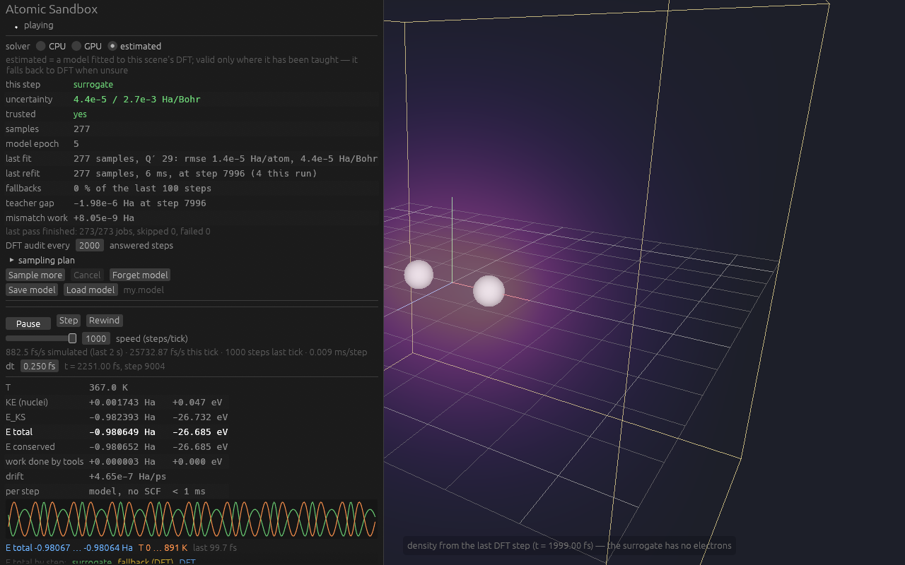

# Atomic Sandbox

An interactive 3D sandbox that simulates matter from the atomic level up with real physics, written from scratch in Rust + wgpu. Nuclei are classical point particles; electrons are solved with real-space Kohn-Sham density-functional theory on a GPU grid. Nothing chemical is hardcoded — every element is described by its atomic number and isotope mass only, and bonds, shapes and energies have to *emerge* from the equations.


## What it does today

| Milestone | Status | What you get |
|---|---|---|
| M1 — CPU reference solver (`qm`) | done | f64 spin-polarised LSDA Kohn-Sham solver on a uniform real-space grid, validated against NIST/literature atoms and the H₂ bond length |
| First pictures | done | H₂ density slice and energy curve (`docs/images/h2_*.png`) |
| M2 — 3D viewer (`app`, `render`) | done | place / select / drag nuclei, orbit camera, volume or isosurface density, energy readouts, scene save/load |
| M3 — GPU solver (`qm-gpu`) | done | the same solver in f32 WGSL compute, 30–100× faster, agrees with the CPU reference at fixed smearing to ≤ 3.5e-7 Ha for H … LiH and 4.1e-6 Ha for H₂O, forces to ≤ 3.7e-6 Ha/Bohr for H₂ and 4.8e-6 for H₂O; the viewer re-solves ~0.1–0.2 s after you move an atom |
| M4 — Dynamics (`sim`) | done | Born-Oppenheimer molecular dynamics in the viewer (velocity Verlet on the GPU Kohn-Sham forces, warm-started and density-extrapolated SCF with a cold retry on a stall): play / pause / step / rewind, drag a nucleus on a capped spring while it moves, pins, CSVR thermostat, temperature and energy readouts with a sparkline and an energy-drift health number; a GPU dynamics suite checks drift, vibration frequency, thermostat statistics and rewind |
| M5 — Surrogate ("estimated") force provider | done | a linear ACE-style model trained on this solver's own DFT, with a Bayesian uncertainty and DFT fallback, behind the same `ForceProvider` boundary: the **estimated** solver in the viewer samples the scene, then answers MD steps in ~5 µs and hands the step back to DFT wherever it is unsure; the surrogate validation suite checks it against its teacher (H₂ frequency within 7e-6 of DFT-MD, energies 2.5e-6 Ha / forces 2e-5 Ha/Bohr rms on fresh geometries, 38 DFT calls to learn H₂ from nothing) |
| M6 — Tools | planned | bond graph read off the density, molecule formulas and names, isotopes, input-replay harness, more presets |

The sandbox now **moves**: the nuclei are classical particles pushed by the Kohn-Sham forces (velocity Verlet, 0.25 fs steps), and the electron cloud is re-solved at every step. It opens on H₂ at 1.6 Bohr, slightly compressed from the bond length of its smeared nuclei; press **Play** and it vibrates with a period of 10.3 fs (one DFT solve per step, while the window stays at full frame rate: on the RX 7900 XTX the viewer showed about 2.5 fs of simulated time per wall second at 49³ — the panel shows the live figure; the headless MD step of the validation suite is 63–82 ms, 3–4 fs/s). The dynamics suite measures what that run does against references: NVE energy drift −4.0e-6 Ha/ps (bound 2e-4), the vibration frequency against the curvature of the same energy surface to 5.6e-4, the thermostat's mean temperature, and rewind retracing to 5.8e-6 Bohr (`crates/validate/references.md`, "Dynamics (M4)").


**Estimated mode (M5).** Pick **estimated** as the solver and the viewer first *teaches* a surrogate on the scene: a sampling pass (about 40 s for H₂ at 49³ — 273 DFT solves at SCF tolerance 1e-6: isolated-atom references, random perturbations, a bond scan and a hot MD burst) fits a linear model of the energy with a Bayesian uncertainty. From then on each MD step asks the model; when its uncertainty is above the threshold, or the geometry is outside what it was taught, the step goes to DFT instead (a **fallback**, shown amber), and that answer becomes a new training sample — the model learns as you play. The validation suite (`crates/validate/tests/surrogate.rs`) measures it against its teacher: the H₂ vibration frequency within 7e-6 of the DFT-MD value, energies within 2.5e-6 Ha and forces within 2e-5 Ha/Bohr (rms) on fresh geometries, and an active-learning run from nothing that needs only 38 DFT calls in 300 steps. The model alone runs at **2.4 × 10⁵ steps/s** for H₂ (headless, the validate suite) against ~10 DFT steps/s. In the viewer a DFT **audit** every 2000 answered steps (a safety check: the teacher answers at that geometry and the gap is compared) runs on a second GPU teacher in the background while the model keeps stepping, so it no longer sets the pace: H₂ plays at ≈ 40 000 fs/s at speed 1000 (headless at 49³; 38 800 fs/s in the worker test at 41³, 44 000 with audits off — before the background auditor it was ≈ 3300 fs/s in the window). At that speed the model outruns the background teacher: the audits run back to back, one per DFT solve — every ≈ 20 000–40 000 answered steps rather than 2000 — and a failed one arrives that many steps after the geometry it checked (the panel's **audit lag**); the 2000-step cadence holds at paced speeds. The in-window rate has not been re-measured since; the window kept full frame rate before (p95 frame interval 5 ms). With the CPU teacher the audit still runs in the step. A surrogate step has no electrons, so the cloud you see is the last DFT density, drawn faded and labelled with its time.



Measured on an AMD RX 7900 XTX (one solve after a drag release): H₂ on a 49³ grid 0.2 s cold / 0.1 s warm; H₂O on 97³ 3.6 s. Energies vs the f64 CPU reference at fixed smearing (σ = h = 0.25, 49³): H 2.2e-8, He 5.5e-8, H₂ 3.3e-8, LiH 3.5e-7, H₂O 4.1e-6 Ha (bound 2e-5; the GPU's own H₂O path scatter is 5.4e-6); forces ≤ 3.7e-6 Ha/Bohr for H₂ (bound 5e-6) and 4.8e-6 for H₂O (bound 6e-5).

## Running it

Requirements: Rust (stable, 1.99 or newer), a Vulkan/DX12/Metal-capable GPU for the GPU backend (the CPU backend works anywhere, slowly).

```bash
cargo run -p app --release
```

Options: `-- --preset h2o` (presets: `h`, `h2`, `he`, `lih`, `h2o`), `-- --backend cpu` (the f64 reference: one MD step takes seconds), `-- --estimated` (start on the estimated solver: its sampling pass begins at once), `-- --speed 1000` (the steps-per-tick slider's start value), `-- --audit 200` (the estimated solver's DFT audit interval; default 2000, 0 = never). Always build `--release`; debug builds are far too slow for the solver.

### Controls

| Action | Input |
|---|---|
| Orbit | middle-drag, or left-drag on empty space |
| Pan | right-drag |
| Zoom | scroll wheel |
| Place an atom | tool **Place**, pick an element (H–Ne), left-click; it lands on the camera's focus plane (shown as the blue placement grid) |
| Move an atom | tool **Select**, click a nucleus, drag. Paused: it moves where you drop it. Playing: it is pulled toward the cursor by a critically damped spring whose force is capped at 0.1 Ha/Bohr (an orange ring marks the target; drag slowly and the molecule follows, drag fast and it mostly heats up). Targets and placements are kept inside the cell, at least 3 grid steps from its faces. Faint lines show its distance to nearby atoms in Bohr and Å | While it falls, the drift readout turns amber (≈ −1e-3 Ha/ps): that is the molecule releasing 4.4 eV into motion on the grid's surface, not an integrator fault.
| Remove an atom | select it, press **Delete** (also while playing) |
| Atom card | selecting an atom opens a labelled Bohr-style schematic (protons, neutrons, electron shells) at the top right — a diagram, not the simulation |
| Play / pause | **Play** button or **Space**; **Step** advances one time step; **Rewind** reverses every velocity (an undisturbed trajectory retraces itself) |
| Speed and time step | **speed (steps/tick)** slider, 1–1000 steps per ≈16 ms tick: a tick that finishes early waits out its 16 ms, so a low speed is a slow run; 1000 means as fast as possible (the panel shows the measured fs/s over the last 2 s; one DFT step usually fills a tick). Above ~30 fs/s a 10 fs bond vibration is faster than the frame rate — you see a shimmer, not a swing: **watchable** sets the speed so one vibration takes ≈ 0.5 s. **dt** in fs, default 0.25, with a warning above 0.5 |
| Hold an atom | select it, tick **pinned** (a blue square marks it) |
| Temperature | **thermostat** (Bussi CSVR) with target T and coupling time τ; switching it on with the atoms at rest gives them Maxwell–Boltzmann velocities first |
| Gravity hook | **uniform acceleration (gravity hook)**: **g = 9.8 m/s² (−y)** or **off**; an acceleration on every nucleus, invisible at atomic scale, by design |
| COM correction | on by default: removes the grid's small spurious net force so a molecule does not wander off |
| Readouts | T, **KE (nuclei)**, **E_KS**, **E total**, **E conserved** and the **work done by tools** (Ha and eV; with the estimated solver the model's own bookings — **model refit** jumps and the **model force mismatch** — on rows of their own), drift in Ha/ps (amber above 1e-4, red above 1e-3), sim time, SCF steps per MD step (**per step**), a sparkline of E total and T; a warning when a nucleus nears the box face; a nucleus closer than 3 grid steps to a face pauses the run with an error, since the electrons cannot follow it there |
| Solver | CPU / GPU / **estimated** radio (switching restarts the run, paused; leaving estimated and coming back keeps its model for the session); charge, spin multiplicity, nuclear smearing σ, grid size and spacing (these pause the run and restart its time) |
| Estimated solver | readouts: who answered this step (**surrogate** green, **fallback** amber, **DFT** blue), the model's force uncertainty against its threshold, **trusted** yes/no with the reason when not (e.g. too few samples, or a training residual above the accuracy it claims), samples, model epoch, last fit (rmse), fallbacks over the last 100 steps, the teacher gap (DFT − model energy on the most recent fallback, with its step), the **last audit** (passed / failed / not judged because box-affected, its gap, its DFT time, its **audit lag** — the answered steps between its dispatch and its verdict) and the booked force-mismatch work; "yes, but not answering here …" when a trusted model has fallen back for 50 steps at one place; the sparkline colours E total by source; **DFT audit every** n answered steps (2000 by default, on a background GPU teacher; 0 = never, flagged unsafe) |
| Sampling pass | starts by itself when estimated has no model, aiming to finish in about 2 minutes: the plan is scaled down to fit (never below the samples trust needs), and a pass that would still take longer waits for **Start anyway** (water at 57³, ≈ 6 min); next to the button the solve count and the expected time, a second click for anything over 2 min; **sampling plan** (perturbations, σ_r, hot-burst steps and T, scan points per pair, seed), a progress bar with stage, time left, last energy and skipped/failed counts, **Cancel** (keeps and fits what it has), **Sample more** (another pass over the current scene, new seed). The dynamics stay paused while it runs; editing is allowed |
| Model files | **Save model** writes `<scene>.model` next to the scene file (`my.scene` → `my.model`); **Load model** reads it — refused unless it was trained on this scene's grid, σ, charge, multiplicity, teacher and teacher tolerance (a model saved before the 1e-6 sample tolerance is refused with both tolerances named); loading a scene in estimated mode also loads its `.model` when there is one; **Forget model** (click twice within 4 s) drops the model and its samples |
| View | volume or isosurface density, gamma / opacity / iso sliders; cell box, floor grid, axes, placement plane, 1 Bohr or 1 Å spacing; **smooth motion** (on by default) draws the nuclei between the last two snapshots, one publish interval behind, so they glide at the frame rate instead of jumping at the simulation's tick rate |

Things to try: switch the solver to **estimated** on H₂, let it sample for about 40 seconds, set the speed to 1000 and press Play — the bond vibrates at tens of thousands of fs per second, the sparkline green (the audits now run in the background: see **last audit**); then drag one H away with the Select tool and watch the fallback light up amber while the model learns the new geometry from each DFT answer (the samples count climbs, the epoch moves, and the amber turns green again once it has seen enough) — up to ≈ 4 Bohr at 49³; farther, the box itself squeezes the molecule, and DFT answers those steps without teaching the model. Press Play on H₂ and watch E total stay flat while T swings between 0 and ~900 K; tug one H with the Select tool while it vibrates; switch the thermostat on at 300 K; stretch the H₂ bond and watch the energy curve and the density neck split; compare the symmetric H₂ cloud with lopsided LiH (charge transfer with nothing told about electronegativity); build water from an O and two H (at the default 0.25 Bohr grid the smeared oxygen makes the relaxed molecule nearly linear — a resolution artefact worth seeing for yourself; the real 104.5° bend needs a finer grid or pseudopotentials); push two He atoms together and watch them refuse to bond; make HeH⁺ (charge +1) and watch them bond.

## Physics, honestly

- **Model:** Born-Oppenheimer separation; electrons in spin-polarised Kohn-Sham DFT with the LSDA exchange-correlation functional (Dirac exchange + Perdew–Wang 92 correlation); 8th-order finite-difference Laplacian; nuclei represented as narrow Gaussians (σ = grid spacing by default) with an analytic potential; Hartree potential from a multipole-bounded Poisson solve; Hellmann-Feynman forces.
- **Units:** atomic units everywhere inside the solver (Hartree, Bohr, mₑ, ħ = e = 1); the UI converts.
- **Precision:** f32 on the GPU grid with two-level compensated reductions; f64 on the CPU for nuclei, small dense algebra and the reference solver.
- **Known gaps, documented rather than hidden:** LSDA underbinds the hydrogen atom (−0.4777 Ha here vs −0.5 exact; the LSDA reference value is −0.4787); absolute energies of anything containing oxygen or heavier are not physical at the default 0.25 Bohr spacing because the nucleus is heavily smeared — the density *shapes* are right, the numbers are not; the f32 GPU path carries ~1e-6 Ha of scatter between solve paths; the lithium atom oracle misses its reference by 0.33 Ha at the tested grid and is kept as an ignored test. See `crates/validate/references.md` for every reference number and tolerance.
- **Dynamics on the smeared surface:** the vibrating H₂ runs at 3237 cm⁻¹ (period 10.30 fs) against 4401 cm⁻¹ measured, because at σ = h = 0.25 the smeared nuclei lengthen the bond (1.79 Bohr, vs 1.45 at σ → 0) and soften its well — the dynamics match the curvature of that same surface to 6e-4, and this solver's σ → 0 curvature gives ≈ 4405 ± 60 cm⁻¹, a figure too coarse to tell experiment (4401) from LSDA (4201).
- **Water heats up on Play:** the same smearing makes water's minimum on this surface near-linear (O–H 2.34 Bohr, 177°) and 0.160 Ha (4.4 eV) below the physical geometry the `h2o` preset loads, so pressing Play on `h2o` heats the molecule — past 10 000 K within ~2.5 fs while it opens toward linear; a 300 K thermostat (τ = 10 fs) brings it back to ~300 K after ~100 fs. Along that fast motion the warm-started solver sometimes stalls; it then retries the step cold (twice in 600 steps, the slower step 24 s instead of ~1 s at 57³), and only a failed cold retry pauses the run.
- **The estimated solver is a model of this DFT, not of nature.** It inherits every approximation of its teacher (smearing, LSDA, the box) and adds its own fit error; the uncertainty it shows is a *model* uncertainty — how sure it is of reproducing the DFT — not a physical error bar. It is valid only where it has been taught: it falls back to DFT when unsure, and an untrusted model (too few samples, or a training sample it cannot fit to the accuracy it claims) never answers. A sample the model cannot represent at all is **quarantined** rather than allowed to untrust everything: kept in the store and the model file, excluded from the fit, its neighbourhood answered by DFT, and counted in the panel ("N samples quarantined — the model cannot represent them"); a later DFT answer there that agrees with the model releases it, and if three consistent DFT answers there all disagree with the model, one is kept and the next refit decides whether the model can learn that region. A DFT answer whose density on the outermost grid plane (one grid step inside the box wall) exceeds 2e-5 e/Bohr³ at the default 0.25 Bohr spacing — scaled by (h / 0.25 Bohr)², because the confinement energy per unit of that density grows as 1/h² (a quarter of it is tolerated at h = 0.125) — is used for that step but never trained on, and an audit there is recorded but not judged: the box's confinement (≈ π d ρ_face / (4κ²h²) for a nucleus d from the wall, ≈ 50 Ha per e/Bohr³ for H₂ at h = 0.25 — measured 40–55 — so ≥ 1e-3 Ha from there on) depends on *where* the molecule sits and how it is *oriented* against the box axes, which a model of the internal geometry neither can nor should learn — in the 10 Bohr box of 41³ that is H₂ stretched beyond ≈ 2.5 Bohr or parked 2–3 Bohr from a face, at the default 49³ beyond ≈ 4 Bohr; the cure is a bigger box. Such answers taken while a model is still being built — the sampling pass's own included — are never quarantined and leave the fit once enough others are held. The estimated solver's own DFT teacher (sampling pass, fallbacks, audits) solves at SCF tolerance 1e-6, tighter than the plain DFT backends' 1e-5, because its answers are kept as training data; a model taught at another tolerance is refused, never mixed. Without a model (a pass waiting to be started), DFT steps keep at most 4 Q′ samples before keeping one in ten. (Before Task 9 such an answer could fail an audit on pure confinement, get quarantined, and fence the equilibrium bond everywhere in the cell: a "trusted" model falling back on every step.) A trusted model that keeps falling back at one place says so on the panel. Repeated fallbacks at one geometry keep only one sample in ten. On a small 33³ grid (8 Bohr box) the teacher's own scatter from confinement keeps a short sampling pass from earning trust; the default 49³ is fine.
- **No per-element parameters.** Allowed inputs are Z and the isotope mass (plus display colours and radii, which are not physics). No force fields, no fitted pair potentials, no chemistry libraries.

## Sources

Every equation in the code is hand-written from the literature below; each derivation lives as a module doc next to the code that implements it, and every validation bound cites its reference number in [`crates/validate/references.md`](crates/validate/references.md).

**Density-functional theory (the electrons)**
- Hohenberg & Kohn, *Phys. Rev.* 136, B864 (1964); Kohn & Sham, *Phys. Rev.* 140, A1133 (1965) — the Kohn–Sham equations solved on the grid.
- Dirac, *Proc. Camb. Phil. Soc.* 26, 376 (1930) — the LSDA exchange energy density.
- Perdew & Wang, *Phys. Rev. B* 45, 13244 (1992) — the PW92 correlation fit (eqs. 8–10, Table I), used exactly as published; `crates/qm/src/xc.rs`.
- Pulay, *Chem. Phys. Lett.* 73, 393 (1980) — DIIS density mixing; `crates/qm/src/scf.rs`.
- Knyazev, *SIAM J. Sci. Comput.* 23, 517 (2001) — LOBPCG for the lowest Kohn–Sham orbitals; `crates/qm/src/eigen.rs`, `crates/qm-gpu/src/eigen.rs`.
- Fornberg, *Math. Comp.* 51, 699 (1988) — the 8th-order finite-difference Laplacian weights; `crates/qm/src/stencil.rs`.
- Feynman, *Phys. Rev.* 56, 340 (1939) — Hellmann–Feynman forces on the nuclei; `crates/qm/src/forces.rs`.
- Jackson, *Classical Electrodynamics* (3rd ed.), §4.1 — the multipole expansion used for the Poisson boundary (solid harmonics in Racah normalisation); `crates/qm/src/poisson.rs`.
- Briggs, Henson & McCormick, *A Multigrid Tutorial* (2nd ed., SIAM 2000) — the multigrid-preconditioned CG Poisson solve on the GPU; `crates/qm-gpu/src/multigrid.rs`.
- Cody, *Math. Comp.* 23, 631 (1969); Abramowitz & Stegun §7.1 — the erf evaluation for the smeared-nucleus potential; `crates/qm-gpu/src/shaders/nuclear.wgsl`.
- Kotochigova, Levine, Shirley, Stiles & Clark, NIST *Atomic Reference Data for Electronic Structure Calculations* (1997) — the LSD atomic energies the oracles are checked against.
- NIST CCCBDB — experimental H₂ ω_e = 4401.21 cm⁻¹ and bond length, the physical values the smearing gap is measured against.

**Molecular dynamics (the nuclei)**
- Verlet, *Phys. Rev.* 159, 98 (1967); Swope, Andersen, Berens & Wilson, *J. Chem. Phys.* 76, 637 (1982) — velocity Verlet; the exact h²/4 energy swing used as a test pin is derived in `crates/sim/src/integrator.rs`.
- Bussi, Donadio & Parrinello, *J. Chem. Phys.* 126, 014101 (2007) — the canonical-sampling velocity-rescaling thermostat (eq. A7 implemented verbatim); `crates/sim/src/thermostat.rs`.
- Wang, Huang, Kondev, Audi & Naimi, *Chinese Phys. C* 45, 030003 (2021) — AME2020 isotope masses, the only per-element data besides Z; `crates/units`.

**The learned surrogate (estimated mode)**
- Drautz, *Phys. Rev. B* 99, 014104 (2019) — the atomic cluster expansion: body-ordered invariants on a species-channelled atomic basis; `crates/surrogate/src/descriptor.rs`.
- Bishop, *Pattern Recognition and Machine Learning* (Springer 2006), §3.3–3.5 — Bayesian linear regression, the evidence framework and predictive variance; MacKay, *Neural Comput.* 4, 415 (1992) — evidence maximisation for the ridge and noise levels; `crates/surrogate/src/fit.rs`.

**Where the physics is documented honestly**
- Approximation gaps (LSDA vs exact atoms, the smearing shift in vibration frequencies, the water geometry at the default grid, box confinement): [`crates/validate/references.md`](crates/validate/references.md) and the milestone handoff notes in `docs/superpowers/notes/`.
- Design decisions and the reasoning behind each ruling: `docs/superpowers/specs/` and `docs/superpowers/plans/`.

## Repository layout

```
crates/units      unit conversions and isotope masses (the only per-element data)
crates/qm         CPU f64 reference Kohn-Sham solver: grid, Laplacian, Poisson, LOBPCG, LSDA, SCF, forces
crates/qm-gpu     the same solver in WGSL compute (wgpu), bit-deterministic, cancellable
crates/gpu        wgpu plumbing: context, surface, 3D volume textures
crates/render     camera, impostor spheres, volume raymarch, line overlays
crates/app        the viewer: winit + egui, solver worker thread, tools, scene files
crates/validate   physics oracles and GPU-vs-CPU suites with cited references
docs/superpowers  design spec, per-milestone implementation plans, handoff notes
```

Tests: `cargo test -p units -p qm --release` (~75 s), `cargo test -p qm-gpu -p sim -p render -p app --release`, `cargo test -p validate --release --test gpu_vs_cpu` (~3.5 min, needs a GPU), `cargo test -p validate --release --test dynamics` (the dynamics suite, ~6 min, needs a GPU), `cargo test -p validate --release` (everything in `validate`: the oracles, ~30 min, plus the two GPU suites). Validation gates are never loosened to make a test pass.

## Design and process

The design is in [`docs/superpowers/specs/2026-10-12-atomic-sandbox-design.md`](docs/superpowers/specs/2026-10-12-atomic-sandbox-design.md); each milestone has a plan in `docs/superpowers/plans/` and a handoff note in `docs/superpowers/notes/`. The code is developed with Claude Code (Fable 5.1 for physics and numerics, Opus 5.5 for engineering), task by task with independent review; every decision made along the way is recorded in the plans and notes.

## Roadmap after M5

Scaling up the "ladder": more elements (pseudopotentials for Z > 10), larger systems through ML potentials trained on this solver's own data and loaded as data behind the same `ForceProvider` boundary, then coarse-grained and continuum stages. Gravity exists as an external-field hook but is invisible at atomic scale, as it should be.


Nuclear physics (decay, transmutation) is planned as a **nuclear-events layer**, not as explicit protons and neutrons: the nucleus is 10⁻⁵ of the atom and no first-principles route from QCD exists, so nuclei stay points for the electrons while a stochastic α/β/γ event process — Q-values from the isotope mass table, rates from measured half-lives — changes Z live and lets the chemistry respond. Decay time gets its own labelled clock, separate from the MD speed.