# Atomic Sandbox

*Powered by **LIRA**, the live interactive real-space ab initio engine: Kohn-Sham DFT solved on the GPU.*

An interactive 3D sandbox that simulates matter from the atomic level up with real physics, written from scratch in Rust + wgpu. Nuclei are classical point particles; electrons are solved with real-space Kohn-Sham density-functional theory on a GPU grid. Nothing chemical is hardcoded — every element is described by its atomic number and isotope mass only, and bonds, shapes and energies have to *emerge* from the equations.

How it was built, what failed on the way and how long each part took: [DEVLOG.md](DEVLOG.md).

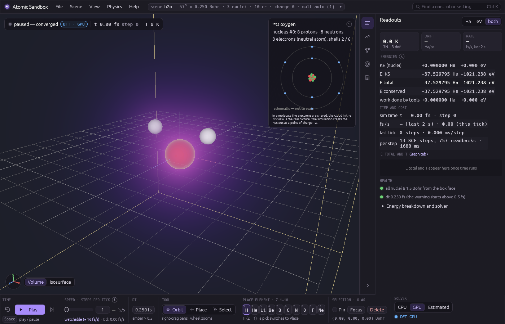

## What it does today

**Since the M7 merge (2026-10-19):** File ▸ **Open…** browses the scenes (presets with previews, the `scenes/` folder) and the models in `models/`, marking each model against the selected scene (ready / needs settings / can't run here, the elements it was taught, a *recommended* badge, *Use its settings* without loading it); opening a scene saved at another grid or ionic potential asks which settings to use. File ▸ **Save…** saves the scene, the model or both (to the folders or anywhere). File ▸ **Profiles…** saves and loads the app's layout and look (`profiles/`, shareable); the layout and look you leave are restored at the next launch. Dock tabs can be dragged up and down or to the other dock (right-click: move, reset). The view switch's fourth choice, **Camera**, draws the atoms as they look — from a soft electron glow to solid shaded balls — time-averaged over a shutter (real motion blur), with exposure, shutter, field of view, solidity and size in View ▸ Display aids (shown while the Camera view is on); the diagram view has its own motion blur, a background colour and a label opacity. In estimated mode: **Solve Bonds** (bottom right) solves the density once between steps for the bonds and angles, the bond references solve only for a loaded scene or on that button, switching to Estimated never starts a sampling pass by itself, Play needs a model, and a run pauses itself when every one of the last 100 steps fell back to DFT. The app is a windowed program with its own icon.

**Since 2026-10-20:** **All orbitals coloured** draws each orbital as its **boundary surface** — the region holding 90 % of its probability (50–99 %), as a thin **shell** (the default), **filled**, or by **density** as before — with *hide core orbitals*, overlaps speckled in both colours rather than averaged, and a vivid palette (Orbitals tab); **one colour per spatial orbital** (an ↑ orbital and its ↓ partner share a colour and a legend chip, and a closed shell's ↓ p set points its lobes where the ↑ set does), **quick presets** (valence only, one spin, p only, everything), **ticked unoccupied orbitals** drawn as boundary surfaces, and a warning when an occupied orbital's boundary **touches the box** ("enlarge the box"). **Fields follow the atoms** (View, on by default): between solves the shown density and orbitals are warped with the atoms — each region turns and moves with its nearby atoms and bonds — until the next DFT solve replaces them; a display approximation that cannot make new chemistry (a bond broken since the solve is drawn stretched). **Bloom** (View: strength and threshold) adds a soft glow to the bright parts of the view. The Camera view's solid is one **smooth surface** (View ▸ Camera ▸ smooth, also in its panel): neighbouring atoms flow into each other through a soft neck instead of a crease. The **Edit tool** moves one atom or a box-selected group with X/Y/Z and plane handles, keeping velocities and pausing the run while a handle is held. New scenes: ethane, propane, propene, cyclopropane and aspirin (the largest: 141³, about 8 GB of GPU memory, minutes per solve). **Training passes are sturdier and resumable:** a hot-burst step whose solve fails no longer ends the burst (and with it the pass) — the burst goes on from the last geometry it solved with fresh velocities at its temperature; a sample solve that runs past 5× the pass's median solve (at least 15 s) is given up like a stalled one and logged as *time limit*; and a running pass is kept in `%LOCALAPPDATA%tomic-sandbox	raining` (its samples and its queue, every few seconds), so after a crash, a close or a solver switch mid-pass the Model tab offers **Resume the interrupted training (sample N of M)** — on the pass's own scene, in the estimated solver — or Discard. A pass that finishes or is cancelled leaves nothing behind.


| Milestone | Status | What you get |
|---|---|---|
| M1 — CPU reference solver (`qm`) | done | f64 spin-polarised LSDA Kohn-Sham solver on a uniform real-space grid, validated against NIST/literature atoms and the H₂ bond length |
| First pictures | done | H₂ density slice and energy curve (`docs/images/h2_*.png`) |
| M2 — 3D viewer (`app`, `render`) | done | place / select / drag nuclei, orbit camera, volume or isosurface density, energy readouts, scene save/load |
| M3 — GPU solver (`qm-gpu`) | done | the same solver in f32 WGSL compute, 30–100× faster, agrees with the CPU reference at fixed smearing to ≤ 3.5e-7 Ha for H … LiH and 4.1e-6 Ha for H₂O, forces to ≤ 3.7e-6 Ha/Bohr for H₂ and 4.8e-6 for H₂O; the viewer re-solves ~0.1–0.2 s after you move an atom |
| M4 — Dynamics (`sim`) | done | Born-Oppenheimer molecular dynamics in the viewer (velocity Verlet on the GPU Kohn-Sham forces, warm-started and density-extrapolated SCF with a cold retry on a stall): play / pause / step / rewind, drag a nucleus on a capped spring while it moves, pins, CSVR thermostat, temperature and energy readouts with a sparkline and an energy-drift health number; a GPU dynamics suite checks drift, vibration frequency, thermostat statistics and rewind |
| M5 — Surrogate ("estimated") force provider | done | a linear ACE-style model trained on this solver's own DFT, with a Bayesian uncertainty and DFT fallback, behind the same `ForceProvider` boundary: the **estimated** solver in the viewer samples the scene, then answers MD steps in ~5 µs and hands the step back to DFT wherever it is unsure; the surrogate validation suite checks it against its teacher (H₂ frequency within 7e-6 of DFT-MD, energies 2.5e-6 Ha / forces 2e-5 Ha/Bohr rms on fresh geometries, 38 DFT calls to learn H₂ from nothing) |
| Orbital viewer (`qm::orbitals`, `render`, `app`) | done (the core-shell reconstruction waits for pseudopotentials) | **View ▸ Density ▸ show**: *Orbitals* (one Kohn–Sham orbital as a ± phase surface or volume, or its square), *All orbitals coloured* (the inner shells and the outer lobes at once, each in its own colour), *Spin density* (ρ↑ − ρ↓), with a list of the occupied and the lowest unoccupied orbitals — ε in Ha and eV, occupation, HOMO / LUMO, labels like 2p_x for a lone atom — and the honesty text of what an orbital is and is not; all of it display-only (a bitwise test pins that it never changes the dynamics) |
| M6 — Tools | done | bonds read off the solved density and drawn in the view, molecules labelled with their formula and name, a composition badge, isotopes (¹H ²H ³H … ⁴⁰Ar) per atom, a FIRE **Relax** tool, a periodic-table picker; a tools suite checks the bonds of H₂, He₂, H₃⁺ and water, the H₂/D₂ frequency ratio and the relax against an independent quench; the viewer's manual checklist became recorded input scripts that replay headlessly (`--record` / `--replay`) |
| Activity tab (`app::ui::activity`, `sim::activity`) | done | the status chip names what is running ("Sample 42 of 273 · bond scan · 1:40 left · iteration 9 / 200", "Refitting · 250 samples", "DFT fallback · iteration 7 / 200") with a progress bar on the toolbar, and a dock tab shows the jobs, three live counters, a **solve log** (one row per teacher solve with the rule that asked for it in words), a **trust checklist** that names the unmet condition, the **training plots** (rmse per refit, model vs DFT, per-pair curves with their uncertainty and where the model would refuse) and an event timeline — read from records already in memory, no view causes a solve, its bookkeeping costs 0.008 % of the teacher's time |
| M7 — Pseudopotentials (`qm::radial`, `qm::ionic`, `providers::pseudo`) | done (merged 2026-10-19; the solver and the app work for H–Ar; the validation oracles pass under *all species* — water 104.8°, O–H +0.010 Å — and the default policy is *accepted species*) | **Physics ▸ Ionic potential**: every species with a core (B, C, N, O, F, Ne, Si, P, S, Cl, Ar) is solved with a norm-conserving pseudopotential this program generates itself from its own all-electron atom, on first use, in seconds — heavy atoms stop losing most of their energy to the smeared nucleus (see **Pseudopotentials** below) |

The sandbox now **moves**: the nuclei are classical particles pushed by the Kohn-Sham forces (velocity Verlet, 0.25 fs steps), and the electron cloud is re-solved at every step. It opens on H₂ at 1.45 Bohr — this solver's σ → 0 LSDA bond length, the physical starting point. Under the default ionic policy (*accepted species*, see **Pseudopotentials**) the hydrogens are pseudised, nothing is smeared, and the surface's minimum at the default Accurate grid is 1.434 Bohr: the start sits 0.016 Bohr outside it, so **Play** shows a small vibration (period ≈ 8.3 fs from the step-halved Richardson ω₀ = 4024 cm⁻¹; the finite-difference ω at δ = h, 4111 cm⁻¹, is biased about +2 %). Under the all-electron policy (and for H in a run without a GPU) the nuclei are smeared over σ = h and the minimum lies further out (1.60 Bohr at Accurate, 1.79 at Balanced), so pressing **Play** makes it vibrate, with a period of about 10 fs (10.3 fs measured at σ = 0.25; one DFT solve per step, while the window stays at full frame rate: on the RX 7900 XTX the viewer showed about 2.5 fs of simulated time per wall second at the old 49³ default, and a warm 81³ solve costs ≈ 0.3 s, so expect roughly 1 fs/s at Accurate — the toolbar shows the live figure; the headless MD step of the validation suite is 63–82 ms, 3–4 fs/s). The dynamics suite measures what that run does against references: NVE energy drift −4.0e-6 Ha/ps (bound 2e-4), the vibration frequency against the curvature of the same energy surface to 5.6e-4, the thermostat's mean temperature, and rewind retracing to 5.8e-6 Bohr (`crates/validate/references.md`, "Dynamics (M4)").

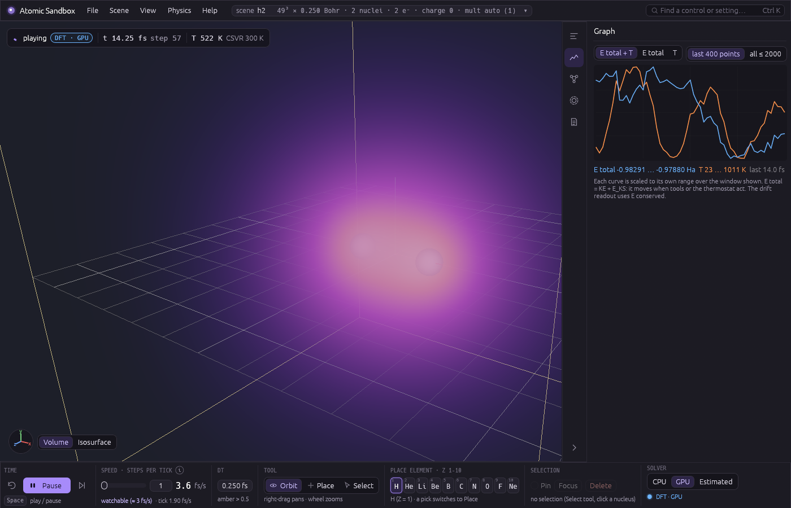

**Estimated mode (M5).** Pick **estimated** as the solver and the viewer first *teaches* a surrogate on the scene: a sampling pass (about 40 s for H₂ at Balanced 49³, a few minutes at the default Accurate 81³ — 273 DFT solves at SCF tolerance 1e-6: isolated-atom references, random perturbations, a bond scan and a hot MD burst) fits a linear model of the energy with a Bayesian uncertainty. From then on each MD step asks the model; when its uncertainty is above the threshold, or the geometry is outside what it was taught, the step goes to DFT instead (a **fallback**, shown amber), and that answer becomes a new training sample — the model learns as you play. The validation suite (`crates/validate/tests/surrogate.rs`) measures it against its teacher: the H₂ vibration frequency within 7e-6 of the DFT-MD value, energies within 2.5e-6 Ha and forces within 2e-5 Ha/Bohr (rms) on fresh geometries, and an active-learning run from nothing that needs only 38 DFT calls in 300 steps. The model alone runs at **2.4 × 10⁵ steps/s** for H₂ (headless, the validate suite) against ~10 DFT steps/s. In the viewer a DFT **audit** every 2000 answered steps (a safety check: the teacher answers at that geometry and the gap is compared) runs on a second GPU teacher in the background while the model keeps stepping, so it no longer sets the pace: H₂ plays at ≈ 40 000 fs/s at the top speed (measured when the top was 1000 steps per tick, unpaced; headless at 49³; 38 800 fs/s in the worker test at 41³, 44 000 with audits off — before the background auditor it was ≈ 3300 fs/s in the window). At that speed the model outruns the background teacher: the audits run back to back, one per DFT solve — every ≈ 20 000–40 000 answered steps rather than 2000 — and a failed one arrives that many steps after the geometry it checked (the Model tab's **audit lag**); the 2000-step cadence holds at paced speeds. The in-window rate has not been re-measured since; the window kept full frame rate before (p95 frame interval 5 ms). With the CPU teacher the audit still runs in the step. A surrogate step has no electrons, so the cloud between DFT densities is an **atomic superposition** — the teacher's own isolated atoms (solved once per species and grid in the background), placed at the current nuclei and blended with the last real density as the atoms move away from it — labelled "atomic superposition — not solved": it shows where the atoms are, not their bonds. The real densities come from DFT steps, from the background audits ("DFT density from the audit at t = … fs") and, if you switch it on, from a display-only **refresh** every 1–10 s while playing. With the superposition off, the last real density is drawn faded and labelled with its time. Both need the GPU teacher (the CPU teacher has no background solver).

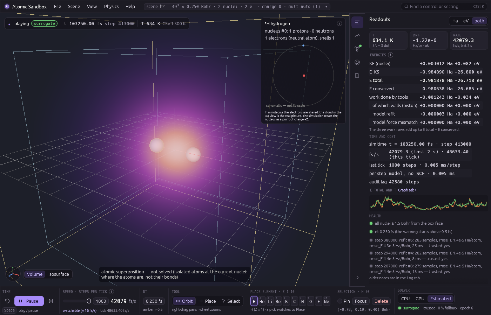

**The Activity tab.** While anything runs the status chip says what and how far — a pass in **samples** (one full DFT calculation at one geometry, one training example) and **iterations** (one SCF refinement round): `Sample 9 of 273 · random nudges · 0:32 left · iteration 1 / 200`, its references stage naming the last reference that finished: `reference (last done: H)`; a refit; a DFT step or a fallback with its iteration (of the cap — the total is unknown before convergence, so the last solve's count stands beside it, and a warm solve retried cold says `cold retry`), a relax, the orbital viewer's eigensolve — with a second pill while a background audit runs, and a 3 px bar on the toolbar's top edge fills for a pass and sweeps for single solves (click it to open the tab). The dock's **Activity** tab lists the **jobs** — a running solve with its Δρ against the target, the energy change per iteration, ms per iteration and a log-Δρ sparkline, and an amber "no 2× gain for 31 / 50" once the best Δρ has not halved for 25 iterations while it is still large (the **SCF stall stop** ends a solve at 50 when its best Δρ is still at or above 1e-3 per electron: a geometry whose density only oscillates at order one — a half-broken O–H bond at 1.8 r₀ — no longer runs to the 200-iteration cap twice, warm and cold, while a slow oscillation far below that, such as stretched H₂, which can still converge after 150 iterations, is left to finish; measured 117 instead of 400 iterations, `crates/validate/references.md` "SCF stall stop", and a stretched bond-scan point that fails skips the further-out points of its scan) — with the one control each has (Cancel, Stop, Pause, Start anyway; "can't be cancelled" says why on hover), three **counters** (samples in the model, teacher solves for this model with their pass / fallback / audit split, teaching solves this session — plain DFT steps are not teaching solves), and the **solve log**: newest first, one row per teacher solve with its driver step, origin, the rule that asked for it (`0 cell`, `4 untrusted`, `5e grade`, `6 force σ`, `8 audit (passed)`, `hot burst 1830 K` …), what became of the answer (`kept`, `kept (box)`, `skipped: similar`, `not kept: box` …), |ΔE| against the model and the solve time with its iterations and how the SCF ended (`840 ms · 37 it`, `16.8 s · 55 stalled`, `… · 200 cap`); hover a row for the sentence ("atom 0 is outside what the model has learned and is touching the box edge — move it inward") and the provider's own text. The **trust checklist** lists the trust rule's conditions in its own order with their numbers against their limits and marks the first unmet one *this is why* (when the box is what blocks trust it comes first, with the cell that would fix it); the Model tab's **trusted** line and the toolbar tooltip use the same plain line, the fit's own words on hover. **Training** (open it to build the views — the worker builds them only then) plots the model's rmse per refit, model vs DFT for the training samples ((E − Σ E_ref)/N, or force components), and for each species pair the model's energy of an *isolated* dimer with its ±1σ model uncertainty (what the uncertainty rule judges — **not an error bar against DFT**), the fit's residual scatter in grey (teacher noise plus what the basis cannot fit; more samples of the same kind do not remove it), the dimer's stored samples as dots, **dashed and labelled with the rule wherever the model would not answer that dimer**, and a log-scale lane of the two uncertainty rules' ratios against their limit of 1; then the pair distances and hot-burst temperatures seen, and an event **timeline** (fallbacks, audits, refits, quarantines, passes). The curve is a slice, not a pair potential: inside a molecule the model may answer a pair where the curve is dashed and refuse it where it is solid, and the captions say so. Cost, measured on the RX 7900 XTX: the bookkeeping is **0.008 % of the teacher's solve time** (1.8 ms over 21.6 s of an H₂ 49³ pass with the views on) and 0.06 % of the wall time while playing; the probe on the DFT solver changes a warm solve by −0.6 % (noise); a training-view build is 1.4 ms for H₂ (cold; 0.5 ms warm) and 3.3 s cold for a four-species model (Q′ 1232 — which the worker spaces at 2 % of its time), and the tab with Training open costs 0.8 ms per frame at 5 000 log rows and 20 000 force points (layout and tessellation; the Readouts tab: 0.4 ms).

| | |
|---|---|
| 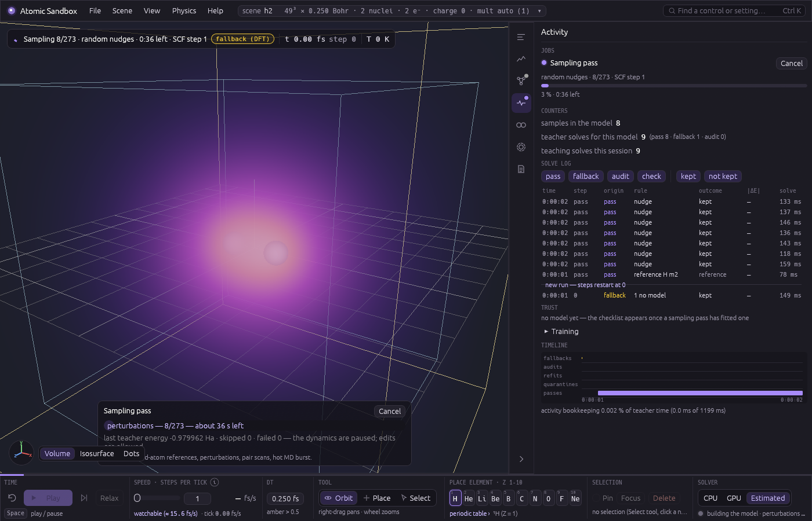 | 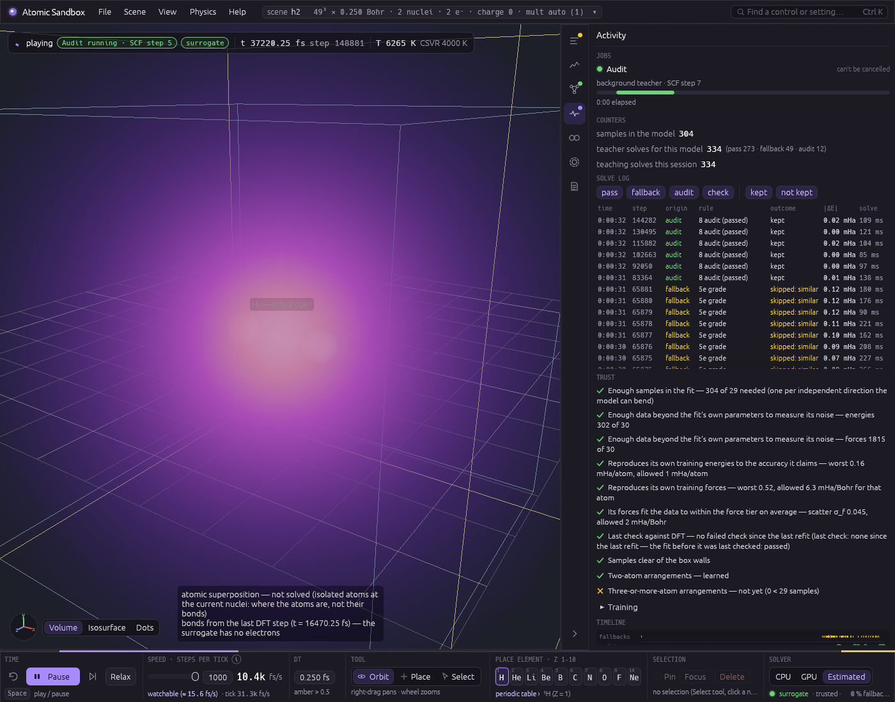 |
| 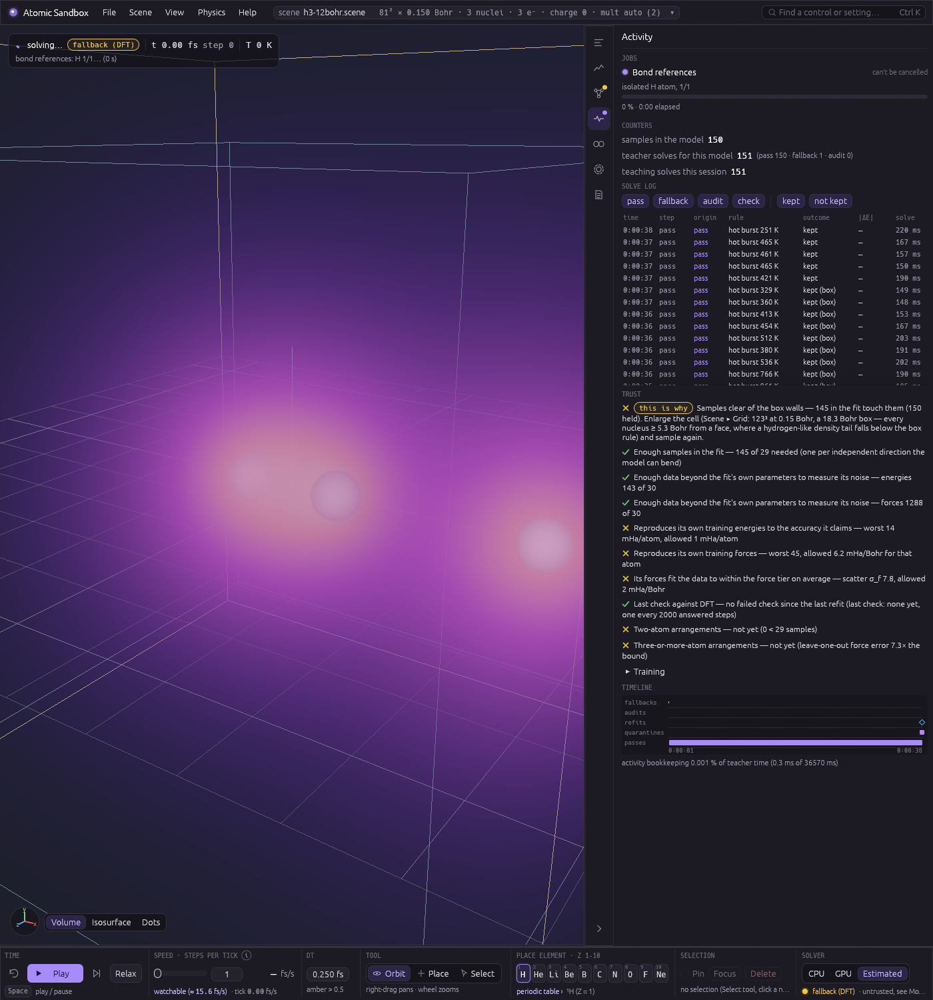 | 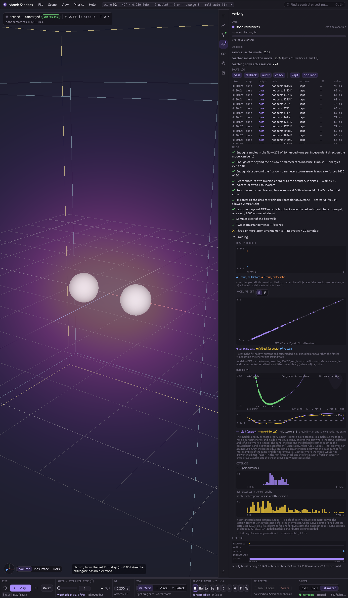 |

**Bonds, molecules and isotopes (M6).** After every converged DFT step the viewer reads the bonds off the density itself: a pair is bonded where the solved density piles up between the two nuclei beyond what their free atoms would put there — compared against the solver's own isolated atoms, solved once per element in the background (O ≈ 1 min at 57³; the status chip says "bond references: O 2/3…") — and nothing about chemistry is told to it. Water gets its two O–H bonds and no H–H bond, He₂ gets none (closed shells push density out of the contact), H₃⁺ gets a three-centre ring (dashed violet). Each molecule is labelled in the view ("H₂O — water") and listed in the Selection tab, and hovering an atom with the Select tool shows its badge: "¹⁶O · 8 p · 8 n · |F| 0.342 Ha/Bohr". Each atom also carries its measured **partial charge** (blue +, red −): a Hirshfeld partition of the same solved density against the same free atoms — every point shared between the atoms in proportion to their free-atom densities, q = Z (the valence charge under a pseudopotential) minus the atom's share — so the charges always add up to the scene's charge (checked; LiH comes out Li δ+, H δ−). One partition scheme of several, with characteristically small magnitudes, measured from this LSDA density: read the signs and trends (Help ▸ Partial charges are one partition of many). Display only, never fed back into the forces. **Relax** (toolbar, or Physics ▸ Relax geometry) moves the atoms downhill with FIRE until every force is below 1e-3 Ha/Bohr; under the estimated solver it relaxes on the model and checks the result with one DFT solve. Any atom can be swapped to another isotope (deuterium, tritium, ¹³C, ¹⁸O, …): only its mass changes, so D₂ vibrates slower than H₂ by √(m_D/m_H) — the tools suite measures 1.4136050 against 1.4136703 (−4.6e-5).

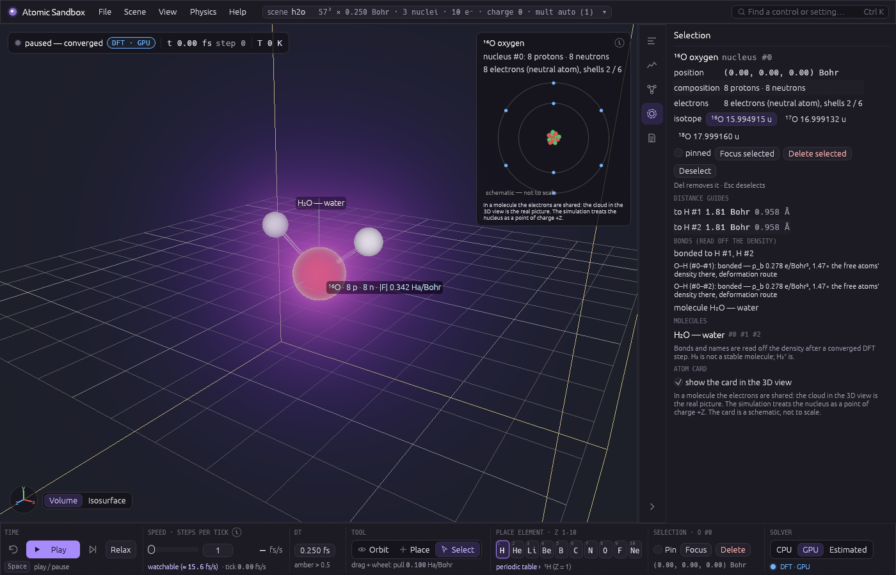

**Accuracy vs speed (the Quality levels).** The default grid is now **Accurate**, h = σ = 0.15 Bohr (81³ for a 12 Bohr box), not the old 0.25: the nuclei are smeared over σ = h, which lengthens bonds, and a finer grid shrinks that error. H₂ on this solver (`crates/validate/references.md`, "Quality presets"; RX 7900 XTX):

| level | h = σ (Bohr) | grid (12 Bohr box) | H₂ R_e(σ = h) | vs 0.7414 Å (experiment) | cold solve at R_e | warm re-solve (+0.01 Bohr) |
|---|---|---|---|---|---|---|
| Fast | 0.30 | 41³ | 1.8931 Bohr = 1.0018 Å | +0.260 Å | 0.12 s (9 SCF steps) | 0.07 s (6) |
| Balanced (old default) | 0.25 | 49³ | 1.7889 Bohr = 0.9467 Å | +0.205 Å | 0.15 s (9) | 0.07 s (6) |
| **Accurate (default)** | 0.15 | 81³ | 1.6008 Bohr = 0.8471 Å | +0.106 Å | 0.53 s (13) | 0.28 s (9) |
| Precise | 0.10 | 121³ | 1.5241 Bohr = 0.8065 Å | +0.065 Å | 0.76 s (13) | 0.46 s (8) |
| σ → 0 (the oracle's extrapolation, not a level) | — | 81³ ladder | 1.4511 Bohr = 0.7679 Å | +0.027 Å (the LSDA functional's own error: LSDA 1.446) | — | — |

Measured on an AMD RX 7900 XTX (one solve after a drag release): H₂ on a 49³ grid 0.2 s cold / 0.1 s warm, on 81³ (the new default) 0.53 s cold / 0.28 s warm; H₂O on 97³ 3.6 s. Energies vs the f64 CPU reference at fixed smearing (σ = h = 0.25, 49³): H 2.2e-8, He 5.5e-8, H₂ 3.3e-8, LiH 3.5e-7, H₂O 4.1e-6 Ha (bound 2e-5; the GPU's own H₂O path scatter is 5.4e-6); forces ≤ 3.7e-6 Ha/Bohr for H₂ (bound 5e-6) and 4.8e-6 for H₂O (bound 6e-5).


**Seeing what training solves.** While the estimated solver's sampling pass runs, the 3D view stops showing your scene and shows what the teacher is solving *right now*, as a wireframe ghost — outlined spheres in element colours, so it cannot be mistaken for your atoms — under a label saying what it is: the **reference** stage is the lone atom at the cell centre (`reference: isolated O`); a **random nudge** is the nudged geometry with an arrow from each atom's unperturbed position (`random nudge 3 of 12`); a **bond scan** highlights the scanned pair, brighter and thicker with a bright link, with the live separation (`O–H · 1.50 × r₀ · 2.71 Bohr`, point 9 of 12 above it); the **hot burst** is the moving geometry with a short fading trail of the last few solved ones. Thin lines join atoms that are close (display only). When a sample finishes its geometry flashes once for half a second — **green** kept, **red** failed or stalled, **grey** skipped or not kept (overlapping cores) — the solve log's own outcomes. Your scene, its bonds and its cloud come back the moment the pass ends, is cancelled or fails. It is display only: the geometry is a few dozen numbers the pass already holds (`sim::PassGhost`, in every snapshot), no density and no extra GPU readback, and nothing in it reaches the solve. **View ▸ Display aids ▸ show what training is solving** (on by default; Ctrl K "ghost") turns it off, and the scene then shows as before during a pass.

## Orbitals and spin


The density is what the solver converges; **View ▸ Density ▸ show** opens it up into the Kohn–Sham orbitals it is built from. There is no Ne preset: save a scene file (`grid 81 0.15`, `charge 0`, `nucleus 10 0 0 0`) and start with `--scene ne.scene --ui "show=orbitals;orbital=2p_x↑"`.

- **Orbitals** draws one orbital by track, as a signed volume or a ± isosurface (red where ψ is positive, blue where it is negative: the textbook convention) or as ψ², with a list of the occupied and the lowest *m* unoccupied ones per spin channel. A lone atom's orbitals get atomic names — 1s, 2s, 2p_x, 2p_y, 2p_z — from their angular character and radial nodes (no table, no per-element rule), and its p set is rotated to line up with the cell axes; in a molecule they are `#1`, `#2`, … and are never given atomic names. Colours, signs and orientations stay steady from step to step (a sign rule with continuity; 100 steps of a vibrating H₂ absorb 42–60 raw sign flips per orbital without a visible one).
- **All orbitals coloured** gives every spatial orbital its own colour and shows them all at once — by default as boundary surfaces (each orbital's 90 % region as a shell; filled or by density in the Orbitals tab; the GPU solver — the CPU reference draws by density), so the inner shells are visible through the outer ones. An ↑ orbital and its ↓ partner (the best spatial overlap, ≥ 0.9) share one colour and one legend chip, and a degenerate ↓ set is rotated onto the ↑ set it matches, so a closed shell is drawn as one set of shapes, not twice in two colours. **Quick presets** in the Orbitals tab set what is included: *valence only* (hides the core), *one spin* (the ↑ orbitals), *p only* (the orbitals of p character about a lone atom, pseudised or not — a molecule's orbitals have no single angular momentum, so it is off there), *everything* (the default). Unoccupied orbitals are drawn only when you tick them, and then only as boundary surfaces, at full weight (they hold no electrons, so by density there is nothing to draw); a state of the box keeps its tag. When an occupied orbital's boundary surface reaches the outer sixth of the box — where the walls (ψ = 0 on them) bend it; the same zone the box rule weighs — the row and the legend say **"boundary touches the box: enlarge the box"**. Blending is *additive* (emission only, the default) or *weighted* (the front shell hides what is behind it), each orbital scaled to its own peak or all to the physical density maximum. With **dots** (View ▸ Density ▸ render as dots) it is a cloud of samples coloured by orbital — of each orbital scaled to its own peak, which is *not* the electron density (the banner says so; with the physical scale the dots sample the density).
- **Spin density** is ρ↑ − ρ↓: amber where ↑ dominates, teal where ↓ does, with n↑, n↓, ∫m, ∫|m| and max|m|/max ρ read out in the tab (for a closed shell, whose m is numerical noise — ∫|m| inside the solver's own error budget from the SCF and eigensolver tolerances and f32 precision — nothing is drawn and the view says "no net spin — closed shell"; lithium shows its 2s↑ electron and a ∫|m| of 1.0004 against ∫m = 1: LSDA core polarisation, a real feature of the functional).

| | |
|---|---|
| 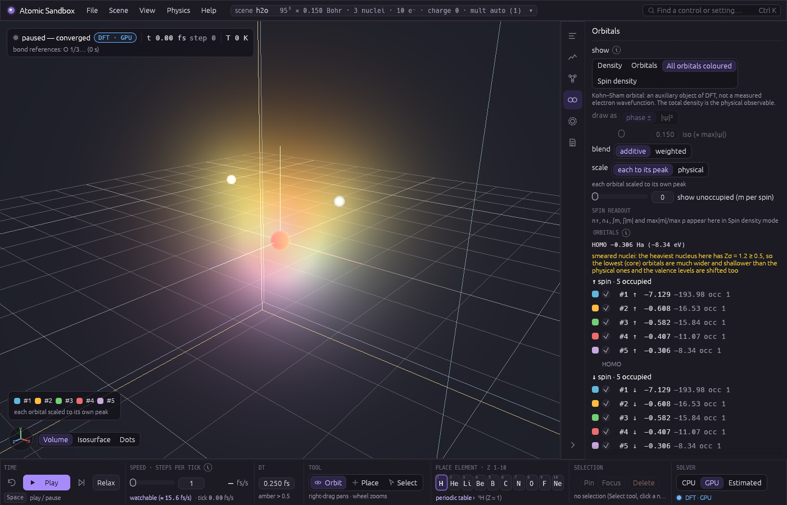 | 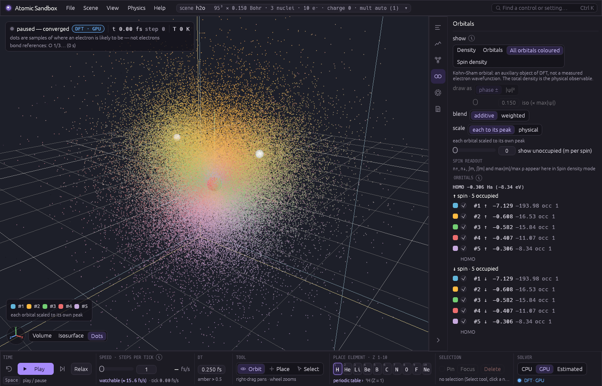 |
| 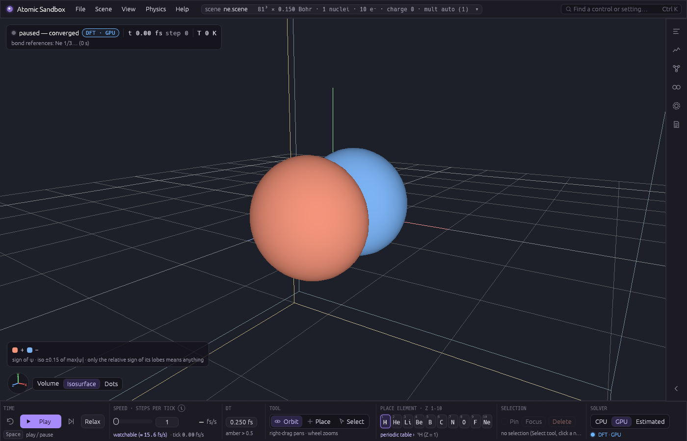 | 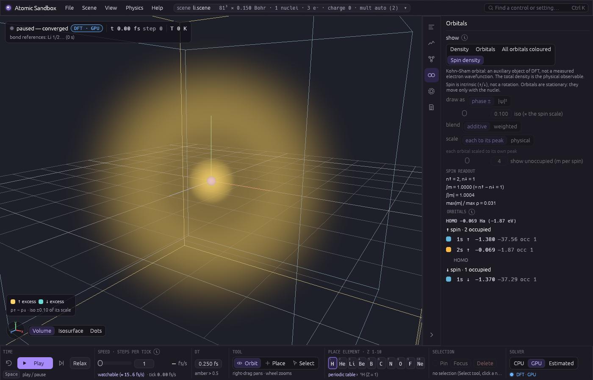 |

**What is on screen, honestly** (every mode's tooltip and the tab's header say it): a Kohn–Sham orbital is an auxiliary object of DFT — the eigenfunction of a fictitious non-interacting system with the same density — not a measured electron wavefunction; **the total density is the physical observable**. The eigenvalues ε are not excitation energies; only the HOMO's has a meaning (−ε_HOMO is the ionisation energy in *exact* DFT), and in LSDA it is far too shallow (this solver's H atom: ε_1s↑ = −0.2373 Ha against NIST's LSD −0.2690 and the exact −0.5; 93 % of the gap to NIST is the smeared nucleus, measured by an independent radial solve, `crates/validate/references.md` "Orbital viewer"). **Unoccupied orbitals** are eigenstates of the converged ground-state potential, computed for display by a separate eigensolve that never touches the dynamics; LSDA's potential decays too fast, so they are mostly not bound — in the 12 Bohr box they are *states of the box* (the tab says "a state of the simulation box, not of the molecule", and words the tag by the sign of ε), and **the Kohn–Sham gap is not the fundamental gap**. **Spin is intrinsic** (↑/↓), not a rotation, and orbitals do not rotate: they are stationary, moving only with the nuclei. The sign of an orbital is arbitrary — only the relative sign of its lobes means anything — and a degenerate set is shown rotated to a steady orientation ("rotated within a degenerate set for display", with the set's eigenvalue spread). **The smeared nucleus is visible here**: at Ne's Accurate grid the 1s sits at −9.66 Ha (the point-nucleus LSD value is −30.31) and 2s lies *above* 2p, the reverse of the physical order, which the tab flags as "shell order inverted by the smeared nucleus — not physical (needs a finer grid or pseudopotentials)"; a lone atom's p shell is also split by the grid (a fraction of a mHa, depending on where the atom sits in it: "split by the grid by … mHa"), never by physics. In estimated mode the model has no electrons, so the orbitals shown are the last DFT solve's, faded and labelled with their time. The reconstruction of core shells for pseudised atoms ("core: reconstructed for display") is built with the pseudopotentials.

**Cost** (RX 7900 XTX, 10 orbitals): one display update is one readback of scalars plus a few GPU copies — 0.8–1.3 ms at 49³, 0.9–1.8 ms at 57³, 1.1–2.3 ms at 97³ — and in play at most one per 100 ms; playing H₂ at the default grid runs at the same rate with an orbital view on (about 2.2 fs of simulated time per wall second either way) with the same time, step count and energies to the digits printed (the bitwise pin is H₂ at 49³, tol 1e-6, 20 steps). The unoccupied eigensolve is the expensive part: H₂ 81³ takes 1.7–1.8 s (about 9 warm SCF solves), H₂O 95³ 9–10 s, so it runs when paused (the view first appears with the occupied orbitals and the unoccupied ones follow, "computing unoccupied orbitals…"; pausing after play re-solves the rows at the pause) and in play only if its last solve took ≤ 0.25 s — with the default four unoccupied orbitals per channel that is probably no grid (a warm H₂ solve at 49³ was measured at 0.66 s; the 0.14 s figure is for m = 2), so by default it is paused-only. Rendering every mode at 97³ in a 1400 × 900 frame takes under 1 ms (volume 0.8, signed volume 0.6, ± isosurface 0.5, colour volume 0.5–0.7, 200 000 dots 0.8 ms). VRAM for the view (10 orbitals; the guard's estimate, not a measurement): 0.011 / 0.016 / 0.041 / 0.067 GB at 49³ / 57³ / 81³ / 97³ with no unoccupied orbitals, 0.09 / 0.14 / 0.36 / 0.59 GB with four per channel (a solve itself is 0.15 / 0.22 / 0.55 / 0.91 GB); a view that would not fit the GPU budget is refused with a message, never the scene. Estimated mode shows the orbitals of its background solver (a refresh per changed view, or "refresh cloud every N s"), and the CPU backend computes the same products in f64 (an H₂ solve at 49³ takes ≈ 6 s there).

## Pseudopotentials

**What it does.** Under the all-electron solver a nucleus of charge Z is a Gaussian of width σ = h, and for anything heavier than hydrogen that smearing is the dominant error (oxygen's energy is ≈ 38 Ha off at the Balanced grid, where Zσ = 2). A *pseudopotential* replaces the nucleus and its frozen core electrons by a smooth ion that the valence electrons see, so the grid only has to resolve the valence shell. **Physics ▸ Ionic potential** chooses how, for the whole scene:

| policy | what is solved |
|---|---|
| all-electron (σ = h) | every electron on the grid, every nucleus a smeared charge — the physics of the first six milestones, bit for bit |
| cores only | each species whose atom has a core (B, C, N, O, F, Ne, Si, P, S, Cl, Ar) gets a pseudopotential; H and He stay all-electron |
| **accepted species** (the app's default for its presets) | every species the recipe accepts, H and He included; a species it refuses (Li, Be — and Na, Mg, Al) stays all-electron at σ = h with a note, so the `lih` preset runs pseudo-H beside an all-electron Li. Decided per species, never per scene: adding an atom never changes how the others are treated. Without a GPU, H and He stay all-electron too (their check would take tens of minutes), with a note |
| all species | H and He too (a pseudo-H is a smooth potential with the same charge, no core). Their softness is checked against a molecule, not just the atom: the pseudised H₂ must reproduce this program's own all-electron H₂ (bond length within 0.02 Bohr, frequency within 5 %), which moves H from the atom-only choice to a harder one (r_c 1.27 Bohr). The check costs ≈ 1 min on the GPU the first time H or He is used (the status line says "generating the H pseudopotential (≈ 1 min …)"); without a GPU it runs on the CPU, about 40 min per element — the status line says so, and a model offer that would switch to this policy says it before you apply it; its verdict is kept in the cache directory (`%LOCALAPPDATA%tomic-sandbox\cache\pseudo`, or `ATOMIC_SANDBOX_CACHE_DIR`), so later launches rebuild the table in seconds until the recipe changes. Measured: H₂ 1.434 Bohr and 4111 cm⁻¹ against the all-electron 1.449 Bohr and 4258 cm⁻¹ (same method); water 104.8°, O–H 0.979 Å (LSDA 105.0°, 0.969 Å) |

Nothing is typed in per element: the program solves the all-electron LSDA atom itself (a radial solver, `qm::radial`), splits core from valence by a rule, builds a norm-conserving Troullier–Martins potential with a Kleinman–Bylander projector and a partial-core density for the exchange–correlation term, and filters the tables for the grid in use. It does this **on first use** — a few seconds per element, kept for the rest of the run (`generated the O pseudopotential` appears as a note) — and only then does it check, per species, how fine a grid its tables are certified for (**h_req**): a scene on a grid coarser than that is **refused with the h_req named** instead of answered wrongly. Under Balanced (0.25 Bohr) and Fast (0.30) that is every scene containing nitrogen or oxygen (h_req = 0.20), fluorine or neon (0.15) — correct behaviour; Scene ▸ Quality marks those levels ("needs h ≤ 0.20 (O)"), and the default Accurate (0.15) and Precise (0.10) are fine. `--ionic none|cores|accepted|all` sets the policy at start-up (a `--scene` file keeps its own `ionic` line; a file without one is all-electron).

**Energies are valence energies.** Under a pseudopotential E_KS (the Readouts row is labelled "E_KS (valence, pseudopotential)") is the energy of the valence electrons and the ions' repulsion, not the all-electron total: water on the Accurate grid reads −17.41 Ha, not −75. Totals are not comparable across policies; **energy differences are the physics** (water's atomisation energy from the pseudo-O and the smeared H atoms the viewer solves for its bond references, in one Accurate-grid run: 0.396 Ha = 10.8 eV. Experiment is 10.07 eV (D_e); converged LSDA overbinds water to ≈ 11.6 eV (266.5 kcal/mol — the G2 reference tabulation of the LSD, PBE and experimental values that PBE 1996 Table I prints, read from a secondary copy of the table, not from the paper itself), so this solver sits ≈ 0.8 eV *below* its own functional's limit — mostly, we expect, the smeared hydrogens (σ = h) and the grid, not yet measured — and its O reference is the spherical shared-shell atom, ≈ 0.1 eV above LSDA's symmetry-broken one; its closeness to experiment is a coincidence of those errors, not a result). The surrogate's models, their provenance, the isolated-atom references and the energy history all separate the policies: a model taught under one is never consulted under another, and switching policy at run time pauses and restarts the run's energy history.

**An open shell is shared.** A partly filled degenerate shell (oxygen's 2p⁴, nitrogen's 2p³) has no well-posed integer solution, so the solver shares the electrons equally over the degenerate levels — the spherical-atom ensemble — and the Readouts say so ("open shell: 1 e shared equally over 3 degenerate levels (↓) …; LSDA's symmetry-broken integer state lies ΔE lower"). The orbital list shows the fractions (f = 1/3), and no HOMO–LUMO gap is quoted when a shell is partly filled. A pseudised lone atom's orbitals are numbered #k, not 1s/2p: a pseudo-orbital has no core nodes (its valence 2s would read 1s), so the atomic names wait for the core reconstruction (planned). A change of that pattern between steps is a warning and the step is never used as training data.

**What is refused.** The recipe's one-projector potential cannot carry every species: lithium and beryllium (and, when Z = 11–18 is enabled, sodium, magnesium and aluminium) are refused until the ONCV stage of the roadmap — under *cores only* they stay all-electron at σ = h with a note saying so, under *all species* the scene is refused naming the reason. When two ions' frozen cores overlap the approximation fails: the pair is tinted red in the view, a toast says so, the step is taken and never kept as training data. **View ▸ Density ▸ with partial core** adds the core model ρ_pc to the density shown — a display of the generator's stand-in for the frozen core, not a solved quantity.

**Egg-box, honestly.** On a grid a pseudised atom feels a small force that depends on where it sits between grid points. M7 aims to cut the all-electron figure (3.4e-4 Ha/Bohr on water at 0.25 Bohr) tenfold, to 3e-5. Measured at the current recipe (`m7-tm-kb-nlcc-4`), `Cores only`, H smeared: at the default Accurate grid (0.15 Bohr) O₂'s net lattice force is 6.75e-6 Ha/Bohr and water's 4.14e-6 — both pass; at 0.20 Bohr they are 4.26e-5 and 3.03e-5 — 8× and 11× better than all-electron, but not under 3e-5 (at 0.175 Bohr O₂ is 9.17e-6). What is left at 0.20 is the valence floor seen through the local potential (lone O: long- plus short-range local force −2.05e-5 Ha/Bohr per component; the short-range table's own leakage is 1.5e-8), not the core; oxygen's table terms are certified from 0.15 Bohr (its h_eb). Fluorine has no grid on the ladder at which its egg-box term is certified (the core's exchange–correlation term, which the grid aliases; the remedy is a later solver change). What it does to a simulation: energies are unaffected (certified separately); total energy is still conserved; the centre of mass drifts unless the COM correction is on; the corrugation is about 1e-6 Ha per atom (≈ 0.3 K); bond stretches shift by < 0.3 %, soft intermolecular modes by up to ~10 %. **Each element shows the grid its egg-box term is certified at** — min(h_eb, h_req): H 0.35, He 0.20, B 0.35, C 0.20, N 0.15, O 0.15, Ne 0.15, F none — in Physics ▸ Ionic potential and the Selection tab, and when the scene's grid is coarser (or the element has none) the line "egg-box force not certified at this grid" appears. It is text only: a scene is never refused for it. Under *all species* hydrogen has no core and its egg-box is tiny: relaxed H₂ 2.8e-6 Ha/Bohr at 0.25 Bohr (held to 3e-5 as a gate); water under *all species* is 4.15e-5 at 0.20 Bohr (oxygen's, as under *cores only*) and 4.7e-6 at the default 0.15.

**Memory and cost.** The GPU memory guard refuses a scene (or a quality change) that would not fit its budget before anything is allocated, and the refusal names the budget and where it came from: half of the card's own memory when the adapter reports it (Vulkan: 12.9 GB of the RX 7900 XTX's 24 GiB), else 12 GB; set `ATOMIC_SANDBOX_VRAM_GB` to choose it yourself. It counts the valence electrons plus what the pseudo path adds (ρ_pc and the XC inputs, the open-shell witness vectors, the force scratch, the projector weights); H₂O at the Accurate grid is ≈ 66 s from launch to its bonds in the screenshot harness on an RX 7900 XTX, the solve itself about 7 s cold (13 SCF steps). On the GPU the SCF stops at max(tol, 2 × the f32 density floor) for pseudo scenes (floor ≈ 5e-8 per valence electron: the requested 1e-6 holds up to 10 valence electrons, a 12-electron O₂ stops at 1.2e-6, noted in the solve notes) and every answer records the tolerance it ran at, and the surrogate's compared provenance carries the stop rule, not its value; its force-label noise prior for pseudo scenes is 5e-5 Ha/Bohr per component, the measured scatter of the GPU path.

## Running it

Requirements: Rust (stable, 1.99 or newer), a Vulkan/DX12/Metal-capable GPU for the GPU backend (the CPU backend works anywhere, slowly).

On Windows, double-click **`start.bat`** in the repository root: it builds the release app (incrementally — only what changed) and launches it. `build.bat` builds without launching and lays out a runnable copy in `dist\AtomicSandbox-<version>-windows-x64\` (`AtomicSandbox.exe` — the presets and shaders are compiled in, so it runs from anywhere — plus this README with its pictures the presets as `scenes\*.scene` files for `--scene`, and `models\` — a copy of the repository's `models/`, trained models that ship pre-downloaded; the Model tab's Save model / Load model dialogs open there, from the repository root too), and zips that folder next to it for a GitHub release. It needs a GPU that supports Vulkan or DirectX 12 (the window renders on it, and the default solver runs on it). Options pass straight through, e.g. `start.bat --preset h2o --quality balanced`. If a window is already open, close it first — a running app locks its own executable. Elsewhere, or by hand:

```bash
cargo run -p app --release
```

Options (after `--` with cargo, or directly after `start.bat`; the hidden `--screenshot <png>` mode takes `--ui "tab=activity;wait=sampling|model;training=open;plan=quick|gentle|standard|hot"` for the Activity tab (and `--ui "ghost=on|off;wait=nudge|scan|burst"` for the training ghost, mid-pass, with `--estimated`) and `--ui "show=orbitals|colour|spin;orbital=2p_x↑;unocc=<m>;phase=pm|squared;blend=additive|weighted;scale=peak|physical;render=volume|iso|dots;dotcolour=density|orbital"` for the orbital views, `--ui "trails=on;trail_fs=<fs>;trail_opacity=<0-100>"` for the atom trails): `-- --preset h2o` (presets: `empty`, `h`, `h2`, `he`, `lih`, `h2o`, `h2s`, `hcl`, `ph3`, `sih4`; `empty` is the default cell with no atoms — nothing is solved until you place some), `-- --quality fast|balanced|accurate|precise` (the grid spacing, default accurate; a `--scene` file keeps its own grid), `-- --ionic none|cores|all` (the ionic policy of the preset, default cores — pseudopotentials for species with a core; a `--scene` file keeps its own `ionic` line), `-- --backend cpu` (on the CPU a preset with oxygen starts refused at the Balanced grid the CPU loads by default — pass `--quality accurate` or `--ionic none`; the f64 reference: an H₂ MD step takes ≈ 6 s at 49³ and ≈ 40 s at 81³ (estimated), and a CPU solve cannot be interrupted — so started on the CPU without `--quality` or `--scene` the preset loads at **Balanced**; switching the solver later keeps the grid), `-- --estimated` (start on the estimated solver; with no model nothing is trained until you press Start sampling in the Model tab — the window never starts a pass by itself), `-- --speed 10000` (the steps-per-tick slider's start value, 1–10 000), `-- --audit 200` (the estimated solver's DFT audit interval; default 2000, 0 = never). Always build `--release`; debug builds are far too slow for the solver.

### Controls

The window has four parts (screenshots below): a **menu bar** at the top (File, Scene, View, Physics, Help — what you set once — plus the scene chip and the control search), which on Windows is also the title bar: drag the window by its empty space (double-click maximises), its own minimise / maximise / close buttons sit at its right end, and the native behaviour stays (Snap Layouts on hovering maximise, Aero Snap, Win+arrows, resizing from the edges; `ATOMIC_SANDBOX_NATIVE_FRAME=1` brings back the standard Windows title bar), a **toolbar** at the bottom (what your hands do: time, speed, dt, tool, element, the selection's actions, the solver), **two docks**, each an icon strip beside the 3D view plus a resizable panel (click the open tab's icon, or the chevron, to fold a dock to its strip; each remembers its own tab and width; the strips' dots keep the drift, the running work, the model's trust and the error count visible, and hovering an icon peeks its key numbers): the **left** dock is what is going on — **Activity**, **Readouts**, **Graph** (open on Activity at start) — and the **right** dock is what you configure — **Model**, **Orbitals**, **Selection**, **Log** (open on Model at start), and the 3D view with a status chip (top left), the Screenshot / Record buttons and the atom card under them (top right), toasts (bottom right) and a Volume / Isosurface / Dots switch with an axes gizmo (bottom left). Below 1240 points of width the toolbar and the menu bar switch to a compact layout (the toolbar already below about 1325, where its fixed-width groups stop fitting; the five menus fold into one, the element chips into one chip with a periodic-table flyout).

| Action | Input |
|---|---|
| Find any control | **Ctrl K** (or the search box at the top right): type part of a control's name, **Enter** reveals it — its menu or dock tab opens and the control is outlined |
| Screenshot and record | the camera and red-dot buttons at the **top right of the 3D view** (the atom card sits under them). Files go to `captures/` (beside the exe in a `dist` folder, else in the working directory — the repository root under `start.bat`; gitignored), named `<date>_<time>_<scene>`. The sliders button opens the quick settings: **hide the UI** (on by default: the 3D view alone — no chrome and no editor geometry: cell box, walls, floor grid, axes, placement grid, selection highlight and angle arcs are left out, bonds and trails stay — rendered offscreen at the chosen **resolution** — the view's height, or 1080p / 1440p / 4K as the short side — and **aspect** — the view's, 16:9, 4:3, 1:1, 9:16 or 21:9; from the view's camera the frame taken is outlined over the view; off: the whole window as you see it, at its size), **show labels and info** over a hidden-UI capture (the view's bond-length, angle and charge labels; a title top left with the molecules' formulas and names in the chosen name style, the scene and the solver; the time, step and rate; a distance scale at the camera's focus), the **camera** (the view's; a **fixed angle** — the azimuth on a dial seen from above, the elevation on a half dial seen from the side, the distance — or an **orbit** round the focus at a set rate per second of video, both drawn in the view as an amber camera with its frustum) and the record mode. **Simulated time** (default) takes one frame per **fs per frame** of simulated time (0.5 fs by default) and plays it at 30 fps, so a DFT run that advances a few fs per second becomes a smooth time-lapse and a fast estimated run is evenly sampled; positions between snapshots are interpolated, nothing is recorded while paused, and the frames show the 3D view only. **As seen** records 30 frames per wall second (for interaction). **Stop at** (optional) ends the recording by itself once the video reaches a set length, however long the run takes to get there. While recording the button shows a red dot, the frames, the simulated time covered and the video's length; when snapshots are too far apart to interpolate (lower the speed) or the capture falls behind (it then doubles the fs per frame, or repeats frames as seen) it says so. Stop encodes the PNG sequence to MP4 (H.264, yuv420p, 30 fps) when `ffmpeg` is on PATH and deletes the PNGs; without it the PNGs stay and the note gives the ffmpeg command. Display only: capture never changes the simulation. Ctrl K: "Screenshot", "Record video", "Capture settings" |
| Pop-out view | **Pop out view**, the first button in the capture settings (the sliders button by Screenshot / Record; Ctrl K: "Pop out view"), opens a second, real window showing exactly what Screenshot and Record take now: the capture's size and aspect (scaled to fit, letterboxed, with the size, the mode and the scale shown in a strip under it), the capture camera following the main window's camera live (or the fixed / orbiting one), the Camera view, bloom, motion blur and dots as captured, the labels and info over it when they are on, and the whole window when **hide the UI** is off. It is drawn by the capture's own offscreen path (one extra render per frame while it is open), so it cannot differ from the files. While recording it shows the recording's own size, a red dot and the frame count (also in its title). Move it to another monitor, resize or maximise it; **F11** there toggles full screen (the strip hidden), **Esc** leaves it. Closing it (or the button again) changes nothing else. A simulated-time recording's frames are interpolated instants; the pop-out shows the live state. It is drawn with the main window's frames, so it pauses while the main window is minimised |
| Orbit | middle-drag, or left-drag on empty space |
| Pan | right-drag |
| Zoom | scroll wheel (while dragging an atom the wheel sets its pull instead — next row) |
| Move atoms (Edit) | toolbar **Tool ▸ Edit**: click an atom, Shift-click to add or remove one, drag a box on empty space to select a group (Shift adds; Esc or a click on empty space clears). Handles sit at the selection's centre: drag an arrow (X red, Y green, Z blue) to move it along that axis, or a square to move it in that plane. The group moves rigidly, its velocities are kept, and it stops as a whole at the cell's margin. Holding a handle pauses a running simulation and releasing it resumes Play. A label shows the offset in Å; Delete removes every selected atom. **Rotate** with the three rings around the centre (drag a ring: the group turns about that axis, following the cursor; the angle is shown; velocities are left as they were). **Ctrl C / Ctrl V** copy and paste the selection (pasted at rest under the cursor, selected for the handles), **Ctrl D** duplicates, **Ctrl A** selects every atom |
| Place an atom | toolbar **Tool ▸ Place**, or click an element chip (H–Ne: picking one switches to Place), then left-click; it lands on the camera's focus plane (shown as the blue placement grid) |
| Build a molecule | **File ▸ Builder…** (Ctrl K "molecule builder"): sketch the structural formula on a 2D canvas and put it into the scene. **Atom** tool: click to place an atom (the palette's element: H C N O F P S Cl, or **more…** for the periodic table up to Ar); with an atom selected, click nearby for a new atom bonded to it (a ghost bond follows the cursor) — clicks draw a chain, each new bond drawn at its real length relative to C–C (from the covalent radii: C–H ≈ 0.70, O–H ≈ 0.64) and, once the atom it grows from has a bond to measure from, at that atom's VSEPR angle on the side you click — 109.5° at a saturated carbon, 120° by a double bond, 180° at a triple bond, 107° at N, 104.5° at O (the first bond from a lone atom follows the cursor; **Alt**-click places freely; a spot on an existing atom bonds to it, closing a ring); Fill hydrogens and the groups use the same lengths and angles; a faded cheat sheet of the controls sits in the canvas's bottom-left corner; right-click deselects, so the next click is a lone atom; click the selected atom again to change its element; Shift-click another atom to bond to it; drag an atom to move it. **Bond** tool: click a bond for single → double → triple, or drag atom to atom. **Charge**: click an atom for 0 → +1 → −1. **Erase** or **Delete** removes; **Select / Move** drags groups (box select). Wheel zooms, right- or middle-drag pans, **Ctrl Z / Ctrl Y** undo / redo. **Groups**: CH₃, OH, NH₂, COOH and a benzene ring, bonded to the selected atom. **Fill hydrogens** adds hydrogens up to each atom's usual valence (a formal charge shifts it: NH₄⁺, H₃O⁺, OH⁻, BH₄⁻); a red ring marks an atom over its valence, an amber one under it after Fill (a radical), and the footer names them. The footer shows the formula and name as drawn. **Replace scene** makes a new scene of the molecule (grid, walls and ionic potential kept); **Insert into scene** adds it beside the scene's atoms (≥ 3 Bohr away); **Relax after** (on) relaxes it on the solver's own surface. The 3D starting geometry comes from covalent radii and VSEPR angles — a drawing aid only: the solver decides the real geometry and bonds. A molecule too big for the box gets an **Enlarge the box to n³** offer with its GPU memory need; a drawing with warnings needs a second press. The window keeps its drawing while closed. |
| Periodic table and isotopes | **periodic table ›** under the element chips (the compact layout's element chip opens it too): all 118 elements in the standard layout, searchable by symbol, name or Z (Enter picks the first match); H–Ar can be placed (Na, Mg and Al are refused by the pseudopotential recipe — the tooltip says why and what the all-electron fallback costs), heavier elements are greyed — they **need pseudopotentials (planned)**. The row under the table lists the chosen element's isotopes with their AME2020 masses (the most abundant is the default): pick ²H to place deuterium. A placed atom's isotope: **Dock ▸ Selection ▸ isotope** (only the mass changes; the kinetic-energy change is booked as work done by tools) |
| Bonds and molecules | drawn after each converged DFT step (**View ▸ Bonds and molecules**: bonds, molecule names, composition badge — all on by default). A bond is a line between the two atoms; dashed violet is a multi-centre (ring) bond. Under the estimated solver the bonds are the last DFT step's, drawn faded between the current positions and labelled "bonds from the last DFT step (t = … fs) — the surrogate has no electrons". **Dock ▸ Selection** lists the selected atom's bonds with each pair's numbers (the density at the bond point, how much the atoms piled up there, or why a pair is not bonded) and every molecule with its formula and name; with several molecules and a net charge the charge is stated once for the scene ("not assignable to one molecule without a density partition") |
| Ionic potential and pseudopotentials | **Physics ▸ Ionic potential**: all-electron / cores only / accepted species (default) / all species; for each pseudised species of the last solve its valence charge Z_v, its radius r_c, the grids its energies (h_req) and its egg-box force are certified at, and the egg-box line when the grid is coarser; the badge of a hovered or selected pseudised atom ends "· pseudo, Z_v = 6, r_c = 1.35 Bohr, needs h ≤ 0.20" and **Dock ▸ Selection** has its generation record; **View ▸ Density ▸ with partial core** adds ρ_pc to the density shown; **Scene ▸ Quality** marks levels coarser than a species allows |
| Molecule name style | **View ▸ Bonds and molecules ▸ name style**: **common** (water, ammonia, hydrogen peroxide — the default), **systematic (stoichiometric)** (the IUPAC Red Book IR-5 name from the composition: dihydrogen monoxide, nitrogen trihydride, carbon tetrahydride, trihydrogen(1+); a heteronuclear ion such as HeH⁺ or a compound of three elements has none and shows its formula), **IUPAC hydride** (oxidane, azane, methane, borane where a parent hydride exists, else the stoichiometric name) or **formula only**. The formula always shows; the setting lasts for the session |
| Bond angles | **View ▸ Bonds and molecules ▸ bond angles** (on by default): between each pair of bonds drawn at an atom, an arc and its angle in degrees ("104.4°" at the O of water), computed from the nuclear positions as drawn now — geometry only, no physics input. An atom with up to three bonds (water, ammonia, any small molecule) shows all its angles; where more than three bonds meet (methane's C), its angles show only while that atom is selected or hovered with the Select tool. The arc takes the style of the weaker of its two bonds — solid for two shared bonds, dashed and faint at a closed-shell contact, dotted where a bond's kind is not resolved, violet dashed for a ring bond — and fades with the bonds when they are an earlier DFT step's. **Dock ▸ Selection** lists the selected atom's angles ("∠H–O–H 104.4°") and says which surface they are measured on: the smeared all-electron nuclei (σ = h; water relaxes to a near-linear 177° there) or the pseudopotential surface; a bond whose bond point lies inside a pseudised atom's core radius is marked "valence-density kind" (the sign of the Laplacian there is not the all-electron one). Both notes follow the scene's pseudised species (Physics ▸ Ionic potential): under all-electron nuclei the angle note reads "includes smeared all-electron nuclei". Replay word `angles true\|false`; screenshot key `--ui angles=on\|off` |
| Composition badge | with the Select tool, hover an atom (or select one): "¹⁶O · 8 p · 8 n · \|F\| 0.012 Ha/Bohr" — isotope, protons, neutrons and the force on it |
| Partial charges | **View ▸ Bonds and molecules ▸ partial charges** (on by default; profile key `show_charges`; Ctrl K "partial charges"): each atom's Hirshfeld charge in e as a small label under it — blue +, red −, grey ≈ 0 — at the label opacity, averaged over the last second like the bond lengths; with more than 12 atoms only the selected or hovered atom and its bonded neighbours. Measured after every converged DFT density (the step's, or under the estimated solver a fallback's, an audit's or a display refresh's — then faded, with "charges from t = … fs" over the view). **Dock ▸ Selection** lists every atom's charge, Σq against the scene's charge and the electron count; the badge adds "q +0.42 e". The system's charge stays in **Scene ▸ Charge** |
| Relax | toolbar **Time ▸ Relax** (or **Physics ▸ Relax geometry**): FIRE moves the atoms downhill until every force is below 1e-3 Ha/Bohr, then leaves them at rest; a card over the view shows the step, max\|F\|, the energy drop and FIRE's own time step, and **Stop** ends it. Play and Step wait for it; it is refused during a sampling pass; its energy drop shows as work done by tools; the clock does not advance. Under the estimated solver it relaxes on the model and one DFT solve checks the result ("verified by one teacher solve: DFT max\|F\| …") |
| Compare with reference | **Physics ▸ Compare with reference…** (or Readouts ▸ **Compare with reference (PySCF)**; Ctrl K "compare"): optional — needs Python with PySCF. Without one the panel offers **Set up PySCF**: the first press shows what it will install, the second does it with a live log and Cancel — on Windows (PySCF has no Windows build) a private WSL distro `AtomicSandbox-PySCF` (Ubuntu 24.04; your own distros are untouched; remove it with `wsl --unregister AtomicSandbox-PySCF`) with a venv and `pip install pyscf geometric` inside, elsewhere a venv under `~/.local/share/atomic-sandbox`. Or point `ATOMIC_SANDBOX_PYTHON` at an interpreter that has PySCF. Pick LDA (the same Slater + PW92 functional as ours), PBE, B3LYP or CCSD(T) in def2-TZVP and press **Compare**: PySCF answers the current geometry in its own process on a background thread (timeout, **Cancel**), and the panel lists ours vs theirs only where they mean the same thing — each atom's \|F\| and \|ΔF\| with the max and RMS, the dipole (ours from the solved density) and, with **relax both** (needs `pip install geometric`), the bond lengths and angles after our FIRE relax and their geometry optimisation from the same start. Total energies are never a deviation (ours carry the nuclear smearing and the grid) and are not shown at all under pseudopotentials (ours exclude the cores). Optional arrows draw both force sets on the atoms (orange theirs, blue ours). It never drives the dynamics |
| Move an atom | toolbar **Tool ▸ Select**, click a nucleus, drag. Paused: it moves where you drop it. Playing: it is pulled toward the cursor by a critically damped spring whose force is capped at the **pull** (an orange ring marks the target; drag slowly and the molecule follows, drag fast and it mostly heats up). **Scroll the wheel while dragging** to set the pull: ×1.25 per notch up, ÷1.25 down, from 0.01 Ha/Bohr (a gentle tug that stretches a bond) to 1 Ha/Bohr (51 eV/Å: pulling the lighter atom of a bond tears it in a few fs), 0.1 by default; the current pull shows next to the cursor in Ha/Bohr and eV/Å (and in the toolbar's Tool group with Select on), it stays for the next drag, and **Physics ▸ Drag pull** has a slider and **Reset to 0.1**. A pull only changes how hard the spring pulls — its stiffness, damping and dt never change — and its work is booked like the drag's. At the strongest pulls one drag can turn the drift readout red for the next ~0.5 ps of simulated time (≈ −1e-2 Ha/ps; amber, −1e-4, at the default): it is the damped spring's booking residual — about −4e-3 Ha each time a dragged hydrogen starts or stops at full pull, ∝ pull² and dt² — not the solver (`crates/validate/references.md`, "Drag force (wheel)"). Targets and placements are kept inside the cell, at least 3 grid steps from its faces. Faint lines show its distance to nearby atoms in Bohr and Å (the dock's **Selection** tab lists them too). While it falls, the drift readout turns amber (≈ −1e-3 Ha/ps): that is the molecule releasing 4.4 eV into motion on the grid's surface, not an integrator fault |
| Remove / deselect | **Delete** removes the selected atom (also while playing; or **Delete** in the toolbar's Selection group); **Esc** deselects |
| Atom card | selecting an atom shows a labelled Bohr-style schematic (protons, neutrons, electron shells) at the top right of the view — a diagram, not the simulation; the Selection tab repeats its lines and can hide it |
| Play / pause | toolbar **Time**: **Play** or **Space**; **Step** advances one time step; **Rewind** goes back to when you pressed Play: every Play keeps a snapshot of the scene (positions, velocities, isotopes, pins, walls, field, thermostat, charge, grid and ionic policy), and Rewind pauses and puts the newest back so Play replays from there (time restarts at 0; with the thermostat on the replay differs, its kicks are random; the estimated model is not rolled back — it keeps what it learned); right-click Rewind or its **▾** to pick one of the last five; the snapshots and rewinds are marked in Activity ▸ Timeline. **Physics ▸ Reverse velocities** flips every velocity (an undisturbed trajectory retraces itself) |
| Speed and time step | toolbar **Speed**: slider or typed value, 1–10 000 steps per ≈16 ms tick: a tick that finishes early waits out its 16 ms, so a low speed is a slow run; 10 000 (the top) means as fast as possible — a tick stops early when its 16 ms budget is spent, so the cap only bounds how many cheap estimated steps one tick may try (it was 1000 before 2026-10-20, which paced the estimated solver at ≈ 15 600 fs/s). The large number is the measured fs/s over the last 2 s, to three significant figures (15.6, 126, 79.4k), with this tick's rate below it (one DFT step usually fills a tick); the toolbar's groups keep their widths whatever the numbers. Above ~30 fs/s a 10 fs bond vibration is faster than the frame rate — you see a shimmer, not a swing: **watchable** sets the speed so one vibration takes ≈ 0.5 s. Speed never changes dt. **dt** in fs (toolbar, also Physics menu), default 0.25, amber with a warning above 0.5 |
| Hold an atom | select it, **Pin** in the toolbar's Selection group (or **pinned** in the Selection tab; a blue square marks it) |
| Temperature | **Physics ▸ Thermostat** (Bussi CSVR) with target T and coupling time τ; switching it on with the atoms at rest gives them Maxwell–Boltzmann velocities first; the status chip shows "CSVR T" while it is on. A **K / °C / °F** toggle beside it (also Ctrl K "celsius" / "fahrenheit") picks the scale every temperature is shown and typed in — the T readout, the status chip, the sparkline's range, the thermostat target and the sampling plan's hot-burst T; display only (the simulation works in kelvin), and typed values stop at absolute zero (0 K = −273.15 °C = −459.67 °F) |
| Gravity hook | **Physics ▸ External field**: **g = 9.8 m/s² (−y)** or **off**; an acceleration on every nucleus, invisible at atomic scale, by design |
| COM correction | **Physics** menu, on by default: removes the grid's small spurious net force so a molecule does not wander off |
| Quality | **Scene ▸ Quality** (also Ctrl K "quality"): **Fast** h = 0.30, **Balanced** 0.25, **Accurate** 0.15 (**the default**), **Precise** 0.10, or a **Custom** h slider (0.08–0.35 Bohr, snapped to 3 decimals). σ follows h unless you set σ yourself; the box keeps its size (12 Bohr for the small presets: 41³ / 49³ / 81³ / 121³), so a finer level means more points. Each level shows its grid, its cost (≈, a rough estimate from this scene's last solve × (n′/n)³ — the GPU is latency-bound on small grids, so from a coarse solve it overestimates the finer levels, e.g. 0.68 s predicted vs 0.53 s measured for 81³, and it can be well off either way) and H₂'s measured bond length at that level (table below). A change is a scene edit: it pauses and re-solves (in estimated mode the model's grid no longer matches: the usual refusal / fresh-model path). Presets and a fresh launch use the selected quality; a loaded scene file keeps its own grid |
| Container walls | **Scene ▸ Container**, **on by default** (every launch, preset and solver, the estimated one included) at 1.5 Bohr inside the cell's face — ±4.5 Bohr in the presets' 12 Bohr cell; untick **container walls** for unconfined physics, or start with `--no-walls` (`--walls <Bohr>` sets the half-width): **container walls** + a half-width slider (Bohr, Å shown; at most the cell less its solver margin) put smooth repulsive walls on the six faces of the box drawn faint blue in the view: a nucleus with up to 1 Ha of kinetic energy per axis turns before the face, so a hot or drifting molecule stays in the cell instead of pausing the run. The walls are a booked potential (E conserved and the drift stay meaningful, a velocity reversal stays exact); shrinking the box while playing is a **piston** that squeezes the atoms, and its work shows on the Readouts row **of which walls (piston)**. A cluster squeezed this way is not a crystal (no periodic cell) |
| Readouts | dock **Readouts**: T, drift (Ha/ps; amber above 1e-4, red above 1e-3) and the measured rate as tiles; **KE (nuclei)**, **E_KS**, **E total**, **E conserved** and the **work done by tools** in Ha, eV or both (with the estimated solver the model's own bookings — **model refit** jumps and the **model force mismatch** — on rows of their own); sim time and step, fs/s, steps and ms per step, SCF steps per MD step (**per step**); a small sparkline; **Health**: a warning when a nucleus nears the box face (a nucleus closer than 3 grid steps to a face pauses the run with an error, since the electrons cannot follow it there), the dt warning, evaluation warnings and the newest dynamics notes; the collapsible **energy breakdown and solver** (kinetic, external, Hartree, xc, nuclear; SCF steps, residuals, solve time, ρ max). Dock **Graph**: E total (coloured by who answered each step) and T, large, over the last 400 points or all ≤ 2000 |
| Log | dock **Log**: every UI error, solver failure, refusal, box / dt / evaluation warning, dynamics and evaluation note, sampling-pass summary and status line of the session, newest first, with filters; errors and refusals also turn the status chip red or show as a toast, and the strip counts the unread ones |
| Solver | toolbar **Solver**: CPU / GPU / **Estimated** (switching restarts the run, paused; leaving estimated and coming back keeps its model for the session), with a trust light and who answered this step. **Scene** menu: charge, spin multiplicity, nuclear smearing σ, grid size and spacing (these pause the run and restart its time) |
| Estimated solver | dock **Model**: who answered this step (**surrogate** green, **fallback** amber, **DFT** blue), the model's force uncertainty against its threshold (a bar with the bound marked), **trusted** yes/no with the reason when not (e.g. too few samples, or a training residual above the accuracy it claims) — and **"trusted, not here — …"** when the model passes its global trust rule but strict mode refuses at the current geometry (the rule that refuses, e.g. a three-or-more-atom environment not learned well enough yet, naming the training sample the rest of the data cannot predict; or "not this scene" when none of this scene's own sampling-pass samples made it into the fit), a **strict here** row with that verdict, samples, model epoch, last fit (rmse), **fit vs held** (why the last fit used fewer samples than the model holds: box-excluded, quarantined, superseded, newer than the fit), last refit, fallbacks over the last 100 steps, the teacher gap (DFT − model energy on the most recent fallback, with its step), the **last audit** (passed / failed / not judged because box-affected, its gap, its DFT time, its **audit lag** — the answered steps between its dispatch and its verdict) and the booked force-mismatch work; "yes, but not answering here …" when a trusted model has fallen back for 50 steps at one place — "not learning here: every answer here touches the box wall — enlarge the grid (or turn container walls on)" when all those DFT answers were box-affected, so nothing could be learned from them; **DFT audit every** n answered steps (2000 by default, on a background GPU teacher; 0 = never, flagged unsafe) |
| Activity | dock **Activity** (also the chip's headline and the bar on the toolbar; Ctrl K "solve log", "trust checklist", …): **Jobs**, **Counters**, the **Solve log** (chips by origin and kept / not kept, the newest 5 000 rows, a divider where a new run restarts the step count, hover for the plain sentence and the technical text), the **Trust** checklist, **Training** (collapsed by default; the plots above) and the **Timeline**; the trust, training and timeline groups are for the estimated solver, the jobs and the log for every solver. Display only: it reads what the worker already records (`sim::activity`) and never asks for a solve |
| Sampling pass | starts by itself when estimated has no model, aiming to finish in about 2 minutes: it starts with the panel's plan and, after its first three solves, is scaled down to fit at their median solve time (never below the samples trust needs); a pass whose fewest trust-earning solves would take longer even at the scene's first solve time waits for **Start anyway** on a card in the view and in the Model tab (water at 57³: 210 solves); next to the Model tab's button the solve count and the expected time, a second click for anything over 2 min; **sampling plan** (perturbations, σ_r, hot-burst steps and T, scan points per pair, seed) with presets — **Quick look**, **Gentle**, **Standard** (the default) and **Hot / reactive**, each with its use case under the row (a preset only sets what the pass samples: no preset's trust outcome is measured, trust is checked after every pass and shown in the Model tab, and atoms pulled beyond the model's cutoff or into arrangements it has not seen are answered by DFT whatever was sampled — Hot / reactive widens what the model has seen, it does not make bond breaking a model answer; the hover text's rule of thumb: sample at roughly twice the temperature you will play at; editing a field shows **Custom**), a progress bar with stage, time left, last energy and skipped/failed counts (also on a card above the toolbar), **Cancel** (keeps what it sampled; it is refitted only once there are enough samples to fit — Q′ — else the log says so and **Sample more** adds to them), **Sample more** (another pass over the current scene, new seed). The dynamics stay paused while it runs; editing is allowed |
| Teach around blockers | when an environment class is untrusted because a few training samples cannot be predicted by the rest of the data (the class rule's leave-one-out), the Model tab and the Activity tab's trust checklist offer **Teach around N blockers (≈M solves, ≈T)**: about 10 DFT solves per blocking sample — random nudges clearly apart from it and from each other, and steps toward its nearest learned neighbour — of which 2 are held out to check the result. The new geometries stay around and inside what the model has seen (never farther out than the blocking sample). It is accepted only if every kind of environment is then trusted with the sample still in the fit and the checks pass; if the blockers are fixed but the model needs more samples (the new data can call for a richer model), it says so and a sampling pass supplies them. The checks are kept as training data afterwards; a check that fails makes the model untrusted until it predicts that geometry ("a teaching check failed"). The offer states the cost, this risk, and the sample count a richer model would need; at most two rounds per kind of environment (pair, many-body), counted again after a sampling pass. A sample the model cannot represent even with its neighbourhood sampled (its own fit residual is beyond the bound) is named and not taught. Runs like a pass (stage "teaching around #345", Cancel, dynamics paused); the outcome is written in the log in plain words. When a run keeps falling back because a kind of environment is refused by a sample far from where the atoms are (nothing done here can fix that), the status chip says "stuck on DFT: …" and a card offers the same button — it never starts by itself. Sampling passes no longer train on pair-scan points past 5/6 of the model's cutoff (5 Bohr), where such points kept whole classes untrusted; instead one point per pair there is solved as a check and the log says whether the model's cutoff holds for that pair ("the model's cutoff holds for Li–H") or names what it truncates ("Li–H still interacts at r = 5.1 Bohr …"; then geometries with that pair between 5 and 6 Bohr are answered by DFT, and the model answers everywhere else as before) |
| Draft mode | estimated solver, off by default, per session: **guess instead of falling back (unsafe)** (**Physics ▸ Estimated solver**, also in the Model tab) makes the model answer every step — also where it is untrusted, uncertain or outside what it has learned — instead of handing it to DFT. A red banner over the view says "extrapolating: N atoms beyond what the model has learned — forces here are an educated guess" while it does, atoms are tinted toward red by their uncertainty (and their distance outside the training envelope), the status chip shows **draft guess**, guessed steps are red in the sparklines, and **last audit** shows how far off the model was and at which step. The background audits keep running; one at a geometry strict mode would answer teaches the model as usual, but one at a geometry strict mode refuses for a reason of the geometry (outside what it learned) is kept and **held out of the fit** ("draft guesses held out" in fit vs held), and its verdict never untrusts the strict model — a draft session can no longer switch strict mode off afterwards with the guess's own excursions; held-out answers are checked again at every refit, and once strict mode's domain reaches one it is judged like an audit and fitted; nothing stops draft mode answering. Scenes it cannot be asked about at all (another grid, σ, charge, multiplicity or a new species) still go to DFT |
| Model files | **File ▸ Estimated model** (and the Model tab): **Save model** writes `<scene>.model` next to the scene file (`my.scene` → `my.model`); **Load model** opens a file dialog and reads the model you pick — it runs only on the grid, σ, charge, multiplicity, ionic potential, teacher and teacher tolerance it was trained at, so when the scene differs a card over the view lists each difference ("model: 81³ × h 0.15 Bohr · scene: 49³ × h 0.25 Bohr") and offers **Apply the model's settings and load** (the grid, σ, charge, multiplicity, ionic policy and the model's isotopes are set, the atoms stay put, then the model loads) or **Cancel**; what the app fixes itself — the 1e-6 teacher tolerance (a model saved before it is named with both tolerances), the teacher (the GPU solver when there is a GPU), another build's pseudopotential recipe, a grid over the GPU memory budget — is named with its reason and Apply is disabled; the isotopes it was trained with are recorded in the file but never compared — the Born-Oppenheimer surface does not depend on mass, so an H₂ model serves D₂); loading a scene with File ▸ Load in estimated mode also loads its `.model` when there is one; starting with `--scene` does **not** load the scene's `.model` (the session autosave loads instead, or the sampling pass starts) — use **Load model** to load it; **Forget model** (click twice within 4 s) drops the model and its samples. **Before a model forms** (its first fit can fail — e.g. an isolated-atom reference such as P's that does not converge) the samples taught so far are not lost: Save model writes them on their own, the session autosave keeps them, and loading such a file fits them as soon as a fit can form; the Model tab (and the Activity tab) says plainly why there is no model yet ("no model yet: the P atom reference did not solve …") with a **Retry** button that solves a missing reference — every allowed multiplicity from a cold start, a solve lost to a busy GPU tried once more, each attempt in the Activity timeline — and then fits; when the atom's SCF itself fails (it stalls or hits its cap) the tab says so and offers no Retry, since a cold solve is deterministic and would fail the same way |
| Scenes and files | **File**: presets — **empty**, h, h2, he, lih, h2o, h2s, hcl, ph3, sih4 — (also the scene chip in the menu bar) and **Reset**. **empty** is the default cell with no nuclei: nothing to solve, no cloud, T reads “—”, and the status says “empty scene — place atoms to start”; Play is accepted but time does not advance until an atom is placed (place one while playing and the run starts at once); in estimated mode no model is needed and the Model tab says “place atoms to sample”; the scene file path, **Save** (positions and velocities as they are now), **Load** |
| Orbitals | **View ▸ Density ▸ show** (also the buttons at the top of the dock's **Orbitals** tab, and Ctrl K "orbitals", "spin density", …): **Density** (the default), **Orbitals**, **All orbitals coloured**, **Spin density** — see *Orbitals and spin* below. The tab lists every orbital by channel and energy (click one to show it; the selection follows the orbital as levels reorder), with **show unoccupied** (0–8 per spin channel, default 4), **phase ± / \|ψ\|²**, the iso slider for the ± surface (View ▸ Density ▸ render as isosurface), the colour look (shell / filled / density, the enclosed share, hide core), the quick presets (valence only / one spin / p only / everything), the colour blend (additive / weighted) and scale (each to its peak / physical) and an include box per orbital for All orbitals coloured (an unoccupied one is drawn as a boundary surface only); a legend chip over the view names the colour pair or palette in use. In estimated mode the orbitals are the last background DFT solve's, drawn faded and labelled "orbitals from t = … fs (last DFT solve)"; with the CPU teacher there is no background solver, so there are none (the view says so) |
| View | **View ▸ Density**: **show** (above), volume, isosurface or **dots** (also the quick switch at the bottom left of the view; dots are random samples of where an electron is likely to be — drawn denser where the density is higher, coloured by density on a purple → pink → yellow → white ramp, sampled exactly from the trilinear density so no grid pattern shows; the volume uses a soft opacity knee so faint density stays translucent; while rendering as dots their own settings — shimmer, floating, glow, drift, amount, dot size, brightness — appear under the sliders), gamma / opacity / iso sliders (an orbital or the spin density draws its own ± isosurface at ±iso of its scale; **colour dots by** density or orbital — orbital by default; it applies to All orbitals coloured); estimated solver: **atomic superposition between DFT clouds** (on by default) and **refresh cloud every N s** (off by default, 1–10 s); **View ▸ Display aids**: cell box, floor grid, axes (and the corner gizmo), placement plane, 1 Bohr or 1 Å spacing, **show what training is solving** (on by default: during a sampling pass the view draws the geometry being solved as a wireframe ghost instead of your scene); **trails** (off by default; display only): a single thin line behind each atom, in its element colour, showing where it has been, fading from its newest end to nothing — **length** (5 fs – 10 ps of *simulated* time, logarithmic, 100 fs by default, so the trail covers the same motion at any play speed; you can type a value such as `250` or `2 ps`) and **opacity** (0–100 %, 70 % by default) appear when it is on; turning it on starts from now, a teleported atom starts a new trail, changing the atom count, loading a scene or rewinding clears them, dragging keeps them; **smooth motion** (on by default) draws the nuclei between the last two snapshots, one publish interval behind, so they glide at the frame rate instead of jumping at the simulation's tick rate, and crossfades the density cloud between the last two solved densities with the same weight (a display blend, not a transported density; it snaps on a grid change; the orbital layer crossfades the same way between payloads of the same orbital and snaps when the mode, the orbital or the grid changes). A menu taller than the window scrolls (the wheel or its scroll bar), and Ctrl K scrolls it to what it finds |
| Help | **Help**: the controls, and the long-form "Physics, honestly" notes (LSDA and smeared nuclei, the estimated solver as a model of this DFT, gravity, the atom card, fast play) |

| | |
|---|---|
| 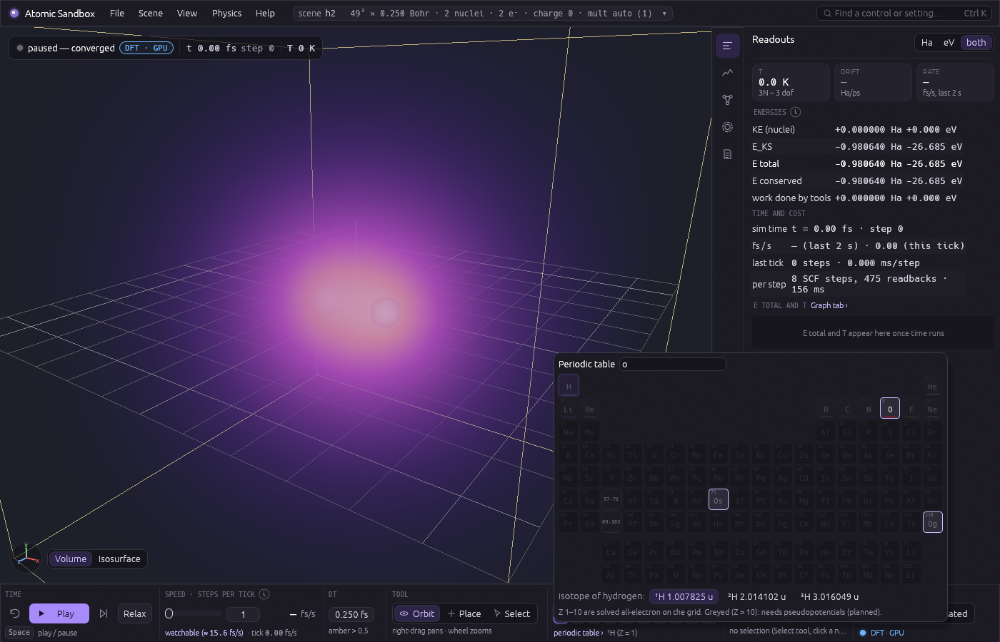 | 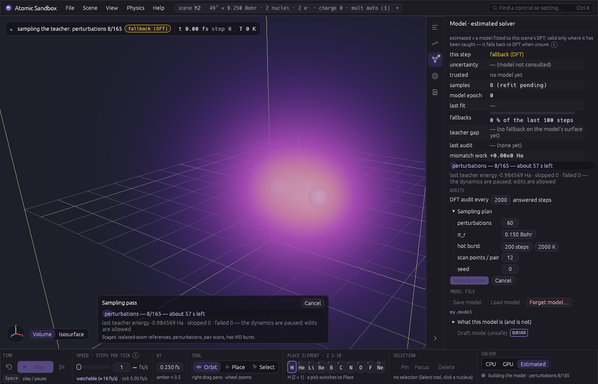 |
| 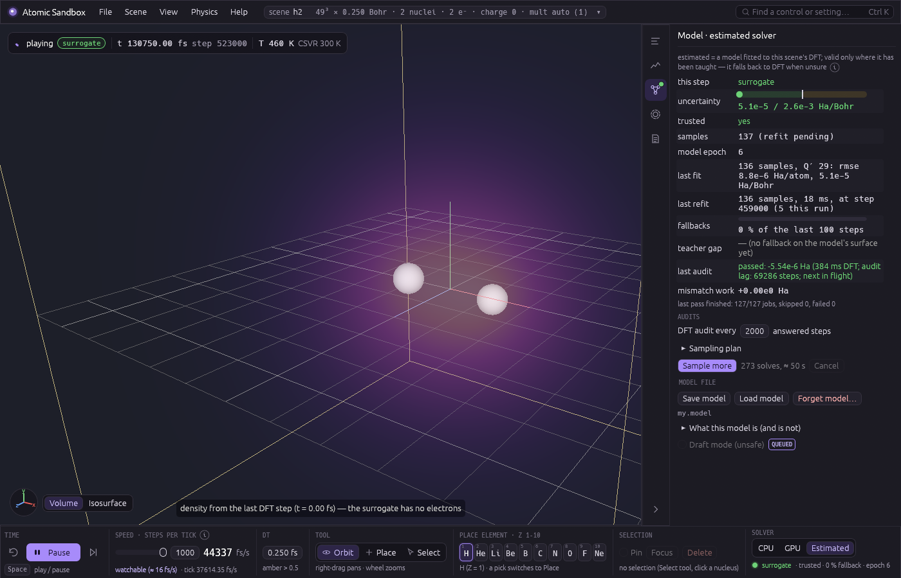 | 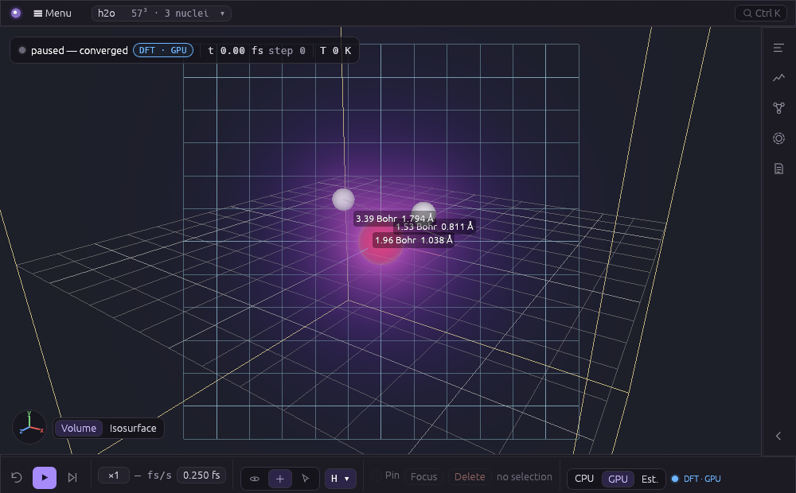 |

More states (every menu, each dock tab, the control search) are in `docs/images/ui_*.png` (the Activity tab: `docs/images/activity_*.png`) (the Selection tab: `m6_water_bonds.png`); the design is `docs/superpowers/notes/2026-10-14-ui-mockup.html`.

Things to try: switch the solver to **estimated** on H₂, let it sample (about 40 s at Balanced, a few minutes at the default Accurate — the pass card shows its time left), set the speed to the top (10 000) and press Play — the bond vibrates at tens of thousands of fs per second, the sparkline green (the audits now run in the background: see **last audit**); then drag one H away with the Select tool and watch the fallback light up amber while the model learns the new geometry from each DFT answer (the samples count climbs, the epoch moves, and the amber turns green again once it has seen enough) — up to ≈ 4 Bohr at 49³; farther, the box itself squeezes the molecule, and DFT answers those steps without teaching the model. Press Play on H₂ and watch E total stay flat while T swings between 0 and ~900 K; tug one H with the Select tool while it vibrates; switch the thermostat on at 300 K; stretch the H₂ bond and watch the energy curve and the density neck split; compare the symmetric H₂ cloud with lopsided LiH (charge transfer with nothing told about electronegativity); build water from an O and two H (at the Balanced 0.25 Bohr grid the smeared oxygen makes the relaxed molecule nearly linear — a resolution artefact worth seeing for yourself; the default Accurate grid smears less, but water's relaxed angle there has not been measured; the real 104.5° bend needs a finer grid or pseudopotentials); push two He atoms together and watch them refuse to bond (no line appears); make HeH⁺ (charge +1) and watch them bond; build water from an O and two H and watch its two bonds and the label "H₂O — water" appear once the oxygen's free-atom reference is in; press **Relax** and watch the energy drain into "work done by tools"; swap both hydrogens of H₂ for ²H in the Selection tab and play: the vibration slows by √(m_D/m_H) ≈ 1.414.

### Recording and replaying input

For contributors: the viewer's checklist runs headlessly as **replay scripts** (`crates/app/replays/*.replay`). `cargo run -p app --release -- --record session.replay` writes what you do in the window — the 3D view's mouse and keys, and every toolbar / menu / dock action that reaches the solver or the scene by name (`action relax`, `action isotope 1 2`; the egui layout itself and display-only settings — density look, display aids, units, graph toggles — are not recorded, so a replayed screenshot shows them at their defaults) — with `wait ms` for pauses longer than 50 ms and `wait idle` whenever the solver went idle. `cargo run -p app --release -- --replay session.replay [--preset h2] [--backend gpu] [--screenshot last.png] [--size 1400x900]` plays one without a window and exits with code 1 at the first failed `expect` line, naming the line and what it saw. Add `expect` lines by hand (`nuclei 3`, `dist 0 1 1.75 1.83` in Bohr, `bonds 2`, `molecule 0 H2O`, `isotope 0 2`, `relaxed true`, `paused true`, `selected 1`, `source surrogate`, `no-error`; after a `mark` line also `max-dist 0 1 2.8`, `fallbacks 1`, `new-samples 1`) and let dynamics advance with `wait steps N` / `wait fs X` / `wait source surrogate`, never with wall time, so a script passes on a slower GPU too. A recorded action a script cannot carry (Apply grid, saving or loading files, Sample — their settings live in the panel) is written as a `# not replayable` comment and reported when recording; the replayer skips a save and refuses the others until you edit the line. Cursor positions are stored relative to the 3D view (offsets from its centre in half its height), so a script recorded at one window size picks the same atoms at another (camera orbits are per pixel, so the replayer lays the chrome out at the script's `view` size unless `--size` says otherwise). Each shipped script pins the grid and the walls it was written for (`action quality balanced`, `action walls off 4.5`; `scene h2_r16.scene` for the H₂ at 1.6 Bohr the scripts were written around), and `--record` writes the session's quality and walls at the top, so a change of the app's defaults never moves a replay. `cargo test -p app --release` runs every script (`replays_pass`); the format is documented in `crates/app/src/replay.rs`.

## Physics, honestly

- **Model:** Born-Oppenheimer separation; electrons in spin-polarised Kohn-Sham DFT with the LSDA exchange-correlation functional (Dirac exchange + Perdew–Wang 92 correlation); 8th-order finite-difference Laplacian; nuclei represented as narrow Gaussians (σ = grid spacing by default) with an analytic potential; Hartree potential from a multipole-bounded Poisson solve; Hellmann-Feynman forces.
- **Units:** atomic units everywhere inside the solver (Hartree, Bohr, mₑ, ħ = e = 1); the UI converts.
- **Precision:** f32 on the GPU grid with two-level compensated reductions; f64 on the CPU for nuclei, small dense algebra and the reference solver.
- **Known gaps, documented rather than hidden:** LSDA underbinds the hydrogen atom (−0.4777 Ha here vs −0.5 exact; the LSDA reference value is −0.4787); absolute energies of anything containing oxygen or heavier are not physical at the Balanced 0.25 Bohr spacing (and still smeared at the default Accurate 0.15) because the nucleus is heavily smeared — the density *shapes* are right, the numbers are not; the f32 GPU path carries ~1e-6 Ha of scatter between solve paths; the lithium atom oracle misses its reference by 0.33 Ha at the tested grid and is kept as an ignored test. A stretched H₂ beyond ~3 Bohr keeps a bond line and a too-high energy (≈ +0.05 Ha at dissociation) because the solver stays on the spin-symmetric solution; the broken-symmetry fix (a spin-asymmetric start for even electron counts, keeping the lower energy) is a planned solver item. See `crates/validate/references.md` for every reference number and tolerance.
- **Dynamics on the smeared surface:** the vibrating H₂ runs at 3237 cm⁻¹ (period 10.30 fs) against 4401 cm⁻¹ measured, because at σ = h = 0.25 the smeared nuclei lengthen the bond (1.79 Bohr, vs 1.45 at σ → 0) and soften its well — the dynamics match the curvature of that same surface to 6e-4, and this solver's σ → 0 curvature gives ≈ 4405 ± 60 cm⁻¹, a figure too coarse to tell experiment (4401) from LSDA (4201).
- **Water heats up on Play:** the same smearing makes water's minimum on this surface near-linear (O–H 2.34 Bohr, 177°) and 0.160 Ha (4.4 eV) below the physical geometry the `h2o` preset loads, so pressing Play on `h2o` heats the molecule — past 10 000 K within ~2.5 fs while it opens toward linear; a 300 K thermostat (τ = 10 fs) brings it back to ~300 K after ~100 fs. Along that fast motion the warm-started solver sometimes stalls; it then retries the step cold (twice in 600 steps, the slower step 24 s instead of ~1 s at 57³), and only a failed cold retry pauses the run.
- **Draft mode guesses.** With "guess instead of falling back" on, the model answers where it would otherwise refuse, and what it says there is an extrapolation of a linear fit: beyond its 6 Bohr descriptor cutoff a bond contributes nothing at all (a pulled-apart pair is two free atoms at the sum of their reference energies, whatever the true dissociation curve does), and a geometry, species or charge state it never saw is answered confidently wrong — its uncertainty can even look small there (a linear model's variance shrinks where its features vanish). The energy bookkeeping stays honest (one surface, booked jumps); the forces do not. A region whose samples were quarantined (the model cannot represent them) is answered by the model too and re-learned only from the audits there, so it learns slowly; and on a hot draft run the drift readout can turn red — the guessed surface may be stiffer than the time step resolves. Steps answered by a guess are drawn red in the sparkline. Use it to look, not to measure.
- **What "trusted" means** (2026-10-18, a user's water session: a model shown trusted fell back on every step, and its draft-mode guesses flung the atoms). *Trusted* is the global rule (enough samples, its own data reproduced, no failed audit); whether the model answers *here* is a separate verdict now shown beside it everywhere — the status chip and Model tab say "trusted, not here — <the rule>", the Activity checklist has a "Strict mode answers at this geometry" line, and the stdout play/snapshot lines print `strict here: …` and `draft on/off`. A failed DFT audit now stays failed until a refit's model predicts the audited geometry *without* that audit's own sample (exactly, by leaving it out); before, the refit the audit's own sample triggered erased the failure. Once cleared, the next three answered steps are audited; a failure is saved with the model file and re-judged on load; and one that three refits cannot clear, or that belongs to a composition the scene no longer has, stops untrusting everything and falls back only near its own geometry. A sampling pass now says how many of its own samples are not in the fit and why (e.g. box-affected: the density reaches the cell's faces — with the default walls 1.5 Bohr inside the faces, atoms can reach places whose DFT answers carry the box's confinement), and a scene none of whose pass samples is in the fit is reported "not this scene", never trusted. The "learned well enough" check (each training sample left out, predicted by the rest) now classes each *atom* by its own neighbours, so a far-away H₂ beside a water molecule is two-atom evidence and is judged as such. One sample the rest cannot predict still switches its whole class off (setting such samples aside was tried and answered hot H₃ up to 6× the force bound, so it was rejected); the readout says "<class> untrusted (everywhere) — worst sample #N …". The class's verdict changes only when samples near that one exist — DFT steps elsewhere do not change it, and a molecule parked under the refusal adds no copies of itself to the model — DFT answers that repeat a stored one within the fit's own noise (they would only make it overconfident: 100 copies cut its stated uncertainty by a third). The user's own water + H₂ model, saved before this change, loads and is re-judged from its stored samples: refused because of sample #345 (a lone added H, 12× its bound).
- **The estimated solver is a model of this DFT, not of nature.** It inherits every approximation of its teacher (smearing, LSDA, the box) and adds its own fit error; the uncertainty it shows is a *model* uncertainty — how sure it is of reproducing the DFT — not a physical error bar. It is valid only where it has been taught: it falls back to DFT when unsure, and an untrusted model (too few samples, or a training sample it cannot fit to the accuracy it claims) never answers. A sample the model cannot represent at all is **quarantined** rather than allowed to untrust everything: kept in the store and the model file, excluded from the fit, its neighbourhood answered by DFT, and counted in the Model tab ("N samples quarantined — the model cannot represent them"); a later DFT answer there that agrees with the model releases it, and if three consistent DFT answers there all disagree with the model, one is kept and the next refit decides whether the model can learn that region. A DFT answer whose density on the outermost grid plane (one grid step inside the box wall) exceeds 2e-5 e/Bohr³ at the default 0.25 Bohr spacing — scaled by (h / 0.25 Bohr)², because the confinement energy per unit of that density grows as 1/h² (a quarter of it is tolerated at h = 0.125) — is used for that step but never trained on, and an audit there is recorded but not judged: the box's confinement (≈ π d ρ_face / (4κ²h²) for a nucleus d from the wall, ≈ 50 Ha per e/Bohr³ for H₂ at h = 0.25 — measured 40–55 — so ≥ 1e-3 Ha from there on) depends on *where* the molecule sits and how it is *oriented* against the box axes, which a model of the internal geometry neither can nor should learn — in the 10 Bohr box of 41³ that is H₂ stretched beyond ≈ 2.5 Bohr or parked 2–3 Bohr from a face, at the default 49³ beyond ≈ 4 Bohr; the cure is a bigger box. Such answers taken while a model is still being built — the sampling pass's own included — are never quarantined and leave the fit once enough others are held. The estimated solver's own DFT teacher (sampling pass, fallbacks, audits) solves at SCF tolerance 1e-6, tighter than the plain DFT backends' 1e-5, because its answers are kept as training data; a model taught at another tolerance is refused, never mixed. Without a model (a pass waiting to be started), DFT steps keep at most 4 Q′ samples before keeping one in ten. (Before Task 9 such an answer could fail an audit on pure confinement, get quarantined, and fence the equilibrium bond everywhere in the cell: a "trusted" model falling back on every step.) An untrusted model whose fit still holds box-affected samples because too few clean ones exist to leave them out (the trust floor, Q′ + 30) says so too — "no — 130 of 145 samples touch the box walls …" instead of only the residual that failed — and suggests a cell that keeps every nucleus a hydrogen-like density tail's distance from the faces (e.g. 123³ at 0.15 Bohr for H₂ + H out to 3.7 Bohr, where the same scene in an 18 Bohr cell was measured trusted), with the GPU memory guard's verdict on it. A trusted model that keeps falling back at one place says so in the Model tab — and says when the reason is the box (every DFT answer there box-affected, so it cannot learn). Repeated fallbacks at one geometry keep only one sample in ten. Since M6 Task 11 (a user's report: an H added to a hot H₂, a model answering free atoms "trusted" 15 Ha off, the atoms leaving the cell): the estimated solver applies the same cell check as DFT (a nucleus within 3 grid steps of a face pauses the run instead of flying away); an atom with no neighbour within the model's 6 Bohr cutoff is never answered by the model in a scene of more than one atom (its free-atom guess is not the teacher's dissociated state), and an atom whose neighbourhood is three times sparser than anything the model was taught falls back too (one kept stretched-pair sample used to make an empty neighbourhood look "inside"); a fallback outside what the model knows, the first step after an edit, or one where the model is off by more than its 1e-3 Ha/atom tier is reported with the DFT energy (the switch booked so E conserved stays continuous), so E total is never the model's guess there; the force-uncertainty test leaves out the fit's own label noise σ_f (a fallback on noise teaches nothing), and a model whose σ_f exceeds 2e-3 Ha/Bohr is untrusted ("force noise") instead of falling back on every pass through equilibrium. A model also refuses a geometry that reaches feature directions its training data never spanned ("new environment") — an H₂-only model asked about H₂ + H used to answer with forces 4–22 times their bound and, in one hot run, an energy 1.32e-3 Ha/atom off (beyond its 1e-3 tier), its own uncertainty estimate blind to it; it re-checks its uncertainty whenever an atom gains or loses a neighbour; and its DFT audits judge the forces as well as the energy. A sparsely learned region is not trusted on the strength of a few samples either: each atom's environment is graded against the most informative environments the model was trained on (an extrapolation grade, D-optimality / MaxVol), and an atom more than twice as far out as anything learned falls back — before this, a model that had kept a few dozen three-body samples answered other three-body geometries with forces up to 20 times their bound under a confident uncertainty; now it waits until the region is actually learned. The model's own uncertainty is not calibrated there: on learned three-body geometries its stated uncertainty is about ten times too small (measured z-scores up to 9.8, 24 in a confined run). And the grade does not make it right *inside* what it has learned: with the hot H₃ kept compact by container walls, so that almost every answer could be checked against DFT, 12 of 196 checked answers were 3.1–6.2 times the force bound and up to 2.6e-3 Ha/atom off at grades 0.86–1.16 — interpolation, not extrapolation. So the model now also has to show it can predict what it was taught: after every refit each training sample is left out (exactly, in closed form) and the fit without it must predict it within the same force bound and energy tier, separately for "pair" environments (every atom with at most one neighbour) and "many-body" ones; a class that fails, or holds fewer samples than the model has directions, is "not learned well enough yet" and falls back to DFT. In the same confined hot run 58 answers were checked, the worst 2.7 times the force bound and 5.2e-4 Ha/atom. The price is honest but real: one sample alone in its region (a single stretched-pair geometry, or the first H–He pair in an H₂ model) untrusts its whole class until the region around it is learned, so such a model falls back to DFT far more often for a while. This max-error rule is the deliberately cautious choice for M6: a calibrated replacement (jackknife+ / conformal intervals) was built and measured but parked — with the extrapolation grade's γ_max 2 it answered unprobed three-body geometries at up to 8 times the force bound, and with γ_max 1 it was too cautious for H₃⁺ and active learning; both variants are kept for after the M6 pause. On a small 33³ grid (8 Bohr box) the teacher's own scatter from confinement keeps a short sampling pass from earning trust; the default 49³ is fine.
- **Bonds are read off the density, with stated limits.** A pair is bonded when the corrected density between the nuclei has a saddle (or, when a heavy atom's smeared tail swamps the saddle, a maximum of the deformation density) above a floor of 0.01 e/Bohr³, where the density exceeds the free atoms' superposition by at least 11 % (δ = 0.11, three times the measured noise), the point lies in the pair's own share of space (Hirshfeld weights), and the feature is a maximum across the line — or, if it rises sideways into a non-nuclear point, a multi-centre ring bond (H₃⁺). The criteria follow Bader's bond critical point; the detector is a line probe, not full QTAIM. **The line shows how strong the bond is:** its width and opacity follow the density at the bond point (log ρ_b from the 0.01 floor to 0.3 e/Bohr³ — a display scale), and its pattern the QTAIM kind from the sign of the Laplacian ∇²ρ_b there (Bader & Essén 1984): solid for a shared-shell (covalent) bond, dashed for a closed-shell (weak / stretched / ionic-like) contact, dotted when the sign is within three times its grid noise, which is estimated at every bond point (interpolation, bond-point location, f32 rounding); Dock ▸ Selection lists ρ_b, ∇²ρ_b and the kind in words. Measured at the default grid: H₂ at 1.45 Bohr ρ_b 0.232, ∇²ρ_b −1.20 (shared); He₂'s contact is closed-shell (+0.20) but is not a bond (no accumulation), so no line is drawn for it — **no drawn bond in any measured system is dashed** (HeH⁺ and LiH, which QTAIM classes closed-shell, come out indeterminate at h = 0.25 and were not measured at 0.15); water's O–H bonds are negative but only just resolved (|∇²ρ_b| ≈ its band: the bond point sits near the hydrogen, where ∇²ρ is steep along the bond, so an O–H line can flicker between solid and dotted as water vibrates — intrinsic to hydrogen's density, not the smearing; a refined bond point is a known follow-up); in the user-reported linear H₃ (H–H 1.45 + a long H…H) the long contact is still shared-shell while it is a bond (R₂ ≤ 2.25), dotted at 2.5, and becomes closed-shell only after the detector has dropped it; its ρ_b (0.08–0.10 against the short bond's 0.22) draws it somewhat thinner and fainter (≈ 16 % narrower at R₂ = 2.0) — a modest cue, since ρ_b comes from the same LSDA density. **LSDA overbinds stretched contacts** (delocalisation / self-interaction error; H + H₂ has no barrier in LSDA): a weak contact drawn here may be weaker or absent in reality — the strength display shows what this density holds, not what exact physics would. A weak contact still joins its atoms into one molecule for the name. Measured on this surface: H₂ q 1.70 (bonded), He₂ q 0.97 (not), water's O–H bonds and no H–H bond (a neighbouring O–H lobe seen from the side is rejected by the share-of-space test), LiH ρ_b 0.042 (literature ≈ 0.04), and HeH⁺ bonded although the spec expected a miss for this closed-shell ion (`crates/validate/references.md`, "Tools (M6 Task 7)"). Known artefacts: a stretched H₂ keeps its bond line up to ≈ 5 Bohr, because the solver stays on the spin-symmetric solution (the same caveat as its energy above); at h = 0.25 heavy atoms are smeared, so the bond topology is right but the bond-point numbers are not physical — the smeared nucleus even reorders oxygen's shells (2s above 2p), and its free-atom reference is a closed-shell singlet because the triplet does not converge on this grid. Names come from a small table of trivial names (water, ammonia, …) or IUPAC rules for binary compounds, marked "(systematic)" — or, by the name-style setting, IR-5 stoichiometric names ("dihydrogen monoxide") or IR-6 parent hydrides ("oxidane"); no general organic nomenclature. They are labels, never fed back into the physics. H₃ is not a stable molecule; H₃⁺ is.
- **Isotopes change the mass, nothing else.** The Born-Oppenheimer surface does not depend on nuclear mass, so swapping an isotope changes the kinetic energy (booked) and the dynamics, never the forces. D₂/H₂: measured ω ratio 1.4136050 vs √(m_D/m_H) = 1.4136703 from the AME2020 atomic masses (−4.6e-5); experiment's 1.41268 differs by the non-Born-Oppenheimer corrections no BO code reproduces.
- **Relax is FIRE** (Bitzek et al. 2006, with Guénolé et al. 2020's half-step backtrack), stopping at max\|F\| < 1e-3 Ha/Bohr; on H₃⁺ it reaches the same minimum as an independent velocity quench to 1.8e-6 Ha. On a small molecule it is not faster than the quench (25 vs 16 evaluations): its adaptive step pays off on many soft modes, not three stiff ones. At the Balanced 0.25 Bohr grid the relaxed water is near-linear (the smearing artefact above); at the default Accurate grid its relaxed angle has not been measured.
- **Orbitals are a display of an auxiliary object.** The orbital viewer (above) shows Kohn–Sham orbitals, eigenvalues, an unoccupied spectrum computed on the ground-state potential, and spin densities; none of these is a measured wavefunction or an excitation energy, the LSDA HOMO is too shallow, unoccupied states in this box are mostly states of the box, the Kohn–Sham gap is not the fundamental gap, and with the smeared nucleus a lone Ne's 2s lies above its 2p (flagged in the tab). Integer occupations break the symmetry of open shells, so an open-shell atom gets `#k` labels, not atomic names. All of it is computed after the forces and never feeds back into the solve.
- **Pseudopotentials are valence-only and approximate** (see **Pseudopotentials** above): E_KS under a pseudopotential is a valence energy, not comparable with all-electron totals; the egg-box force is certified per element only to a stated grid (O₂ at 0.20 Bohr: 4.26e-5 Ha/Bohr net against the 3e-5 target — a recorded miss; at the default 0.15 it is 6.75e-6) and not at all for F; an open shell is the spherical-atom ensemble, which LSDA's symmetry-broken integer state undercuts by a few mHa; Li, Be (and Na, Mg, Al are refused until the ONCV stage.
- **The reference comparison is an oracle, not a backend.** Physics ▸ Compare with reference runs PySCF (if installed) as a separate program on the current geometry; nothing of it is linked, and nothing it answers feeds the dynamics. It compares like with like only: forces, the dipole and relaxed internal coordinates. Expect differences from the basis set (def2-TZVP is incomplete), from our grid and nuclear smearing σ, and — for PBE, B3LYP and CCSD(T) — from the method itself: that difference is the point of comparing against a better method.
- **No per-element parameters.** Allowed inputs are Z and the isotope mass (plus display colours (the Jmol CPK scheme, Z = 1–109; the rest a neutral pink) and radii, which are not physics). No force fields, no fitted pair potentials, no chemistry libraries.

## Sources

Every equation in the code is hand-written from the literature below; each derivation lives as a module doc next to the code that implements it, and every validation bound cites its reference number in [`crates/validate/references.md`](crates/validate/references.md).

**Density-functional theory (the electrons)**
- Hohenberg & Kohn, *Phys. Rev.* 136, B864 (1964); Kohn & Sham, *Phys. Rev.* 140, A1133 (1965) — the Kohn–Sham equations solved on the grid.
- Dirac, *Proc. Camb. Phil. Soc.* 26, 376 (1930) — the LSDA exchange energy density.
- Perdew & Wang, *Phys. Rev. B* 45, 13244 (1992) — the PW92 correlation fit (eqs. 8–10, Table I), used exactly as published; `crates/qm/src/xc.rs`.
- Pulay, *Chem. Phys. Lett.* 73, 393 (1980) — DIIS density mixing; `crates/qm/src/scf.rs`.
- Knyazev, *SIAM J. Sci. Comput.* 23, 517 (2001) — LOBPCG for the lowest Kohn–Sham orbitals; `crates/qm/src/eigen.rs`, `crates/qm-gpu/src/eigen.rs`.
- Fornberg, *Math. Comp.* 51, 699 (1988) — the 8th-order finite-difference Laplacian weights; `crates/qm/src/stencil.rs`.
- Feynman, *Phys. Rev.* 56, 340 (1939) — Hellmann–Feynman forces on the nuclei; `crates/qm/src/forces.rs`.
- Jackson, *Classical Electrodynamics* (3rd ed.), §4.1 — the multipole expansion used for the Poisson boundary (solid harmonics in Racah normalisation); `crates/qm/src/poisson.rs`.
- Briggs, Henson & McCormick, *A Multigrid Tutorial* (2nd ed., SIAM 2000) — the multigrid-preconditioned CG Poisson solve on the GPU; `crates/qm-gpu/src/multigrid.rs`.
- Cody, *Math. Comp.* 23, 631 (1969); Abramowitz & Stegun §7.1 — the erf evaluation for the smeared-nucleus potential; `crates/qm-gpu/src/shaders/nuclear.wgsl`.
- Kotochigova, Levine, Shirley, Stiles & Clark, NIST *Atomic Reference Data for Electronic Structure Calculations* (1997) — the LSD atomic energies the oracles are checked against.
- NIST CCCBDB — experimental H₂ ω_e = 4401.21 cm⁻¹ and bond length, the physical values the smearing gap is measured against.

**Molecular dynamics (the nuclei)**
- Verlet, *Phys. Rev.* 159, 98 (1967); Swope, Andersen, Berens & Wilson, *J. Chem. Phys.* 76, 637 (1982) — velocity Verlet; the exact h²/4 energy swing used as a test pin is derived in `crates/sim/src/integrator.rs`.
- Bussi, Donadio & Parrinello, *J. Chem. Phys.* 126, 014101 (2007) — the canonical-sampling velocity-rescaling thermostat (eq. A7 implemented verbatim); `crates/sim/src/thermostat.rs`.
- Wang, Huang, Kondev, Audi & Naimi, *Chinese Phys. C* 45, 030003 (2021) — AME2020 atomic masses of the 22 listed isotopes (the stable ones of H–Ar plus ³H and ¹⁴C), the only per-element data besides Z; `crates/units/src/isotopes.rs`.
- Bitzek, Koskinen, Gähler, Moseler & Gumbsch, *Phys. Rev. Lett.* 97, 170201 (2006) — FIRE; Guénolé et al., *Comput. Mater. Sci.* 175, 109069 (2020) — its half-step backtrack and Δt_min; `crates/sim/src/relax.rs`.

**Bonds and names (M6 tools)**
- Bader, *Atoms in Molecules: A Quantum Theory* (Oxford 1990); Bader & Essén, *J. Chem. Phys.* 80, 1943 (1984) — the bond critical point and ρ_b ranges the detector's criteria follow; `crates/sim/src/bonds.rs`.
- Hirshfeld, *Theor. Chim. Acta* 44, 129 (1977) — the stockholder shares behind the "own share of space" condition.
- Hill, *J. Am. Chem. Soc.* 22, 478 (1900) — Hill order for carbon formulas; IUPAC, *Nomenclature of Inorganic Chemistry* (Red Book, 2005), IR-4.4.2.1 and Table VI — the formula order and binary names; IR-5 (stoichiometric names, charge numbers) and IR-6 (parent hydrides) — the other name styles; `crates/app/src/names.rs`.

**The learned surrogate (estimated mode)**
- Drautz, *Phys. Rev. B* 99, 014104 (2019) — the atomic cluster expansion: body-ordered invariants on a species-channelled atomic basis; `crates/surrogate/src/descriptor.rs`.
- Bishop, *Pattern Recognition and Machine Learning* (Springer 2006), §3.3–3.5 — Bayesian linear regression, the evidence framework and predictive variance; MacKay, *Neural Comput.* 4, 415 (1992) — evidence maximisation for the ridge and noise levels; `crates/surrogate/src/fit.rs`.

**More methods behind the code**
- Troullier & Martins, *Phys. Rev. B* 43, 1993 (1991) — the norm-conserving pseudopotential construction; Kleinman & Bylander, *Phys. Rev. Lett.* 48, 1425 (1982) — the separable nonlocal form; Louie, Froyen & Cohen, *Phys. Rev. B* 26, 1738 (1982) — the nonlinear core correction; `crates/qm/src/radial/`.
- Podryabinkin & Shapeev, *Comput. Mater. Sci.* 140, 171 (2017) — active learning with the D-optimality / MaxVol extrapolation grade the estimated solver's rule 5e uses; `crates/surrogate/src/grade.rs`.
- Neumaier, *ZAMM* 54, 39 (1974) — compensated summation in the energy reductions and the fit's normal equations.
- Jimenez, "Next Generation Post Processing in Call of Duty: Advanced Warfare" (SIGGRAPH 2014) — the 13-tap downsample of the bloom pass; Quílez, "Smooth minimum" (iquilezles.org) — the polynomial smooth minimum behind the Camera view's smooth surface. Display only.

**Data**
- NIST Computational Chemistry Comparison and Benchmark Database (CCCBDB) — the experimental geometries of the shipped scenes in `scenes/` and the LSDA reference geometries and frequencies the oracles check against.
- PubChem (CID 2244) — the 3-D conformer of the aspirin scene.
- Cordero et al., *Dalton Trans.* 2832 (2008) — covalent radii used **only** by the 2D molecule builder to place a starting geometry (and capping hydrogens), never in the physics (the user's rule-1 sign-off, `docs/superpowers/specs/2026-10-20-molecule-builder-design.md`).

**Prior work and inspiration**
Interactive quantum chemistry has a history this project builds on in spirit (none of its code is used): Markus Reiher's group at ETH Zürich (haptic, real-time quantum chemistry since 2009; SCINE Sparrow and Heron), Todd Martínez's group at Stanford (ab initio interactive molecular dynamics on GPUs, Luehr, Jin & Martínez, *J. Chem. Theory Comput.* 11, 4536 (2015); InteraChem), and David Glowacki's group (Narupa / NanoVer interactive molecular dynamics in VR). The glowing-dots look of the density view was inspired by the "Quantum-Atom" web simulator. How this project compares, with citations: `reports/Atomic Sandbox novelty check.md`.

**Software**
Built in Rust on [wgpu](https://github.com/gfx-rs/wgpu) (the GPU), [egui](https://github.com/emilk/egui) with egui-wgpu / egui-winit (the interface), [winit](https://github.com/rust-windowing/winit) (windows), [glam](https://github.com/bitshifter/glam-rs) and [nalgebra](https://nalgebra.org) (vectors and small dense linear algebra), [rand](https://github.com/rust-random/rand), [bytemuck](https://github.com/Lokathor/bytemuck), [pollster](https://github.com/zesterer/pollster), [png](https://github.com/image-rs/image-png), [rfd](https://github.com/PolyMeilex/rfd) (file dialogs), [winresource](https://github.com/BenjaminRi/winresource) and [windows-sys](https://github.com/microsoft/windows-rs) (the Windows icon and window frame). The optional *Compare with reference* panel runs [PySCF](https://pyscf.org) in a separate process when it is installed (nothing of it is linked). Plumbing only — every physics kernel is hand-written (CLAUDE.md rule 2).

**How it was built**
Designed and directed by Dakoda Lancelot ([ItsKodas](https://github.com/ItsKodas)); the code, derivations and reviews were written with AI assistance (Anthropic's Claude, through Claude Code), with every physics change gated by the validation suites in `crates/validate`.

**Where the physics is documented honestly**
- Approximation gaps (LSDA vs exact atoms, the smearing shift in vibration frequencies, the water geometry at the default grid, box confinement): [`crates/validate/references.md`](crates/validate/references.md) and the milestone handoff notes in `docs/superpowers/notes/`.
- Design decisions and the reasoning behind each ruling: `docs/superpowers/specs/` and `docs/superpowers/plans/`.

## Repository layout

```
crates/units      unit conversions and isotope masses (the only per-element data)
crates/qm         CPU f64 reference Kohn-Sham solver: grid, Laplacian, Poisson, LOBPCG, LSDA, SCF, forces; M7: the radial atom and the pseudopotential generator (radial/), ionic species (ionic), the Kleinman-Bylander projectors (nonlocal)
crates/qm-gpu     the same solver in WGSL compute (wgpu), bit-deterministic, cancellable
crates/gpu        wgpu plumbing: context, surface, 3D volume textures
crates/render     camera, impostor spheres, volume raymarch (density, signed orbital / spin, colour volume), probability dots, line overlays
crates/sim        nuclear dynamics: scene, Verlet, thermostat, the driver, relax; the ForceProvider / Trainable boundary
crates/providers  the force providers: Kohn-Sham (CPU, GPU), the process-wide pseudopotential cache (pseudo) and the surrogate with its sampling pass
crates/surrogate  the surrogate's model: descriptors, basis, Bayesian linear fit, model files
crates/app        the viewer: winit + egui chrome (src/ui/: toolbar, menus, dock, periodic table, activity), the molecule builder (src/builder/), solver worker thread (src/worker/), tools, molecule names, scene files
crates/validate   physics oracles and GPU-vs-CPU suites with cited references
tools/reference   pyscf_ref.py: the optional PySCF helper behind Compare with reference (run out of process, never linked)
docs/superpowers  design spec, per-milestone implementation plans, handoff notes
```

Tests: `cargo test -p units -p qm --release` (~75 s), `cargo test -p qm-gpu -p sim -p providers -p surrogate -p render -p app --release` (the app's include the replay scripts of the viewer checklist), `cargo test -p validate --release --test tools` (the M6 tools suite: bonds, D₂/H₂, relax; ~3 min on a quiet GPU), `cargo test -p validate --release --test orbitals` (the orbital display oracles: normalisation, alignment and labels of a lone Ne at four grid offsets, signs and tracks through 100 H₂ steps, spin integrals; ~1 min), `cargo test -p validate --release --test gpu_vs_cpu` (~3.5 min, needs a GPU), `cargo test -p validate --release --test dynamics` (the dynamics suite, ~6 min, needs a GPU), `cargo test -p validate --release` (everything in `validate`: the oracles, ~30 min, plus the GPU suites, dynamics, surrogate, tools and orbitals). Validation gates are never loosened to make a test pass.

## Design and process

The design is in [`docs/superpowers/specs/2026-10-12-atomic-sandbox-design.md`](docs/superpowers/specs/2026-10-12-atomic-sandbox-design.md); each milestone has a plan in `docs/superpowers/plans/` and a handoff note in `docs/superpowers/notes/`. The code is developed with Claude Code (Fable 5.1 for physics and numerics, Opus 5.5 for engineering), task by task with independent review; every decision made along the way is recorded in the plans and notes.

## Roadmap after M5

Scaling up the "ladder": more elements (pseudopotentials for Z > 10), larger systems through ML potentials trained on this solver's own data and loaded as data behind the same `ForceProvider` boundary, then coarse-grained and continuum stages. Gravity exists as an external-field hook but is invisible at atomic scale, as it should be.


Nuclear physics (decay, transmutation) is planned as a **nuclear-events layer**, not as explicit protons and neutrons: the nucleus is 10⁻⁵ of the atom and no first-principles route from QCD exists, so nuclei stay points for the electrons while a stochastic α/β/γ event process — Q-values from the isotope mass table, rates from measured half-lives — changes Z live and lets the chemistry respond. Decay time gets its own labelled clock, separate from the MD speed.

## License

Copyright © 2026 Dakoda Lancelot (ItsKodas). Licensed under the [PolyForm Noncommercial License 1.0.0](LICENSE.md) — source-available, not open source:

- **Allowed:** using, copying, forking and modifying the project, and sharing your versions, for any noncommercial purpose — personal use, hobby projects, study, research, education, and use by charities, schools and public bodies.
- **Not allowed:** any commercial use — selling it or anything built from it, or using it to make money.
- Anyone who shares a copy must pass these terms on with it (the license's *Required Notice* line included).

Contributions (pull requests) are accepted under the same license. For anything the license does not cover, ask the copyright holder.

